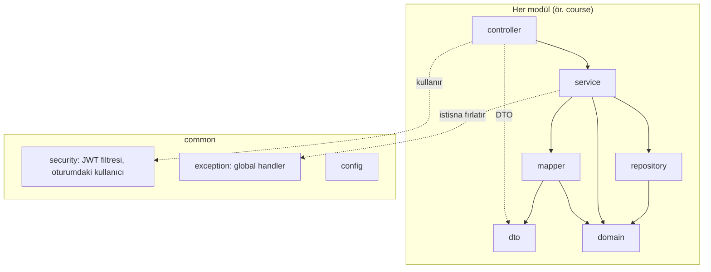
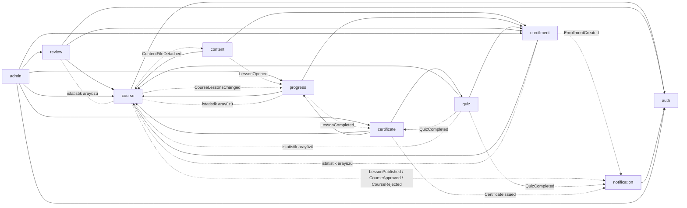

# Mimari kurallar

Bu doküman Mini Udemy backend'inin mimari kurallarını tanımlar: sistemin hangi modüllere ayrıldığını, katmanların ve modüllerin birbirine nasıl bağımlı olabileceğini ve tasarım desenlerinin nerede kullanıldığını. Kod bu kurallara uyar; kural değişecekse önce bu doküman (ve gerekiyorsa bir ADR) değişir.

Kapsamın kaynağı proje tanım dokümanıdır (modüller A–L, senaryo 1–5). Önemli kararların gerekçeleri `docs/adr/` altındaki mimari karar kayıtlarındadır (ADR).

## 1. Mimari stil

**Katmanlı, modüler monolit.** Backend tek bir Spring Boot uygulaması olarak dağıtılır ve tek bir PostgreSQL veritabanı kullanır. Kod içeride iş alanlarına göre modüllere, her modül de katmanlara ayrılır.

Kısaca neden: proje dokümanı bu yapıyı önerir; dört kişilik ekip ve beş haftalık süre için mikroservislerin dağıtım, ağ ve veri tutarlılığı maliyeti gereksizdir. Modül sınırları ise kodun büyürken dağılmasını önler ve ileride bir modülün ayrılmasını mümkün kılar. Ayrıntılı karar ve değerlendirilen alternatifler: [**ADR-001**](adr/0001-moduler-monolit.md).

## 2. Modüller

Paket yapısı: `com.miniudemy.<modül>.<katman>`

| Modül | Sorumluluk | Ana kavramlar | Proje dokümanı |
|---|---|---|---|
| `auth` | Kayıt, giriş, JWT, parola yenileme, profil; kursiyer/eğitmen/yönetici rolleri | User, Role | A |
| `course` | Kategori, kurs, bölüm ve sıralı ders hiyerarşisi; kurs yayın durumları; katalog ve arama; eğitmen paneli istatistikleri | Category, Course, Section, Lesson, CourseState | B, D, J |
| `content` | Ders içerikleri ve materyaller: video/PDF/doküman yükleme, içerik türleri, yerel depolama, yetki kontrollü servis | LessonContent, StoredFile | C |
| `enrollment` | Yayımlanmış kurslara ücretsiz kayıt, kayıtlı kurslar paneli, mükerrer kayıt engeli | Enrollment | E |
| `progress` | Ders tamamlama, son izlenen ders, bölüm/kurs ilerleme yüzdesi, kaldığı yerden devam | LessonProgress, CourseProgress | F |
| `quiz` | Soru bankası, bölüm sonu sınavı, otomatik puanlama, başarı eşiği, deneme geçmişi | Question, Quiz, QuizAttempt | G |
| `certificate` | Koşulları tamamlayan kursiyere doğrulama kodlu platform içi sertifika | Certificate | H |
| `review` | 1–5 puan ve yorum, mükerrer değerlendirme engeli | Review | I |
| `notification` | Uygulama içi bildirimler; domain olaylarını dinler | Notification | L |
| `admin` | Kurs onay/red/yayından kaldırma, kullanıcı ve kategori yönetimi, şikâyetler, platform raporları | Complaint | K |
| `common` | Config, güvenlik altyapısı (`common/security`: JWT doğrulama, herkese açık uçlar, 401/403 gövdeleri), global hata yönetimi, MapStruct ortak ayarı | – | – |

`common` iş kuralı içermez ve hiçbir modüle bağımlı değildir.

## 3. Katmanlar

Her modül aynı altı pakete ayrılır:

| Katman | İçerik | Kullanabileceği |
|---|---|---|
| `controller` | REST uçları, istek doğrulamasının tetiklenmesi, yetki anotasyonları | `service`, `dto` |
| `service` | İş kuralları ve `@Transactional` sınırı | `repository`, `domain`, `mapper`, `dto` |
| `repository` | Spring Data JPA arayüzleri | `domain` |
| `dto` | API'nin istek/yanıt tipleri (Java `record`) | yalnız `domain`'deki enum'lar (ör. `CourseStatus`) |
| `mapper` | `domain` ↔ `dto` dönüşümleri | `domain`, `dto` |
| `domain` | JPA entity'leri, enum'lar, domain olayları, State deseninin durum sınıfları | yalnız `common.exception` (ortak hata tipleri; [ADR-010](adr/0010-state-kurs-durumu.md)) |

Bağımlılık yönü tek yönlüdür: **controller → service → repository**. Hepsi `domain`'i kullanabilir; `domain` hiçbir katmana bağımlı değildir. `domain`'in dışarıya tek bağımlılığı `common.exception`'dır: kurs durumunda izinsiz işlem 409 olarak `CourseStateException` (bir `ConflictException`) fırlatır. `common.security`, `common.config` ve `common.mapper` domain için yasaktır (ADR-010).

**Yasaklar:**

- Controller repository'ye erişmez ve iş kuralı içermez.
- **Entity API'ye çıkmaz.** Controller yalnız DTO alır ve döner; dönüşüm yalnız mapper'da yapılır.
- İş kuralı yalnız service katmanındadır; repository'de sorgu dışında mantık olmaz.
- Hata yanıtı controller'da elle kurulmaz; service tanımlı bir istisna fırlatır, `common` içindeki global handler standart hata gövdesine çevirir (`CLAUDE.md` › Standart hata formatı).
- Şema yalnız Flyway migration'ı ile değişir (`backend/src/main/resources/db/migration/README.md`).

### Yetki kontrolleri nasıl yazılır

Kimlik doğrulama ve rol kontrolü `common/security/SecurityConfig`'te kurulu (#10, [ADR-002](adr/0002-jwt-stateless-kimlik-dogrulama.md)). Yeni bir uç yazarken üç soru sorulur: kim çağırabilir, hangi rol, kimin kaynağı?

1. **Kimlik:** sözleşmede `security: []` olmayan her uç token ister. Token yoksa, geçersizse ya da süresi dolmuşsa filtre 401 döner; uçta ayrıca bir şey yazılmaz. Yeni bir **herkese açık** uç, sözleşmede `security: []` ile ve `SecurityConfig.PUBLIC_GET` / `PUBLIC_POST` listesinde aynı PR'da eklenir.
2. **Rol:**
   - `/api/admin/**` yalnız ADMIN'e, `/api/instructor/**` yalnız INSTRUCTOR'a açıktır. Bu adres kuralı `SecurityConfig`'te; bu öneklerin altındaki uçlara ayrıca anotasyon yazılmaz.
   - Diğer uçlarda rol kuralı **controller metodunda** `@PreAuthorize` ile yazılır (`@EnableMethodSecurity` açık).
   - Rol token'daki claim'den değil, her istekte veritabanından okunur (`AccountLookup`). Rolü değişen kullanıcının eski token'ı eski rolle çalışmaz.
   - Ret 403 ve standart gövde döner ("Bu işlem için yetkiniz yok."), 500 değil.
3. **Giriş yapan kullanıcı ve sahiplik:**
   - Controller kullanıcının id'sini `CurrentUser.id(authentication)` ile alır ve service'e **id olarak** verir. Service `Authentication`'a ya da `SecurityContextHolder`'a erişmez.
   - "Bu kurs bu eğitmenin mi?" gibi sahiplik kontrolleri rol değil iş kuralıdır. Service'te yapılır ve `ForbiddenException` fırlatır (NFR-05; proje dokümanı §6 "yetkisiz kurs düzenleme" testi).

```java
@PostMapping("/api/courses")
@PreAuthorize("hasRole('INSTRUCTOR')")                       // 2. rol: uçta
public CourseResponse create(@Valid @RequestBody CreateCourseRequest request, Authentication authentication) {
    return courseService.create(CurrentUser.id(authentication), request);   // 3. kullanıcı id olarak
}

// CourseService — 3. sahiplik: service'te
if (!course.getInstructorId().equals(userId)) {
    throw new ForbiddenException("Bu kursu düzenleme yetkiniz yok.");
}
```

Örnekler ve testleri:
- `SecurityConfigTest`: `hasRole('ADMIN')` ve `hasRole('INSTRUCTOR')` (öğrenci 403, doğru rol 200); adres kuralı; rolün veritabanından geldiği.
- `MeControllerTest`: `GET /api/me` için token'sız 401, kendi profili 200, pasif hesap 403.

## 4. Modüller arası iletişim

Bir modül başka bir modülle **yalnız iki yoldan** konuşur:

1. **Diğer modülün `service` paketindeki public arayüzü** (senkron çağrı; örn. kayıt sırasında kursun yayımlanmış olup olmadığını sormak).
2. **Domain olayları** (Observer, bölüm 5): bir modülün işi başka modüllerde tepki doğuracaksa olay yayınlanır, dinleyen modül tepkisini kendisi verir.

**Yasaklar:**

- Başka bir modülün `repository` paketine erişilmez.
- Başka bir modülün entity'si alan, parametre ya da dönüş tipi olarak kullanılmaz. Modül sınırında yalnız id ya da DTO taşınır. Başka modülün `domain` paketinden yalnız olaylar (record) ve enum'lar kullanılabilir; örnek: `admin`, `course`'un `CourseStatus`'unu ve `auth`'un `Role`'ünü liste filtresi olarak alır. Veritabanında modüller arası yabancı anahtar olabilir, ama JPA ilişkisi (`@ManyToOne` vb.) yalnız aynı modülün entity'leri arasında kurulur.
- Modüller arası döngüsel bağımlılık olmaz.

### İzin verilen modül bağımlılıkları

| Modül | Service'ini kullanabileceği modüller | Dinlediği olaylar |
|---|---|---|
| `auth` | – | – |
| `course` | `auth` | – |
| `enrollment` | `course` | – |
| `content` | `course`, `enrollment` | – |
| `progress` | `course`, `enrollment` | `LessonCompleted`, `LessonOpened`, `CourseLessonsChanged` |
| `quiz` | `course`, `enrollment` | – |
| `certificate` | `course`, `progress`, `quiz` | `LessonCompleted`, `QuizCompleted` |
| `review` | `auth`, `course`, `enrollment` | – |
| `notification` | `auth` | Tüm bildirim olayları (bölüm 5) |
| `admin` | `auth`, `course`, `enrollment`, `progress`, `certificate`, `review` | – |

Tabloda olmayan bir bağımlılık gerekiyorsa önce bu doküman güncellenir. Tablo `ModuleArchitectureTest.ALLOWED`'da aynen kodlu; ikisi aynı PR'da değişir. Başka modülün olayını dinlemek (domain'deki record'a bağımlılık) tablodan bağımsız serbesttir.

**Eğitmen istatistikleri (J) döngü oluşturmasın diye bağımlılık tersine çevrilir.** Eğitmen paneli `course` modülündedir ama kayıt, ilerleme, sınav ve puan verisi başka modüllerdedir; `course` bu modülleri doğrudan çağırsaydı onlar da `course`'a bağlı olduğu için döngü oluşurdu. Bunun yerine `course`, istatistik için ihtiyaç duyduğu sorgu arayüzlerini kendi `service` paketinde tanımlar; `enrollment`, `progress`, `quiz` ve `review` bu arayüzleri uygular. Böylece bağımlılık yönü hep "diğer modül → `course`" kalır (Dependency Inversion). Katalogdaki kayıt sayısı da aynı yolla gelir: `course/service/EnrollmentCounts` arayüzünü `enrollment/service/EnrollmentStatsService` uygular (#26); puan için aynı kalıp `review`'da kullanılır: `course/service/CourseRatings` arayüzünü `review/service/ReviewStatsService` uygular (katalogdaki ortalama puan, `minRating` filtresi #143; eğitmen istatistiği #133).

**Güvenlik altyapısı da aynı yolla `auth`'a bağımlı olmaz.** `common/security` her kimlikli istekte kullanıcının hâlâ var olup olmadığını, aktifliğini ve güncel rolünü bilmek zorunda (pasif kullanıcının ya da rolü düşürülmüş kullanıcının eski token'ı çalışmamalı). Bu bilgi `auth`'taki `users` tablosunda; `common` doğrudan `auth`'u çağırsaydı "`common` hiçbir modüle bağımlı değildir" kuralı bozulurdu. Bunun yerine `common` `AccountLookup` arayüzünü tanımlar, `auth/service/AccountLookupService` uygular (#10).

## 5. Tasarım desenleri

Desenler gerçek bir ihtiyaç için ve bilinçli olarak kullanılır. Her birinin gerekçesi kendi issue'sunda, kararı `docs/adr/` altında bir ADR'dedir.

| Desen | Modül | Çözdüğü sorun | Issue |
|---|---|---|---|
| **State** | `course` | Kursun durumu (Taslak / İncelemede / Yayımlandı / Yayından kaldırıldı) düzenleme, silme, onaya gönderme, onay, red ve yayından kaldırma kurallarını belirler. Her durumun kuralları kendi sınıfında toplanır; serviste durum için if/switch yazılmaz. `CourseState` (`sealed`) ve dört durum sınıfı `course/domain`'de; işlemler `Course` üzerinden çağrılır, izinsiz işlem 409. Geçiş tablosu aşağıda, gerekçe: [ADR-010](adr/0010-state-kurs-durumu.md). | #85 |
| **Observer** | yayınlayan: `enrollment`, `course`, `progress`, `quiz`, `certificate`; dinleyen: `progress`, `certificate`, `notification` | Bir olaya birden fazla modül tepki verir; yayınlayan modül dinleyenleri bilmez. Spring `ApplicationEventPublisher` ve `@TransactionalEventListener(AFTER_COMMIT)` ile uygulanır ([ADR-009](adr/0009-observer-spring-events.md)). | #42, #124 |
| **Strategy** | `quiz` | Puanlama kuralı sınavın `scoringType`'ına göre değişir; her kural ayrı bir `ScoringStrategy` bean'idir (`SingleAnswerScoring`, `MultiAnswerAllOrNothing`, `MultiAnswerPartialScoring`), yeni kural yeni sınıftır. `ScoringStrategyResolver` stratejiyi `ScoringType` → strateji eşlemesiyle if/switch olmadan seçer; tip için strateji eksikse uygulama başlamaz. Stratejiler entity yerine `ScoringInput`/`QuestionScore` değer tiplerini kullanır. Gerekçe: [ADR-008](adr/0008-strategy-puanlama.md). | #52 |
| **Factory Method** | `content` | Ders içerik türleri (VIDEO, PDF, DOCUMENT) farklı biçim, boyut ve sunuluş kurallarına sahiptir. Yaratıcı `LessonContentFactory` (factory method `createContent()`), türün alt sınıfı (`VideoContentFactory`, `PdfContentFactory`, `DocumentContentFactory`) kendi ürününü (`VideoContent`, `PdfContent`, `DocumentContent`) üretir. Ürün `filePolicy()` (kabul edilen türler, sınır, 413/415 mesajları), `deliveryMode()` (inline / indirme) ve `supportsRangeRequests()` verir. Tür → fabrika seçimi `LessonContentFactories`'te if/switch olmadan; eksik ya da çift fabrika açılışta hata. Yükleme (#112, `ContentUploadService`) yalnız `filePolicy()`'yi depolamaya (`StorageService.store`, #111) verir (kapak görselinin kuralı da bir `FilePolicy`'dir: `CoverImage`), sunum (#113) yalnız sunuluşu kullanır; depolama türleri bilmez. Gerekçe: [ADR-011](adr/0011-factory-method-icerik-turleri.md). | #110, #111 |
| **DTO + Mapper** | tüm modüller | Entity'nin API'ye sızmasını önler; API sözleşmesini veritabanı şemasından ayırır. DTO'lar `record`, mapper'lar **MapStruct** arayüzleri: `@Mapper(config = MapStructConfig.class)` (`common/mapper`), `unmappedTargetPolicy = ERROR` ile sözleşmeye eklenip eşlenmeyen alan derlemeyi durdurur. Elle yazılmış mapper yerine MapStruct'ın seçilme gerekçesi: [ADR-006](adr/0006-dto-mapper-mapstruct.md). | #9 |

### Kurs durumları (State)

Satır: kursun şu anki durumu, sütun: işlem. ✓ izinli kontrol, → hedef durum, 409 red (`CourseStateException`). Kaynak: proje dokümanı FR-09, FR-10, FR-38; test: `CourseStateTest` (28 birleşimin tamamı).

| | Düzenle | Ders ekle | Sil | Onaya gönder | Onayla | Reddet (gerekçe zorunlu) | Yayından kaldır |
|---|---|---|---|---|---|---|---|
| Taslak | ✓ | ✓ | ✓ | → İncelemede | 409 | 409 | 409 |
| İncelemede | 409 | 409 | 409 | 409 | → Yayımlandı | → Taslak | 409 |
| Yayımlandı | 409 | ✓ | 409 | 409 | 409 | 409 | → Yayından kaldırıldı |
| Yayından kaldırıldı | ✓ | ✓ | 409 | → İncelemede | 409 | 409 | 409 |

- Katalogda yalnız Yayımlandı görünür.
- "Ders ekle" sütunu #25 ile eklendi: yayımlanmış kursa yeni ders eklenebilir (FR-43, `LessonPublished`); yayımlanmış kursta mevcut bir dersi güncellemek, silmek ve sıralamak "Düzenle" kuralına bağlı kalır ve 409 döner.
- Red gerekçesi `rejection_reason`'a yazılır, onaya gönderince temizlenir.
- Yayından kaldırma gerekçesi isteğe bağlıdır; yönetici gerekçeyle, eğitmen gerekçesiz kaldırabilir. `unpublish_reason`'a yazılır.
- Onaya gönder: `POST /api/courses/{id}/submit` (#27, `CourseLifecycleService`). Sıra: kurs yoksa 404, eğitmeni değilse 403, durum izin vermiyorsa 409, içerik eksikse 400. İçerik kuralı `Course.submit()`'te: en az bir bölüm, bir ders ve içeriği yüklenmiş en az bir ders.
- Yönetici (#59, `admin` modülü → `course`'un `CourseLifecycleService` ve `CourseCatalogService`'i): onay kuyruğu `GET /api/admin/courses?status=IN_REVIEW` (en uzun süredir değişmeyen önce), `POST /api/admin/courses/{id}/approve`, `POST /api/admin/courses/{id}/reject` (gerekçe 5–1000 karakter, zorunlu). Kurs içeriği yönetici tarafından `GET /api/courses/{id}` ile incelenir. Başarılı onayda `CourseApproved`, redde `CourseRejected` (gerekçeyle) yayınlanır; geçiş 409/404 ile düşerse olay yok.
- İçerik ve kapak yükleme (#112): kapak "Düzenle" kuralına bağlıdır (Taslak ve Yayından kaldırıldı). Ders içeriği: içeriği henüz olmayan derse "Ders ekle" kuralı (Taslak, Yayımlandı, Yayından kaldırıldı; yayımlanmış kursa FR-43 ile eklenen ders içeriksiz gelir ve içeriği yüklenebilmelidir), içeriği olan dersin dosyasını değiştirmek "Düzenle" kuralı (yayımlanmış kursta 409). Kural `CourseState.assertContentUploadable` içindedir.
- Diğer uçlar: düzenle/sil #23, ders ekle/güncelle/sil/sırala #25.

### Domain olayları

Olay tipleri yayınlayan modülün `domain` paketinde Java `record` olarak tanımlanır; yayınlama `ApplicationEventPublisher` ile service içinde, işlem sınırı (`@Transactional`) içinde yapılır. Dinleyiciler dinleyen modülün `listener` paketindedir ve `@TransactionalEventListener(phase = AFTER_COMMIT)` kullanır: olay yalnız işlem commit olunca, yayınlayanla aynı thread'de (senkron) teslim edilir; rollback olursa hiç teslim edilmez. Karar ve alternatifler: [ADR-009](adr/0009-observer-spring-events.md). Hiçbir `service` sınıfı bir `listener` paketine bağımlı olamaz; bu `ObserverArchitectureTest` ile CI'da denetlenir.

AFTER_COMMIT dinleyicisi, işlem bittiği için veritabanı yazması gerekiyorsa kendi işlemini açar (`@Transactional(propagation = REQUIRES_NEW)`); işlem zaten commit edildiği için dinleyicideki bir hata onu geri almaz.

| Olay | Olay tipi (modül) | Yayıncı | Dinleyenler (planlanan) | Durum |
|---|---|---|---|---|
| `EnrollmentCreated` | `enrollment` | `EnrollmentService.enroll` | `notification` (eğitmene) | Yayıncı var; dinleyici #124 |
| `LessonPublished` | `course` | `LessonService.create` (yayımlanmış kursa ders eklenince, #25) | `notification` (kayıtlı kursiyerlere) | Yayıncı var; dinleyici sonra |
| `CourseApproved` | `course` | `CourseLifecycleService.approve` (#59) | `notification` (eğitmene) | Yayıncı var; dinleyici #124 |
| `CourseRejected` (gerekçeli) | `course` | `CourseLifecycleService.reject` (#59) | `notification` (eğitmene) | Yayıncı var; dinleyici #124 |
| `LessonCompleted` | `progress` | `LessonCompletionService.complete` (#41), yalnız ilk tamamlamada | `progress` (`ProgressListener`, kurs yüzdesi), `certificate` (uygunluk) | Yayıncı ve `progress` dinleyicisi (#43) var; `certificate` dinleyicisi sonra |
| `QuizCompleted` | `quiz` | `QuizAttemptService.submit` (#54) | `certificate` (uygunluk), `notification` (kursiyere) | Yayıncı var; dinleyiciler sonra |
| `LessonOpened` | `content` | `ContentDeliveryService.openLessonContent` (#119), yalnız kayıtlı kursiyer açınca; eğitmen ve yönetici açınca yok | `progress` (`ProgressListener`, son izlenen ders) | Yayıncı ve dinleyici var |
| `CourseLessonsChanged` | `course` | `LessonService.create` / `delete`, `SectionService.deleteSection` (#249): kursun ders sayısı değişince, her durumda | `progress` (`ProgressListener`, kayıtlıların yüzde önbelleği) | Yayıncı ve dinleyici var |
| `ContentFileDetached` | `course` | `ContentLinkService` (kapak ya da ders içeriği değişince, #112), `LessonService.update` (içerik türü değişince) ve `delete`, `SectionService.deleteSection`: dosya hiçbir yerde kullanılmaz olunca | `content` (`StoredFileCleanupListener`, dosyayı diskten ve `stored_files`'tan siler) | Yayıncı ve dinleyici var |
| `CertificateIssued` | `certificate` | sertifika verme | `notification` (kursiyere) | Yalnız tip; yayıncı ve dinleyici sonra |

Bugün `EnrollmentCreated`, `LessonPublished`, `CourseApproved`, `CourseRejected`, `LessonCompleted`, `QuizCompleted`, `LessonOpened`, `CourseLessonsChanged` ve `ContentFileDetached` gerçekten yayınlanıyor. `ContentFileDetached` dosya id'sini taşır; `course` content'e bağımlı olamayacağı için dosyayı kendisi silmez, bağı koparıp olayı yayınlar, silmeyi commit'ten sonra `content` yapar (silme başarısız olursa yalnız loglanır, kullanıcının isteği geri alınmaz). `CourseLessonsChanged`'i ders ekleme, ders silme ve bölüm silme yayınlar; `ProgressListener` commit'ten sonra kursa kayıtlı herkesin yüzde önbelleğini `ProgressService.recalculateCourse` ile yeniden yazar (#249). `LessonPublished`'ın yalnız yayımlanmış kursta yayınlandığı `LessonServiceTest`'te denetlenir. `LessonOpened`'ı ders içeriği ucu (`GET /api/lessons/{id}/content`, #119) yayınlar; `ProgressListener` commit'ten sonra `course_progress`'e son açılan dersi ve zamanı yazar (her istekte; video oynatıcının Range istekleri de dahil, satır tek kalır). `QuizCompleted`'ı sınav çözme ucu (`POST /api/quizzes/{id}/attempts`, #54) yayınlar. `EnrollmentCreated`, `CourseApproved` ve `CourseRejected`'ın henüz üretim dinleyicisi yok; teslim kuralı `EnrollmentCreatedDeliveryTest` ile gösterilir. `LessonCompleted`'ı ders tamamlama ucu (`POST /api/lessons/{id}/complete`, #41) yayınlar; `ProgressListener` commit'ten sonra kurs yüzdesini günceller (`LessonCompletedDeliveryTest`). Diğer olayların yayıncıları ilgili issue'larda eklenir; tipleri şimdiden tanımlıdır ve alanları o issue'larda gerekirse genişletilir.

## 6. Diyagramlar

### Sistem ve dağıtım

- Sistem bağlamı (C4 seviye 1): [`diagrams/c4-context.puml`](diagrams/c4-context.puml) ([PNG](diagrams/c4-context.png))
- Container'lar (C4 seviye 2): [`diagrams/c4-container.puml`](diagrams/c4-container.puml) ([PNG](diagrams/c4-container.png)). Tarayıcıdaki React arayüzü backend'e doğrudan (`NEXT_PUBLIC_API_URL`, CORS) istek atar; Next.js sunucusu yalnız sayfaları verir. Yüklenen dosyalara yalnız backend erişir (ADR-004).
- Dağıtım (UML): [`diagrams/deployment.puml`](diagrams/deployment.puml) ([PNG](diagrams/deployment.png)). `docker-compose.yml` ve iki Dockerfile ile birebir: 3 container, 2 volume, varsayılan compose ağı.

### Modül ve katman yapısı



### Modül bağımlılıkları

Düz ok: service çağrısı. Kesikli ok: domain olayı (yayınlayan → dinleyen). Noktalı çizgi: `course`'un tanımladığı istatistik arayüzünü uygulama.

### İlerleme yüzdesi hesaplama kuralı (#43)

- **Kurs yüzdesi** = kaydın tamamladığı ders sayısı / kurstaki toplam ders sayısı × 100, iki ondalığa yuvarlanır (HALF_UP). Örnek: 20 dersin 15'i 75.00; 3 dersin 1'i 33.33.
- **Bölüm yüzdesi** aynı kuraldır, yalnız bölümün dersleri üzerinden.
- **Dersi olmayan kurs ya da bölümde yüzde 0'dır**; sıfıra bölme yapılmaz. Dersi olmayan bölüm kurs yüzdesini değiştirmez (paydaya ders eklemez).
- Yalnız kursta **hâlâ var olan** dersler sayılır. Bir ders silinirse hem payda hem (o dersi tamamlamış kayıtlar için) pay değişir; tamamlama kaydı da `ON DELETE CASCADE` ile silinir.
- Bütün dersler eşit ağırlıktadır (zorunlu/isteğe bağlı ayrımı yüzdeye girmez).
- `GET /api/me/courses/{id}/progress` yanıtı her istekte güncel ders yapısından hesaplanır; bölüm yüzdeleri hiçbir yerde saklanmaz. `course_progress.progress_percent` liste ekranları için tutulan önbellektir: `ProgressListener` her `LessonCompleted` olayında ilgili kaydın satırını yazar, kursun ders sayısı değişince (ders ekleme, ders silme, bölüm silme) `CourseLessonsChanged` olayıyla `ProgressService.recalculateCourse(courseId)` kursun tüm kayıtlarını yeniden yazar (#249).
- `progress`, ders sayıları için `course/service/CourseStructureService`'i, kayıt id'si ve kayıt denetimi için `enrollment/service/EnrollmentService`'i kullanır (tablodaki `course`, `enrollment` bağımlılıkları içinde).
- **Kaldığı yerden devam (#119):** `GET /api/me/courses/{id}/resume` son açılan dersi döner; o ders yoksa (hiç açılmamış ya da silinmiş) ilk tamamlanmamış dersi, hepsi tamamlanmışsa kursun ilk dersini; kursta ders yoksa ders alanları boştur. Yüzde her istekte güncel ders yapısından hesaplanır.
- **Kayıtlı kurslar listesi (#119):** yüzde ve son ders `course_progress`'ten gelir. `enrollment`, `progress`'e bağımlı olmamak için `enrollment/service/EnrollmentProgress` arayüzünü tanımlar, `progress/service/EnrollmentProgressService` uygular (`EnrollmentCounts` ile aynı kalıp). Listedeki yüzde önbellektir; kursun ders sayısı değişince (`CourseLessonsChanged`, #249) `recalculateCourse` ile güncellenir.



## 7. Mimari kararlar ve kuralların denetimi

- **Mimari karar kayıtları:** önemli her karar `docs/adr/` altında bir ADR olarak yazılır: bağlam, karar, değerlendirilen alternatifler, sonuçlar. Kurallar, şablon ve kayıt listesi: [`docs/adr/README.md`](adr/README.md). Planlanan ADR'ler: ADR-001 modüler monolit (#80), ADR-002 JWT ve ADR-003 Flyway (#81), ADR-004 yerel dosya depolama ve ADR-005 ayrı frontend (#84). ADR-009 Observer (#42). Diğer desen kararlarının ADR'leri ilgili desen issue'larında yazılır.
- **Otomatik denetim:** bölüm 3 ve 4'teki kurallar ArchUnit testleriyle CI'da kontrol edilir (#86, `backend/src/test/java/com/miniudemy/common/architecture/`). Kural ihlali build'i kırar; testi geçmek için kural gevşetilmez, kod düzeltilir.
  - `LayerArchitectureTest` (§3): controller → repository/mapper yok; controller entity almaz ve döndürmez (generic tipler dahil); service → controller yok; repository, dto ve mapper üst katmanlara bağımlı değil; domain yalnız Java, JPA/Hibernate, domain paketleri ve `common.exception`'a bağımlı (ADR-010).
  - `ModuleArchitectureTest` (§4): başka modülden yalnız `service`, `dto`, olay (record) ve enum; modül bağımlılıkları yukarıdaki tabloyla aynı; modüller arası döngü yok; `common` hiçbir modüle bağımlı değil; kaynak dizinindeki modüllerle tablodaki modüller birebir aynı (10 modül).
  - `ObserverArchitectureTest` (bölüm 5): service, dinleyiciyi çağırmaz (#42, ADR-009).
- **Review:** PR'larda bu dokümana uyum kontrol edilir; modüller arası yeni bir bağımlılık bu dokümanın güncellenmesini gerektirir.
- **Tutarlılık:** bu doküman, `CLAUDE.md` ve bileşen diyagramı (#91) aynı modül listesini ve bağımlılık kurallarını anlatır; biri değişirse diğerleri aynı PR'da güncellenir.
