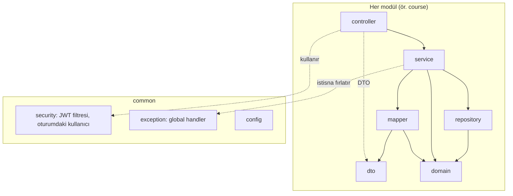
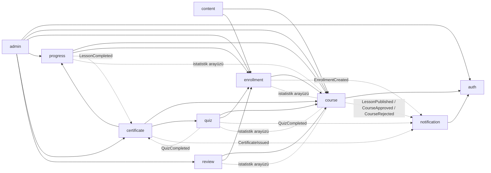

# Mimari kurallar

Bu doküman Mini Udemy backend'inin mimari kurallarını tanımlar: sistemin hangi modüllere ayrıldığını, katmanların ve modüllerin birbirine nasıl bağımlı olabileceğini ve tasarım desenlerinin nerede kullanıldığını. Kod bu kurallara uyar; kural değişecekse önce bu doküman (ve gerekiyorsa bir ADR) değişir.

Kapsamın kaynağı proje tanım dokümanıdır (modüller A–L, senaryo 1–5). Önemli kararların gerekçeleri `docs/adr/` altındaki mimari karar kayıtlarındadır (ADR).

## 1. Mimari stil

**Katmanlı, modüler monolit.** Backend tek bir Spring Boot uygulaması olarak dağıtılır ve tek bir PostgreSQL veritabanı kullanır. Kod içeride iş alanlarına göre modüllere, her modül de katmanlara ayrılır.

Kısaca neden: proje dokümanı bu yapıyı önerir; dört kişilik ekip ve beş haftalık süre için mikroservislerin dağıtım, ağ ve veri tutarlılığı maliyeti gereksizdir. Modül sınırları ise kodun büyürken dağılmasını önler ve ileride bir modülün ayrılmasını mümkün kılar. Ayrıntılı karar ve değerlendirilen alternatifler: [**ADR-001**](adr/0001-moduler-monolit.md).

## 2. Modüller

Paket yapısı: `com.miniudemy.<modül>.<katman>`

| Modül | Sorumluluk | Ana kavramlar | Proje dokümanı |
|---|---|---|---|
| `auth` | Kayıt, giriş, JWT, parola yenileme, profil; kursiyer/eğitmen/yönetici rolleri | User, Role | A |
| `course` | Kategori, kurs, bölüm ve sıralı ders hiyerarşisi; kurs yayın durumları; katalog ve arama; eğitmen paneli istatistikleri | Category, Course, Section, Lesson, CourseState | B, D, J |
| `content` | Ders içerikleri ve materyaller: video/PDF/doküman yükleme, içerik türleri, yerel depolama, yetki kontrollü servis | LessonContent, StoredFile | C |
| `enrollment` | Yayımlanmış kurslara ücretsiz kayıt, kayıtlı kurslar paneli, mükerrer kayıt engeli | Enrollment | E |
| `progress` | Ders tamamlama, son izlenen ders, bölüm/kurs ilerleme yüzdesi, kaldığı yerden devam | LessonProgress, CourseProgress | F |
| `quiz` | Soru bankası, bölüm sonu sınavı, otomatik puanlama, başarı eşiği, deneme geçmişi | Question, Quiz, QuizAttempt | G |
| `certificate` | Koşulları tamamlayan kursiyere doğrulama kodlu platform içi sertifika | Certificate | H |
| `review` | 1–5 puan ve yorum, mükerrer değerlendirme engeli | Review | I |
| `notification` | Uygulama içi bildirimler; domain olaylarını dinler | Notification | L |
| `admin` | Kurs onay/red/yayından kaldırma, kullanıcı ve kategori yönetimi, şikâyetler, platform raporları | Complaint | K |
| `common` | Config, güvenlik altyapısı (JWT filtresi, oturumdaki kullanıcı), global hata yönetimi | – | – |

`common` iş kuralı içermez ve hiçbir modüle bağımlı değildir.

## 3. Katmanlar

Her modül aynı altı pakete ayrılır:

| Katman | İçerik | Kullanabileceği |
|---|---|---|
| `controller` | REST uçları, istek doğrulamasının tetiklenmesi, yetki anotasyonları | `service`, `dto` |
| `service` | İş kuralları ve `@Transactional` sınırı | `repository`, `domain`, `mapper`, `dto` |
| `repository` | Spring Data JPA arayüzleri | `domain` |
| `dto` | API'nin istek/yanıt tipleri (Java `record`) | – |
| `mapper` | `domain` ↔ `dto` dönüşümleri | `domain`, `dto` |
| `domain` | JPA entity'leri, enum'lar, domain olayları | – |

Bağımlılık yönü tek yönlüdür: **controller → service → repository**. Hepsi `domain`'i kullanabilir; `domain` hiçbir katmana bağımlı değildir.

**Yasaklar:**

- Controller repository'ye erişmez ve iş kuralı içermez.
- **Entity API'ye çıkmaz.** Controller yalnız DTO alır ve döner; dönüşüm yalnız mapper'da yapılır.
- İş kuralı yalnız service katmanındadır; repository'de sorgu dışında mantık olmaz.
- Hata yanıtı controller'da elle kurulmaz; service tanımlı bir istisna fırlatır, `common` içindeki global handler standart hata gövdesine çevirir (`CLAUDE.md` › Standart hata formatı).
- Şema yalnız Flyway migration'ı ile değişir (`backend/src/main/resources/db/migration/README.md`).

## 4. Modüller arası iletişim

Bir modül başka bir modülle **yalnız iki yoldan** konuşur:

1. **Diğer modülün `service` paketindeki public arayüzü** (senkron çağrı; örn. kayıt sırasında kursun yayımlanmış olup olmadığını sormak).
2. **Domain olayları** (Observer, bölüm 5): bir modülün işi başka modüllerde tepki doğuracaksa olay yayınlanır, dinleyen modül tepkisini kendisi verir.

**Yasaklar:**

- Başka bir modülün `repository` paketine erişilmez.
- Başka bir modülün entity'si alan, parametre ya da dönüş tipi olarak kullanılmaz. Modül sınırında yalnız id ya da DTO taşınır. Veritabanında modüller arası yabancı anahtar olabilir, ama JPA ilişkisi (`@ManyToOne` vb.) yalnız aynı modülün entity'leri arasında kurulur.
- Modüller arası döngüsel bağımlılık olmaz.

### İzin verilen modül bağımlılıkları

| Modül | Service'ini kullanabileceği modüller | Dinlediği olaylar |
|---|---|---|
| `auth` | – | – |
| `course` | `auth` | – |
| `enrollment` | `course` | – |
| `content` | `course`, `enrollment` | – |
| `progress` | `course`, `enrollment` | `LessonCompleted` |
| `quiz` | `course`, `enrollment` | – |
| `certificate` | `course`, `progress`, `quiz` | `LessonCompleted`, `QuizCompleted` |
| `review` | `course`, `enrollment` | – |
| `notification` | `auth` | Tüm bildirim olayları (bölüm 5) |
| `admin` | `auth`, `course`, `enrollment`, `progress`, `certificate`, `review` | – |

Tabloda olmayan bir bağımlılık gerekiyorsa önce bu doküman güncellenir.

**Eğitmen istatistikleri (J) döngü oluşturmasın diye bağımlılık tersine çevrilir.** Eğitmen paneli `course` modülündedir ama kayıt, ilerleme, sınav ve puan verisi başka modüllerdedir; `course` bu modülleri doğrudan çağırsaydı onlar da `course`'a bağlı olduğu için döngü oluşurdu. Bunun yerine `course`, istatistik için ihtiyaç duyduğu sorgu arayüzlerini kendi `service` paketinde tanımlar; `enrollment`, `progress`, `quiz` ve `review` bu arayüzleri uygular. Böylece bağımlılık yönü hep "diğer modül → `course`" kalır (Dependency Inversion).

## 5. Tasarım desenleri

Desenler gerçek bir ihtiyaç için ve bilinçli olarak kullanılır. Her birinin gerekçesi kendi issue'sunda, kararı `docs/adr/` altında bir ADR'dedir.

| Desen | Modül | Çözdüğü sorun | Issue |
|---|---|---|---|
| **State** | `course` | Kursun durumu (Taslak / İncelemede / Yayımlandı / Yayından kaldırıldı) düzenleme, silme, onaya gönderme, onay, red ve yayından kaldırma kurallarını belirler. Her durumun kuralları kendi sınıfında toplanır; serviste durum için if/switch yazılmaz. | #85 |
| **Observer** | yayınlayan: `enrollment`, `course`, `progress`, `quiz`, `certificate`; dinleyen: `progress`, `certificate`, `notification` | Bir olaya birden fazla modül tepki verir; yayınlayan modül dinleyenleri bilmez. Spring `ApplicationEventPublisher` ve `@TransactionalEventListener` ile uygulanır. | #42, #124 |
| **Strategy** | `quiz` | Puanlama kuralı sınavın türüne göre değişir; her kural ayrı bir `ScoringStrategy` sınıfıdır, yeni kural yeni sınıftır. | #52 |
| **Factory Method** | `content` | Ders içerik türleri (VIDEO, PDF, DOCUMENT) farklı biçim, boyut ve sunuluş kurallarına sahiptir; içeriği oluşturan kod türün fabrikasındadır, yükleme servisi yalnız ortak arayüzü bilir. | #110 |
| **DTO + Mapper** | tüm modüller | Entity'nin API'ye sızmasını önler; API sözleşmesini veritabanı şemasından ayırır. DTO'lar `record`, mapper'lar **MapStruct** arayüzleri: `@Mapper(config = MapStructConfig.class)` (`common/mapper`), `unmappedTargetPolicy = ERROR` ile sözleşmeye eklenip eşlenmeyen alan derlemeyi durdurur. Elle yazılmış mapper yerine MapStruct'ın seçilme gerekçesi: [ADR-006](adr/0006-dto-mapper-mapstruct.md). | #9 |

### Domain olayları

| Olay | Yayınlayan | Dinleyenler |
|---|---|---|
| `EnrollmentCreated` | `enrollment` | `notification` (eğitmene) |
| `LessonPublished` | `course` | `notification` (kayıtlı kursiyerlere) |
| `CourseApproved` | `course` | `notification` (eğitmene) |
| `CourseRejected` (gerekçeli) | `course` | `notification` (eğitmene) |
| `LessonCompleted` | `progress` | `progress` (ilerleme yüzdesi), `certificate` (uygunluk) |
| `QuizCompleted` | `quiz` | `certificate` (uygunluk), `notification` (kursiyere) |
| `CertificateIssued` | `certificate` | `notification` (kursiyere) |

Olay tipleri yayınlayan modülün `domain` paketinde Java `record` olarak tanımlanır.

## 6. Diyagramlar

### Modül ve katman yapısı

### Modül bağımlılıkları

Düz ok: service çağrısı. Kesikli ok: domain olayı (yayınlayan → dinleyen). Noktalı çizgi: `course`'un tanımladığı istatistik arayüzünü uygulama.

## 7. Mimari kararlar ve kuralların denetimi

- **Mimari karar kayıtları:** önemli her karar `docs/adr/` altında bir ADR olarak yazılır: bağlam, karar, değerlendirilen alternatifler, sonuçlar. Kurallar, şablon ve kayıt listesi: [`docs/adr/README.md`](adr/README.md). Planlanan ADR'ler: ADR-001 modüler monolit (#80), ADR-002 JWT ve ADR-003 Flyway (#81), ADR-004 yerel dosya depolama ve ADR-005 ayrı frontend (#84). Desen kararlarının ADR'leri ilgili desen issue'larında yazılır.
- **Otomatik denetim:** bölüm 3 ve 4'teki kurallar ArchUnit testleriyle CI'da kontrol edilir (#86). Kural ihlali build'i kırar; testi geçmek için kural gevşetilmez, kod düzeltilir.
- **Review:** PR'larda bu dokümana uyum kontrol edilir; modüller arası yeni bir bağımlılık bu dokümanın güncellenmesini gerektirir.
- **Tutarlılık:** bu doküman, `CLAUDE.md` ve bileşen diyagramı (#91) aynı modül listesini ve bağımlılık kurallarını anlatır; biri değişirse diğerleri aynı PR'da güncellenir.
