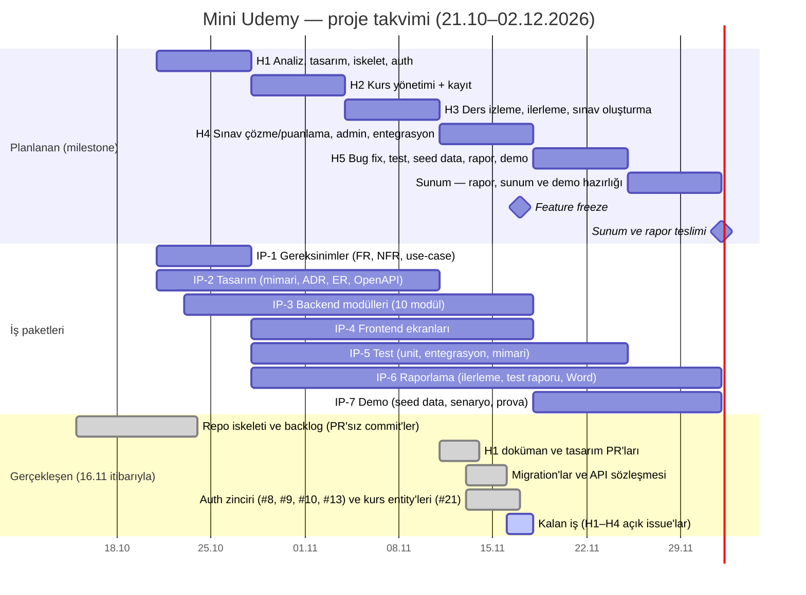

# Proje planı: Gantt, görev dağılımı, risk analizi

Proje raporu şablonunun 6. bölümü (#82). Planlanan takvim `CONTRIBUTING.md` › Sprint'teki milestone'lardan, görev sayıları GitHub'daki issue'lardan alındı.
**Veri tarihi:** 16.11.2026 11:10 (İstanbul saati). Hafta 5'te gerçekleşenle güncellenecek.

## 1. Takvim özeti

| | Tarih |
|---|---|
| Proje başlangıcı | 21.10.2026 |
| Sprint süresi | 1 hafta; her hafta bir milestone |
| Feature freeze | 17.11.2026 (Hafta 4 sonu): sonrasında yeni özellik yok |
| Sunum ve rapor teslimi | 02.12.2026 (rapor hocanın Word şablonunda, .docx) |

## 2. Gantt şeması

Kaynak: [`diagrams/gantt.mmd`](diagrams/gantt.mmd) (Mermaid). GitHub aşağıdaki bloğu şema olarak gösterir; iki dosya aynı içeriği taşır, biri değişirse diğeri de aynı PR'da güncellenir.

## 3. Faz dağılımı

| Faz | Milestone | Süre | Ana çıktılar |
|---|---|---|---|
| Analiz ve tasarım | Hafta 1 (21–27.10) | 1 hafta | FR, NFR, use-case, ER, OpenAPI, mimari kurallar, ADR-001 |
| Geliştirme | Hafta 2–4 (28.10–17.11) | 3 hafta | 10 backend modülü, frontend ekranları, diyagramlar (C4, sınıf, bileşen, sekans, dağıtım), unit testler |
| Test ve kararlılık | Hafta 5 (18–24.11) | 1 hafta | Entegrasyon testleri, bug bash, seed data, test raporu, izlenebilirlik matrisi |
| Sunum hazırlığı | Sunum (25.11–01.12) | 1 hafta | Word raporu, sunum, demo provası ve yedek kayıt |

## 4. İş paketleri

| İş paketi | Kapsam | Örnek issue'lar | Rol |
|---|---|---|---|
| IP-1 Gereksinimler | Fonksiyonel ve fonksiyonel olmayan gereksinimler, kullanım senaryoları | #77, #78, #79, #1 | alan, kalite |
| IP-2 Tasarım | Mimari kurallar, ADR'ler, ER, OpenAPI, UML diyagramları | #6, #80, #2, #3, #87, #91, #51 | mimar, veri, alan |
| IP-3 Backend | Auth, kurs, içerik, kayıt, ilerleme, sınav, sertifika, yorum, bildirim, admin | #8–#13, #21–#30, #41–#49 | dört rol |
| IP-4 Frontend | Kayıt/giriş, katalog, eğitmen paneli, oynatıcı, sınav, admin ekranları | #16–#19, #35–#38, #45 | işin backend rolü |
| IP-5 Test | Servis unit testleri, entegrasyon testleri (Testcontainers), ArchUnit, coverage | #15, #31, #32, #44, #65, #86, #89, #139 | kalite (ArchUnit: mimar) |
| IP-6 Raporlama | Haftalık ilerleme raporları, test planı ve raporu, Word raporu | #83, #90, #92, #93, #99, #69 | kalite |
| IP-7 Demo | Seed data, demo senaryosu, bug bash, prova | #67, #68, #70, #106 | kalite |

## 5. Rol ve görev dağılımı

Roller `CONTRIBUTING.md` › Roller tablosuyla aynı. Her issue'nun tek rol etiketi var; o rolün sahibi issue'yu yapar. Frontend issue'ları ilgili backend işinin rolündedir.

| Rol | Kişi | Temel sorumluluk |
|---|---|---|
| Yazılım Mimarı (`rol:mimar`) | Bertan | Mimari yaklaşım, bileşen sınırları, ADR'ler, auth ve güvenlik |
| Alan Tasarımcısı (`rol:alan`) | Sedat | Alan modeli, sınıflar, tasarım desenleri, sınıf ve sekans diyagramları |
| Veri ve Entegrasyon (`rol:veri`) | Eray | Veritabanı, migration'lar, API sözleşmesi, ER diyagramı |
| Kalite ve Süreç (`rol:kalite`) | Veronika | Testler, kod kalitesi, Git iş akışı, ilerleme raporları |

Milestone ve role göre issue sayısı (16.11.2026; parantez içinde kapanan):

| Milestone | mimar | alan | veri | kalite | Toplam |
|---|---|---|---|---|---|
| Hafta 1 | 8 (5) | 6 (5) | 9 (7) | 4 (2) | 27 (19) |
| Hafta 2 | 9 (2) | 9 (0) | 9 (2) | 5 (1) | 32 (5) |
| Hafta 3 | 9 (0) | 9 (0) | 9 (2) | 6 (2) | 33 (4) |
| Hafta 4 | 4 (0) | 11 (0) | 9 (1) | 9 (0) | 33 (1) |
| Hafta 5 | 3 (0) | 2 (0) | – | 9 (0) | 14 (0) |
| Sunum | 2 (0) | 2 (0) | – | 3 (0) | 7 (0) |
| **Toplam** | **35** | **39** | **36** | **36** | **146 (29)** |

Rol etiketli 146 issue'nun 125'i P1, 21'i P2. Kapanan sayıları rol etiketine göredir; işi yapan kişi farklı olabilir: #8 ve #9 (`rol:alan`) Sedat müsait olmadığı için Bertan tarafından yapıldı (devralma kuralı, `CONTRIBUTING.md` › İş seçme).

## 6. Risk analizi

Olasılık ve etki: Düşük / Orta / Yüksek. "Durum" sütunu 16.11.2026 itibarıyladır.

| # | Risk | Olasılık | Etki | Önlem | Durum |
|---|---|---|---|---|---|
| R1 | **Takvim kayması:** işler milestone'unda bitmez, feature freeze'e (17.11) yetişmez | Yüksek | Yüksek | Haftalık ilerleme raporlarıyla takip; P2 kesme kuralı (Hafta 3'ün P1'leri bitmezse Hafta 4'ün P2'leri kapatılır); freeze sonrası yalnız bug fix | **Gerçekleşti.** Hafta 1–3'ten 65 issue açık; ilk PR'lar 11.11'de geldi. Hafta 4'ün 10 P2'si henüz kapatılmadı |
| R2 | **Kritik yol bağımlılığı:** kurs, kayıt ve test işleri auth zincirini (#8 → #10 → #12/#13 → #14) ve kurs entity'lerini (#21) bekler | Yüksek | Yüksek | Issue'larda "Blocked by" satırı; bağımlılığı kapanmayan işe başlanmaz; zincirdeki işler öncelikli | Kısmen giderildi: #8, #9, #10, #13, #21 kapandı; #12 ve #14 açık |
| R3 | **Ekip üyesinin müsait olmaması** | Orta | Yüksek | Rolün işi takılırsa başka üye etiketi değiştirerek devralır; assignee kuralı kimin çalıştığını gösterir | Gerçekleşti: Sedat 11.11'den itibaren müsait değildi, #8 ve #9'u Bertan devraldı; Sedat 15.11'de #21 ile döndü |
| R4 | **Sahipsiz ya da iki kişinin aynı anda yaptığı işler** | Yüksek | Orta | İşe başlarken assignee + "In Progress" zorunlu; kişi başı en fazla 2 iş (WIP) | Açık: Hafta 2–3'ün açık 56 issue'sunun büyük kısmının sahibi yok |
| R5 | **Testlerin yetişmemesi:** test issue'ları test edeceği kodu bekler, kod gecikince test de gecikir | Orta | Yüksek | Test planı (#92); her FR/NFR'ye test yöntemi; JaCoCo ile coverage takibi (#89, hedef servis katmanında ≥ %70); PR'larda test kanıtı | İzleniyor: `main`'de 70 test; giriş testleri #13 ile geldi |
| R6 | **Review'sız merge ve doküman–kod tutarsızlığı** | Orta | Orta | Her PR'da CI + Kalite ve Süreç sorumlusunun hızlı kontrolü (#84); kod değişirse OpenAPI/diyagram aynı PR'da; OpenAPI–kod eşitleme (#66), diyagram–kod kontrolü (#97) | Gerçekleşti ve önlem alındı: ilk 4 PR onaysız birleşti; `fullName` uzunluğu sözleşmede 100, ER'de 150'ydi, review'da yakalanıp düzeltildi |
| R7 | **Giriş denemelerinde sınır yok** (güvenlik denetimi O4): kaba kuvvet ya da sızmış parola listeleriyle hesap ele geçirme. Parola yenileme isteği (#115) için de geçerli | Düşük (yerel demo) | Yüksek | Kapsam kararı (15.11.2026, Bertan): sınır konmadı. Mevcut önlemler: BCrypt (her deneme yavaş), yanlış e-posta ve yanlış parola için aynı 401, kullanıcı yokken de parola karşılaştırması. Gerçek kullanımda IP + e-posta başına deneme sınırı ve 429 yanıtı | Kabul edildi (kapsam dışı) |
| R8 | **Demo günü ortamın çalışmaması** (kurulum, veri, ağ) | Orta | Yüksek | Tek komutla kurulum (`docker compose up --build`, NFR-16); seed data (#67); süre tutularak demo provası ve yedek demo kaydı (#106) | Planlandı (Hafta 5 – Sunum) |
| R9 | **Üyenin kendi PR'ındaki kararları sunumda anlatamaması** (bireysel katkı katsayısı 0,5–1,1) | Orta | Yüksek | PR açılmadan önce "Ne / Neden" bölümü PR sahibi tarafından okunur; katkı notları (`docs/katki/`); review'lar modüller arasında dönüşümlü | İzleniyor |

## 7. Bütçe

Projede ücretli yazılım lisansı kullanılmıyor; **ürünün lisans maliyeti 0 TL**. Uygulama yerelde Docker ile çalışıyor, sunucu ya da bulut maliyeti yok.

| Araç | Kullanım | Lisans |
|---|---|---|
| Java 21, Spring Boot 3.5 (Web, Data JPA, Security, Validation, Actuator) | Backend | Açık kaynak (GPL + Classpath istisnası / Apache 2.0) |
| Flyway | Veritabanı migration'ları | Açık kaynak (Apache 2.0) |
| PostgreSQL 17 | Veritabanı | Açık kaynak (PostgreSQL License) |
| MapStruct | DTO dönüşümü | Açık kaynak (Apache 2.0) |
| Next.js, React, TypeScript, ESLint | Frontend | Açık kaynak (MIT / Apache 2.0) |
| JUnit 5, Mockito, JaCoCo (Testcontainers #65'te eklenecek) | Test ve coverage | Açık kaynak (EPL 2.0 / MIT) |
| Docker, Docker Compose | Çalıştırma | Docker Engine açık kaynak (Apache 2.0); Docker Desktop kişisel ve eğitim kullanımında ücretsiz |
| GitHub (repo, Issues, Projects), GitHub Actions | Kaynak kod, iş takibi, CI | Herkese açık repoda ücretsiz |
| PlantUML, Mermaid | Diyagramlar | Açık kaynak |

Geliştirme aracı olarak kullanılan Claude Code ücretli bir abonelik gerektirir; ürünün çalışması için gerekli değildir ve ürünün lisans maliyetine dahil değildir.

## 8. Planlanan ve gerçekleşen (16.11.2026)

| Milestone | Planlanan bitiş | Planlanan issue | Kapanan | Not |
|---|---|---|---|---|
| Hafta 1 | 27.10 | 27 | 19 | İlk PR'lar 11.11'de; #12, #14 ve #15 dahil 8 issue açık |
| Hafta 2 | 03.11 | 32 | 5 | Kurs ve kayıt işleri auth zincirini bekledi |
| Hafta 3 | 10.11 | 33 | 4 | Hafta içinde `main`'e değişiklik girmedi |
| Hafta 4 | 17.11 | 33 | 1 | Devam ediyor; freeze 17.11 |
| Hafta 5 | 24.11 | 14 | 0 | Başlamadı |
| Sunum | 01.12 | 7 | 0 | Başlamadı |

Ayrıntılar haftalık raporlarda: [`progress/`](progress/).
