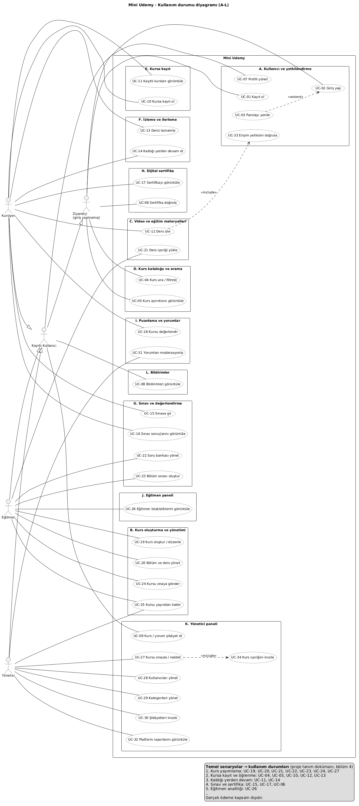
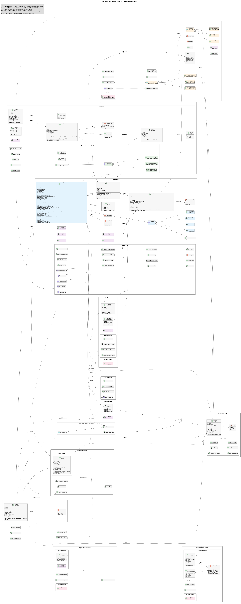
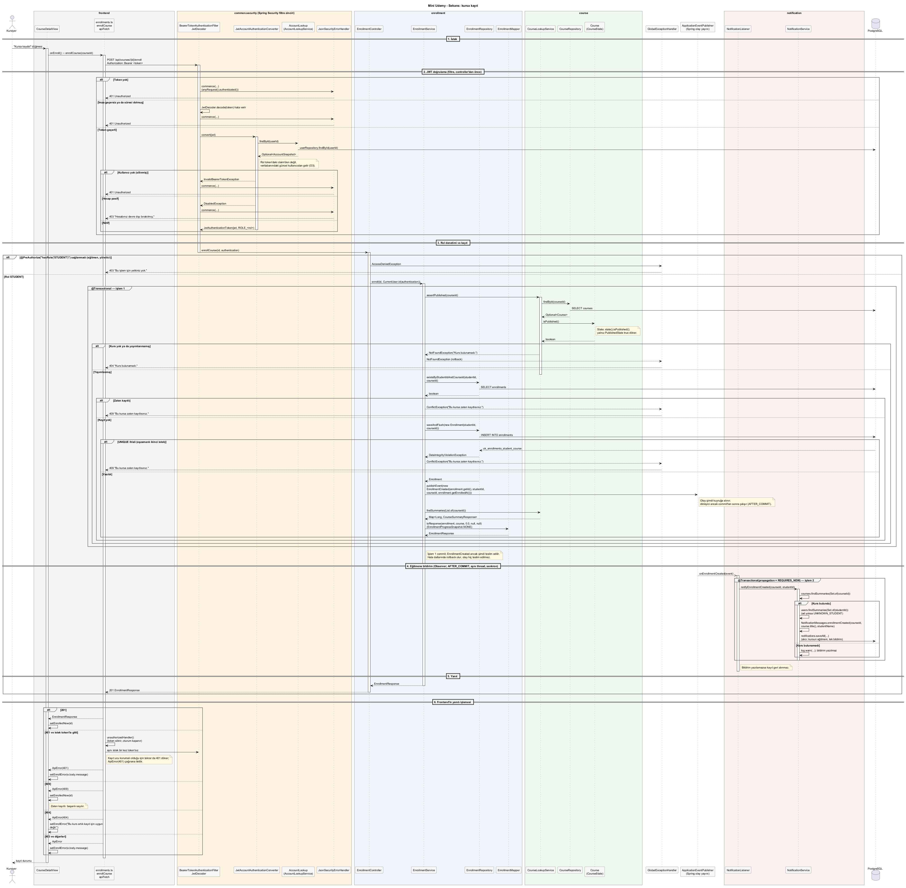
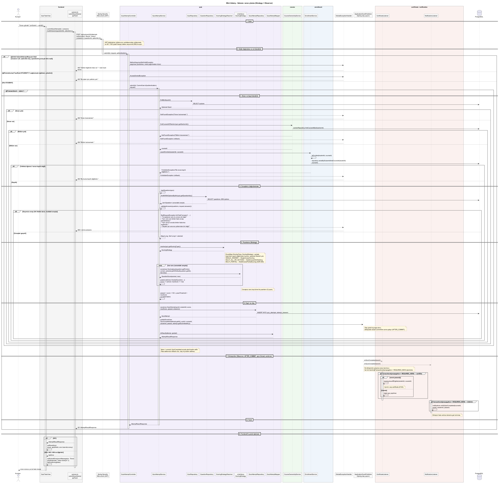
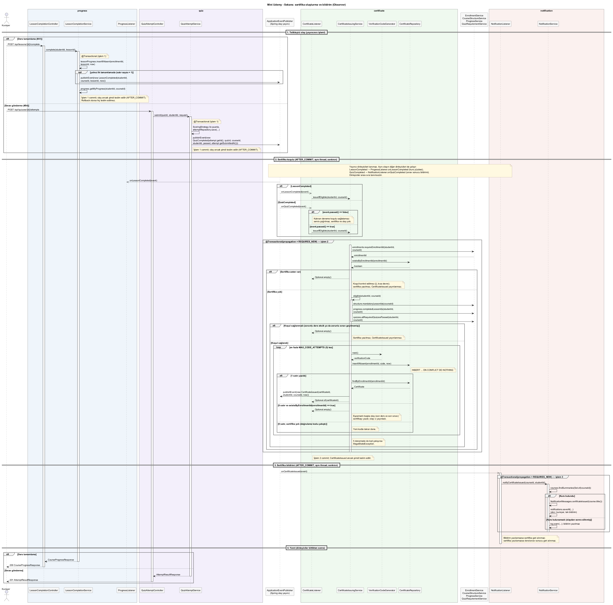
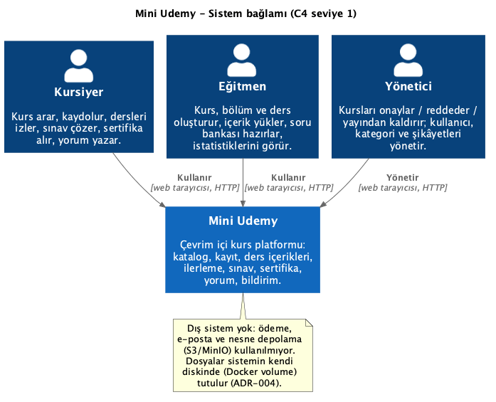
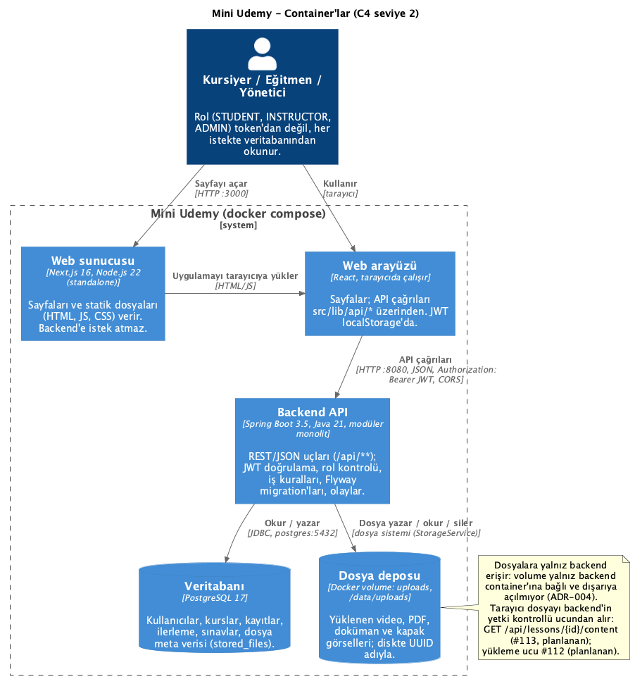
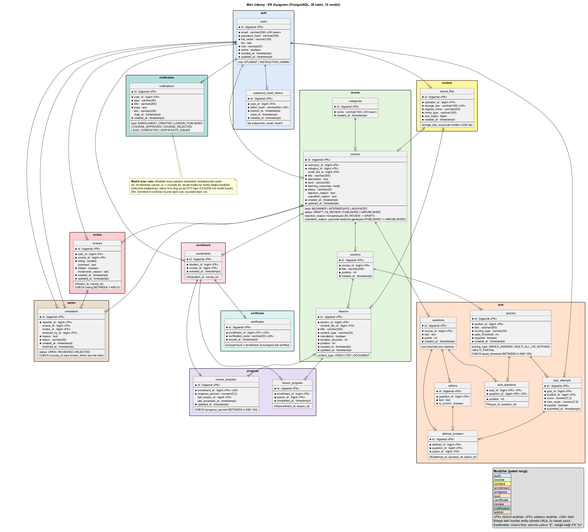

# Proje raporu — Bölüm 1–3 (taslak)

Hocanın Proje Yazım Şablonu'nun 1–3. bölümlerinin içeriği (#102). Word dosyasında birleştirme #69'da yapılır; bu dosya metnin kaynağıdır. Ayrıntılı tablolar repodaki dokümanlarda; burada rapora girecek özetleri var. Bölüm 4 (mimari, desenler, SOLID, API): #103; bölüm 5–8: [`bolum-5-8.md`](bolum-5-8.md) (#104, taslak PR #287; merge edilene kadar bağlantı `main`'de açılmaz).

**Veri tarihi:** 20.11.2026, `main` @ `c99d931`. ⟨…⟩ ile işaretli yerler test raporu (#99), bug bash (#68), demo provası (#106), diyagram–kod tutarlılık kontrolünün sonu (#97) ve ekran görüntüleri bitince doldurulacak; son güncelleme 01.12.2026'dan önce.

**Şablon numaraları:** 3.2, 3.3.1–3.3.8, 3.4.1, 3.4.5 ve 3.4.7 issue'lardaki şablon atıflarından (#77, #78, #79, #87, #88) alındı. 3.4.2, 3.4.3, 3.4.4 ve 3.4.6'nın sırası tahmindir; Word şablonuyla birleştirirken (#69) kontrol edilecek.

---

## 1. Giriş

### 1.1 Amaç

Mini Udemy; eğitmenlerin video, PDF ve dokümanlardan oluşan kurslar hazırlayıp yayımladığı, kursiyerlerin bu kurslara kaydolup dersleri izlediği, bölüm sonu sınavlarına girdiği ve koşulları tamamlayınca doğrulama kodlu sertifika aldığı bir çevrim içi eğitim platformudur. Yöneticiler kursları yayından önce inceler, kullanıcıları, kategorileri, yorumları ve şikâyetleri yönetir.

Proje, Yazılım Tasarımı ve Mimarisi dersi kapsamında yapıldı. Asıl amaç çalışan bir ürünün yanında **tasarımın kendisini** göstermektir: gereksinimlerden kullanım senaryolarına, oradan mimariye, tasarım desenlerine ve koda kadar izlenebilen; diyagramları ve API sözleşmesi kodla tutarlı bir sistem.

### 1.2 Kapsam

Kapsamın tek kaynağı proje tanım dokümanıdır. Sistem dokümandaki 12 modülü (A–L) ve 5 temel senaryoyu karşılar:

| Kod | Modül | Kod | Modül |
|---|---|---|---|
| A | Kullanıcı ve yetkilendirme | G | Sınav ve değerlendirme |
| B | Kurs oluşturma ve yönetimi | H | Dijital sertifika |
| C | Video ve eğitim materyalleri | I | Kurs puanlama ve yorumlar |
| D | Kurs kataloğu ve arama | J | Eğitmen paneli |
| E | Kursa kayıt | K | Yönetici paneli |
| F | İzleme ve ilerleme takibi | L | Bildirimler |

Kullanıcılar üç role ayrılır: **kursiyer**, **eğitmen** ve **yönetici**; giriş yapmamış **ziyaretçi** katalogda gezinebilir ve sertifika doğrulayabilir.

**Kapsam dışı** (proje tanım dokümanı, bölüm 2):

- Gerçek ödeme entegrasyonu: kurslara kayıt ücretsizdir (P3 #74 "gelecek çalışma" olarak bırakıldı, bkz. 8.3).
- Bağımsız mobil uygulama: mobil uyumlu web arayüzü yeterlidir (NFR-07).
- Dış dosya depolama servisi (S3 vb.): dosyalar sunucudaki Docker volume'unda, yetki kontrollü servisle sunulur (ADR-004).

### 1.3 Hedefler ve başarı kriterleri

**Hedefler**

| # | Hedef | Karşılayan |
|---|---|---|
| H1 | Proje tanım dokümanındaki 5 temel senaryo uçtan uca çalışır: kurs yayımlama, kursa kayıt ve öğrenme, kaldığı yerden devam, sınav ve sertifika, eğitmen analitiği. | 3.4.1; FR'ler 3.2 |
| H2 | Dokümanın Bölüm 6'daki dört kritik durumu doğru davranır: kayıtsız erişim reddedilir, mükerrer kayıt engellenir, yetkisiz kurs düzenlenemez, ilerleme yüzdesi doğru hesaplanır. Dosya türü ve boyutu denetlenir. | FR-06, FR-18, FR-10, FR-21, FR-11; NFR-03, NFR-09–NFR-12 |
| H3 | Tasarım kodla tutarlıdır: katmanlı modüler monolit (10 modül), beş tasarım deseni (State, Observer, Strategy, Factory Method, DTO + Mapper), kararlar ADR olarak kayıtlı, diyagramlar ve OpenAPI sözleşmesi koda uyar. | 3.4; Bölüm 4; NFR-13, NFR-15, NFR-18, NFR-19 |
| H4 | Sistem tek komutla kurulur ve mobil ekranda kullanılabilir. | NFR-07, NFR-16, NFR-17 |
| H5 | Her değişiklik otomatik testlerle doğrulanır ve gereksinimden teste izlenebilir. | NFR-14; test planı (7.5) |

**Başarı kriterleri.** Ölçütler test planındaki başarı ölçütleriyle ([`docs/test-plan.md`](../docs/test-plan.md) › 7) birebir aynıdır; gerçekleşen değerler test raporundan ([`docs/test-report.md`](../docs/test-report.md) › 7, #99, taslak PR #279) alınır.

| # | Kriter | Ölçüt (hedef) | Hedef | Kanıt | Gerçekleşen |
|---|---|---|---|---|---|
| 1 | CI yeşil | `main`'de backend build + tüm testler ve frontend lint + build başarılı | H5 | GitHub Actions, test raporu § 1 | ⟨#99⟩ |
| 2 | P1 gereksinimler doğrulanmış | 44 FR'nin P1 olan 31'inin her biri için en az bir otomatik test ya da yazılı manuel kontrol; izlenebilirlik matrisinde gösterilmiş | H1, H5 | [`docs/traceability.md`](../docs/traceability.md) (#98) | ⟨#99⟩ |
| 3 | Bölüm 6 ve dosya denetimi testleri | Dört durumun ve dosya türü/boyutu testlerinin hepsi var, yeşil, hiçbiri `@Disabled` değil | H2 | Test raporu § 4 | ⟨#99⟩ |
| 4 | Servis katmanı coverage'ı | `com.miniudemy.*.service` satır coverage'ı ≥ %70 (JaCoCo) | H5 | Test raporu § 2 (#89) | ⟨#99⟩ |
| 5 | Mimari kurallar | ArchUnit kurallarında ihlal yok; kurallar gevşetilmemiş | H3 | Test raporu § 1 (mimari testler) | ⟨#99⟩ |
| 6 | Bug bash | Bug bash'te açılan P1 hataların hepsi demo öncesi kapalı | H1 | Test raporu § 6 (#68) | ⟨#68⟩ |
| 7 | Demo provası | Senaryo 1–5 provada hatasız tamamlanıyor | H1, H4 | Demo provası (#106), [`docs/demo.md`](../docs/demo.md) | ⟨#106⟩ |

### 1.4 Tanımlar, kısaltmalar

Raporda sık geçen kısaltmalar aşağıdadır; terimlerin tamamı (34 terim) Bölüm 5'teki sözlüktedir.

| Kısaltma | Açıklama |
|---|---|
| FR / NFR | Fonksiyonel / fonksiyonel olmayan gereksinim (FR-01…FR-44, NFR-01…NFR-19) |
| UC | Kullanım durumu (use case; UC-01…UC-34) |
| P1 / P2 / P3 | Öncelik: zorunlu / önemli / kapsam dışı (zaman kalırsa) |
| ADR | Mimari karar kaydı (`docs/adr/`, 12 adet) |
| C4 | Yazılım mimarisini bağlam, container, bileşen ve kod seviyelerinde gösteren diyagram modeli |
| ER | Varlık–ilişki (entity–relationship) diyagramı |
| DTO | Veri aktarım nesnesi; API'de dışarı verilen ve alınan veri biçimi |
| JWT | JSON Web Token; girişten sonra verilen imzalı kimlik anahtarı |
| CI | Sürekli entegrasyon (GitHub Actions) |
| Taslak / İncelemede / Yayımlandı / Yayından kaldırıldı | Kursun dört durumu (FR-09, State deseni) |

### 1.5 Kaynaklar

1. Proje tanım dokümanı (Mini Udemy): modüller A–L, temel senaryolar 1–5 (bölüm 4), teknik beklentiler (bölüm 5), test durumları (bölüm 6), beklenen nihai ürün (bölüm 7).
2. Proje Yazım Şablonu (ders, Word).
3. Proje deposu: `github.com/Bertanokt/mini-udemy`; gereksinimler [`docs/requirements.md`](../docs/requirements.md), [`docs/non-functional-requirements.md`](../docs/non-functional-requirements.md); senaryolar [`docs/use-cases.md`](../docs/use-cases.md); mimari [`docs/architecture.md`](../docs/architecture.md) ve [`docs/adr/`](../docs/adr/README.md); API sözleşmesi [`docs/api/openapi.yaml`](../docs/api/openapi.yaml); diyagramlar `docs/diagrams/`.
4. Mevcut sistemler (Bölüm 2): udemy.com, coursera.org, edx.org, khanacademy.org.

### 1.6 Raporun düzeni

Bölüm 2 benzer platformları kısaca karşılaştırır ve Mini Udemy'nin bunlardan neyi aldığını, neyi bilerek dışarıda bıraktığını anlatır. Bölüm 3 önerilen sistemi gereksinimler (FR, NFR) ve sistem modelleriyle (senaryolar, use-case, sınıf, sekans, mimari, ER, arayüz) tanımlar. Bölüm 4 mimariyi, tasarım desenlerini, SOLID'i, API ve güvenlik tasarımını ve mimari kararları; Bölüm 5 sözlüğü; Bölüm 6 proje planını; Bölüm 7 metodoloji, teknoloji, kullanım kılavuzu ve testleri; Bölüm 8 sonuç ve tartışmayı içerir.

---

## 2. Mevcut sistem

Çevrim içi eğitim alanında farklı iş modelleriyle çalışan yerleşik platformlar var. Mini Udemy'nin kapsamını belirlerken dördü örnek alındı. Aşağıdaki karşılaştırma platformların genel ve kamuya açık özelliklerine dayanır; ayrıntılar (fiyat, sertifika koşulları) platformlarda zamanla değişebilir.

| Özellik | Udemy | Coursera | edX | Khan Academy | **Mini Udemy** |
|---|---|---|---|---|---|
| İçerik kimden | Bağımsız eğitmenler (açık pazar yeri) | Üniversite ve şirket ortakları | Üniversite ve kurum ortakları | Kurumun kendi ekibi | Platforma kayıtlı eğitmenler |
| Yayından önce inceleme | Kalite incelemesi var | Ortak kurum hazırlar | Ortak kurum hazırlar | — | Yönetici onayı zorunlu (Taslak → İncelemede → Yayımlandı) |
| Ücret | Kurs başına ücret | Abonelik / kurs başına; ücretsiz izleme seçeneği | Ücretsiz izleme; sertifika ücretli | Ücretsiz (kâr amacı gütmeyen) | Ücretsiz (ödeme kapsam dışı) |
| İçerik türleri | Video, doküman, alıştırma | Video, okuma, ödev | Video, okuma, ödev | Video, alıştırma | Video, PDF, doküman |
| Değerlendirme | Kısa sınav, alıştırma testi | Notlu ödev ve sınav, akran değerlendirmesi | Notlu ödev ve sınav | Ustalık temelli alıştırmalar | Bölüm sonu sınavı, otomatik puanlama, başarı eşiği |
| Sertifika | Tamamlama belgesi (akredite değil) | Ücretli, kurum logolu; doğrulama bağlantısı | Ücretli doğrulanmış sertifika | — | Doğrulama kodlu, platform içi katılım belgesi (akreditasyon iddiası yok) |
| Puan ve yorum | Var | Var | Var | — | Var; yönetici moderasyonu ve şikâyet |
| Eğitmen analitiği | Var (kayıt, gelir, katılım) | Ortak kurumlara | Ortak kurumlara | — | Var: kayıt, tamamlanma oranı, sınav başarısı, puan dağılımı |
| Kurulum | Bulut hizmeti (SaaS) | Bulut hizmeti | Bulut hizmeti (Open edX açık kaynak) | Bulut hizmeti | Kendi sunucusunda, tek komutla (Docker Compose) |

**Mini Udemy'nin aldıkları.** Açık eğitmen modeli ve kurs → bölüm → ders hiyerarşisi (Udemy); bölüm sonu sınavı ve başarı eşiği (Coursera, edX); kaldığı yerden devam ve ilerleme yüzdesi (hepsi); herkesin doğrulayabildiği sertifika kodu (Coursera, edX); puan, yorum ve eğitmen paneli (Udemy).

**Bilerek dışarıda bıraktıkları.** Ödeme ve gelir paylaşımı (kapsam dışı); akran değerlendirmesi, ödev teslimi ve teslim tarihleri; video akışı için CDN ve ölçek altyapısı; resmî/akredite sertifika. Bunun yerine projenin odağı, aynı kuralların (kayıt, yetki, ilerleme, sınav, sertifika) **tasarım desenleriyle açık ve test edilebilir** biçimde kurulmasıdır.

**Farkı.** Mevcut platformlar ürün olarak çok daha geniştir; Mini Udemy'nin katkısı kapsamın küçük tutulup her kuralın gereksinim → senaryo → diyagram → kod → test zinciriyle izlenebilmesidir (izlenebilirlik matrisi, 7.5).

---

## 3. Önerilen sistem

### 3.1 Genel bakış

Sistem üç parçadan oluşur: tarayıcıda çalışan **Next.js / React** arayüzü, **Spring Boot** REST API'si ve **PostgreSQL** veritabanı. Yüklenen dosyalar backend'in bağlı olduğu bir Docker volume'unda saklanır ve yalnız yetki kontrolünden geçen istekle sunulur. Üçü `docker compose up --build` ile birlikte ayağa kalkar.

Backend **katmanlı, modüler bir monolittir** (ADR-001): tek uygulama, içeride 10 iş modülü (`auth`, `course`, `content`, `enrollment`, `progress`, `quiz`, `certificate`, `review`, `notification`, `admin`) ve ortak altyapı (`common`). Her modül controller → service → repository katmanlarına ayrılır; bir modül başka modüle yalnız onun servis arayüzü ya da domain olaylarıyla erişir. Bu kurallar ArchUnit testleriyle CI'da denetlenir.

Beş tasarım deseni gerçek bir ihtiyaç için kullanılır: kurs durumları için **State**, modüller arası tepkiler (sertifika, ilerleme, bildirim) için **Observer**, sınav puanlaması için **Strategy**, ders içerik türleri için **Factory Method**, entity'nin API'ye sızmaması için **DTO + Mapper**. Ayrıntı Bölüm 4'te.

Teknoloji sürümleri (`main` @ `c99d931`): Spring Boot 3.5.16 (Java 21), Next.js 16.4.6 ve React 19.3.0 (TypeScript), PostgreSQL 17. Tam liste 7.2'de.

### 3.2 Fonksiyonel gereksinimler

Proje tanım dokümanının A–L modüllerinden ve temel senaryolarından **44 fonksiyonel gereksinim** türetildi. Her gereksinimin aktörü, kaynağı, test edilebilir kabul kriteri ve önceliği vardır. **P1** = 5 temel senaryonun, Bölüm 6 test durumlarının ya da tasarım çıktılarının çalışması için gerekli; **P2** = senaryo dışı ayrıntı. Tam tablo: [`docs/requirements.md`](../docs/requirements.md).

| Modül | FR | P1 | P2 | Örnek gereksinimler |
|---|---|---|---|---|
| A. Kullanıcı ve yetkilendirme | FR-01–06 | 4 | 2 | Rolüyle kayıt ve giriş (JWT); rol ve kayıt kontrolü sunucuda (401/403) |
| B. Kurs oluşturma ve yönetimi | FR-07–10 | 4 | 0 | Bölüm/ders hiyerarşisi; dört kurs durumu ve geçiş kuralları; kursu yalnız sahibi düzenler |
| C. Video ve eğitim materyalleri | FR-11–12 | 2 | 0 | Video ≤ 200 MB, PDF/doküman ≤ 20 MB, tür içerikten denetlenir (413/415); oynatıcı |
| D. Kurs kataloğu ve arama | FR-13–16 | 2 | 2 | Anahtar kelime, kategori, seviye, eğitmen filtresi; yalnız yayımlanmış kurslar |
| E. Kursa kayıt | FR-17–19 | 3 | 0 | Ücretsiz kayıt; mükerrer kayıt 409; kayıtlı kurslar paneli |
| F. İzleme ve ilerleme takibi | FR-20–22 | 3 | 0 | Ders tamamlama; yüzde = tamamlanan / toplam × 100; kaldığı yerden devam |
| G. Sınav ve değerlendirme | FR-23–26 | 3 | 1 | Soru bankası; bölüm sonu sınavı ve eşik (varsayılan %70); otomatik puanlama |
| H. Dijital sertifika | FR-27–29 | 3 | 0 | Koşul sağlanınca bir kez, doğrulama kodlu; akreditasyon iddiası yok |
| I. Kurs puanlama ve yorumlar | FR-30–32 | 0 | 3 | 1–5 yıldız ve yorum; kursiyer başına bir değerlendirme; moderasyon |
| J. Eğitmen paneli | FR-33–36 | 3 | 1 | Kurslar ve kayıt sayıları; tamamlanma oranı ve sınav başarısı; kursiyer ilerlemesi |
| K. Yönetici paneli | FR-37–42 | 2 | 4 | Onay / gerekçeli red; yayından kaldırma; kullanıcı, kategori, şikâyet, raporlar |
| L. Bildirimler | FR-43–44 | 2 | 0 | Altı olayda uygulama içi bildirim; okunmamış sayısı |
| **Toplam** | **44** | **31** | **13** | |

**Senaryolar → gereksinimler** ([`docs/requirements.md`](../docs/requirements.md) › Temel senaryolar):

| Senaryo | Gereksinimler |
|---|---|
| 1. Kurs yayımlama | FR-07, FR-08, FR-09, FR-11, FR-23, FR-24, FR-37 |
| 2. Kursa kayıt ve öğrenme | FR-13, FR-15, FR-17, FR-12, FR-06, FR-20, FR-21 |
| 3. Kaldığı yerden devam | FR-19, FR-22 |
| 4. Sınav ve sertifika | FR-25, FR-27, FR-28, FR-29 |
| 5. Eğitmen analitiği | FR-33, FR-34, FR-35 |

**Bölüm 6 test durumları → gereksinimler:** kayıtsız erişim → FR-06; mükerrer kayıt → FR-18; yetkisiz kurs düzenleme → FR-10; yanlış ilerleme hesabı → FR-21.

### 3.3 Fonksiyonel olmayan gereksinimler

Proje tanım dokümanının 5. bölümündeki teknik beklentilerden **19 ölçülebilir NFR** türetildi. Her birinin ölçütü ve doğrulama yöntemi (otomatik **test**, kod/doküman **inceleme**si ya da **demo**) vardır. Tam tablo: [`docs/non-functional-requirements.md`](../docs/non-functional-requirements.md).

| Başlık | NFR | Ölçüt (özet) | Doğrulama |
|---|---|---|---|
| 3.3.1 Performans | NFR-01, 02 | Listeler sayfalı (`size` ≤ 50); dosyalar akışla, video `Range` (206) destekli | Test |
| 3.3.2 Güvenlik | NFR-03–06 | Kayıtsız içerik isteği 403; JWT'siz istek 401; parolalar BCrypt; sahiplik sunucuda denetlenir; gizli bilgi ortam değişkeninde | Test, inceleme |
| 3.3.3 Kullanılabilirlik ve mobil uyumluluk | NFR-07, 08 | 360 px'te yatay kaydırma yok; doğrulama hatası ilgili alanın altında | Demo, test |
| 3.3.4 Güvenilirlik ve veri bütünlüğü | NFR-09, 10 | Mükerrer kayıt ve sertifika yok (benzersizlik kısıtı); ilerleme yüzdesi sınır durumlarıyla testli | Test |
| 3.3.5 Dosya sınırları | NFR-11, 12 | Tür ve boyut sınırı (413/415); tür uzantıdan değil içerikten | Test |
| 3.3.6 Bakım yapılabilirlik | NFR-13–15 | Modül sınırları; her PR'da CI; OpenAPI sözleşmesi kodla aynı PR'da | İnceleme |
| 3.3.7 Taşınabilirlik ve kurulum | NFR-16, 17 | `docker compose up --build` ile tek komut; güncel Chrome, Firefox, Safari | Demo |
| 3.3.8 Ölçeklenebilirlik ve genişletilebilirlik | NFR-18, 19 | Yeni içerik türü yalnız yeni fabrika sınıfıyla (Factory Method); yan etkiler olaylarla (Observer) | İnceleme |

### 3.4 Sistem modelleri

Diyagramlar metin tabanlıdır (PlantUML) ve render edilmiş PNG/SVG'leri yanındadır (`docs/diagrams/`). Her diyagramın koda karşı kontrolü #97'de, diyagramı hazırlayandan farklı bir üye tarafından yapıldı; sonuçlar her diyagramın altında.

#### 3.4.1 Senaryolar

Proje tanım dokümanının 4. bölümündeki beş temel senaryo; her biri aktör, ön koşul, ana akış, alternatif/hata akışları ve son koşulla [`docs/use-cases.md`](../docs/use-cases.md) › 1'de.

| # | Senaryo | Aktör | Özet akış | Kritik hata akışları |
|---|---|---|---|---|
| 1 | Kurs yayımlama | Eğitmen, Yönetici | Kurs oluştur (Taslak) → bölüm/ders ekle → içerik yükle → soru bankası ve bölüm sınavı → onaya gönder (İncelemede) → yönetici onaylar (Yayımlandı) | Red: gerekçeyle Taslak'a döner; geçersiz dosya 413/415; geçersiz durum geçişi 409; başka eğitmenin kursu 403 |
| 2 | Kursa kayıt ve öğrenme | Kursiyer | Katalogda ara → kurs ayrıntısı → ücretsiz kayıt → dersi izle → tamamlandı işaretle → ilerleme yeniden hesaplanır | Mükerrer kayıt 409; kayıtsız içerik isteği 403; dersi olmayan bölüm %0 |
| 3 | Kaldığı yerden devam | Kursiyer | Tekrar giriş → kayıtlı kurslar paneli (yüzde, son ders) → "Devam et" son izlenen dersi açar | Hiç ders izlenmemişse ilk ders açılır |
| 4 | Sınav ve sertifika | Kursiyer, Sistem, Ziyaretçi | Bölüm sınavı → otomatik puanlama → geçti/kaldı → koşullar tamamsa sertifika oluşur → herkes kodla doğrular | Kaldı: sınırsız deneme; koşul eksikse sertifika yok; ikinci sertifika oluşmaz |
| 5 | Eğitmen analitiği | Eğitmen | Kurslarım → kurs istatistikleri: kayıt, tamamlanma oranı, sınav başarısı, kursiyer ilerlemesi | Başka eğitmenin kursu 403 |

#### 3.4.2 Kullanım durumu (use-case) modeli

Beş aktör (ziyaretçi, kayıtlı kullanıcı, kursiyer, eğitmen, yönetici) ve **34 kullanım durumu** (UC-01…UC-34). Her UC'nin metin açıklaması ve gereksinim eşlemesi [`docs/use-cases.md`](../docs/use-cases.md) › 2–3'te.

| Aktör | Kullanım durumları |
|---|---|
| Ziyaretçi | UC-01 Kayıt ol, UC-02 Giriş yap, UC-03 Parolayı yenile, UC-04 Kurs ara / filtrele, UC-05 Kurs ayrıntısı, UC-06 Sertifika doğrula |
| Kayıtlı kullanıcı | UC-07 Profili yönet, UC-08 Bildirimler, UC-09 Kurs / yorum şikâyet et |
| Kursiyer | UC-10 Kursa kayıt ol, UC-11 Kayıtlı kurslar, UC-12 Ders izle, UC-13 Dersi tamamla, UC-14 Kaldığı yerden devam, UC-15 Sınava gir, UC-16 Sınav sonuçları, UC-17 Sertifikayı görüntüle, UC-18 Kursu değerlendir |
| Eğitmen | UC-19 Kurs oluştur / düzenle, UC-20 Bölüm ve ders yönet, UC-21 Ders içeriği yükle, UC-22 Soru bankası, UC-23 Bölüm sınavı, UC-24 Onaya gönder, UC-25 Yayından kaldır, UC-26 Eğitmen istatistikleri |
| Yönetici | UC-25 Yayından kaldır, UC-27 Onayla / reddet, UC-28 Kullanıcılar, UC-29 Kategoriler, UC-30 Şikâyetler, UC-31 Yorum moderasyonu, UC-32 Platform raporları, UC-34 Kurs içeriğini incele |
| (içerilen) | UC-33 Erişim yetkisini doğrula: UC-12 Ders izle'ye `<<include>>` ile bağlı; sistemin her içerik isteğinde yaptığı kontrol |

*Tutarlılık (#97, 19.11):* UC-01…UC-34'ün 34'ü diyagramda ve `use-cases.md`'de aynı.

#### 3.4.3 Nesne modeli: sınıf diyagramı

Genel bakış diyagramı 10 modülün domain ve service sınıflarını ve modüller arası bağımlılıkları gösterir. Beş desenin her biri ayrı bir diyagramda, ilgili ADR'ye bağlantıyla ayrıntılandırılır (desenlerin anlatımı Bölüm 4'te).

| Desen | Diyagram | Kodda | ADR |
|---|---|---|---|
| State | [`class-state.png`](../docs/diagrams/class-state.png) | `course` — `CourseState` ve dört durum sınıfı | ADR-010 |
| Observer | [`class-observer.png`](../docs/diagrams/class-observer.png) | 10 domain olayı; dinleyiciler `progress`, `certificate`, `notification` | ADR-009 |
| Strategy | [`class-strategy.png`](../docs/diagrams/class-strategy.png) | `quiz` — `ScoringStrategy` ve üç puanlama stratejisi | ADR-008 |
| Factory Method | [`class-factory.png`](../docs/diagrams/class-factory.png) | `content` — `LessonContentFactory` ve VIDEO, PDF, DOCUMENT fabrikaları | ADR-011 |
| DTO + Mapper | [`class-dto-mapper.png`](../docs/diagrams/class-dto-mapper.png) | Her modülün `dto` ve `mapper` paketi (MapStruct) | ADR-006 |

*Tutarlılık:* diyagramlar `main`'deki koddan çıkarıldı (#51, PR #283) ve PR'da diyagram–kod tablosuyla verildi. #97 kontrolü ⟨#97: sınıf diyagramı kontrolü bekleniyor⟩.

#### 3.4.4 Dinamik model: sekans diyagramları

Üç ana akış sekans diyagramıyla gösterilir. Her biri isteğin güvenlik filtresinden controller, service ve repository'ye geçişini, hata dallarını ve yayınlanan domain olaylarını içerir.

| Akış | Diyagram | Gösterdiği kurallar |
|---|---|---|
| Kursa kayıt (#39) |  | Yayımlanmamış kurs 404; mükerrer kayıt 409 (ön kontrol + benzersizlik kısıtı); `EnrollmentCreated` olayı işlem commit edildikten sonra |
| Sınav çözme (#64) |  | Puanlama stratejisinin sınav türüne göre seçimi (Strategy); 404/403/400 dalları; geçme formülü; `QuizCompleted` olayı |
| Sertifika oluşturma ve bildirim (#140) |  | Olay dinleyicisi koşulları denetler (Observer); sertifika bir kez oluşur; `CertificateIssued` → bildirim |

*Tutarlılık (#97, 19.11):* üçü de PR incelemelerinde adım adım kodla karşılaştırıldı; fark yok.

#### 3.4.5 Sistem mimarisi

Sistem bağlamı (C4 seviye 1) üç kullanıcı rolünü ve Mini Udemy'yi; container diyagramı (C4 seviye 2) tarayıcıdaki arayüzü, Next.js sunucusunu, Spring Boot API'sini, PostgreSQL'i ve dosya volume'unu gösterir. Tarayıcı backend'e doğrudan REST isteği atar; dosyalara yalnız backend erişir. Bileşen ve dağıtım diyagramları, modül bağımlılıkları ve ADR'ler Bölüm 4'te.

*Tutarlılık (#97, 19.11):* container'lar ve ilişkiler `docker-compose.yml` ile aynı. Veritabanı açıklamasının yeni tabloları da (değerlendirme, sertifika, bildirim) anması önerildi ⟨#97 sonucuna göre güncellenecek⟩.

#### 3.4.6 Veri modeli: ER diyagramı

Veritabanı şeması yalnız Flyway migration'larıyla değişir (ADR-003). ER diyagramı 20 tablo içerir; bunların 19'u `main`'deki migration'larda var. `password_reset_tokens` parola yenileme işiyle (#115, açık) gelecek.

| Alan | Tablolar |
|---|---|
| Kullanıcı | `users`, `password_reset_tokens` |
| Kurs yapısı | `categories`, `courses`, `sections`, `lessons`, `stored_files` |
| Kayıt ve ilerleme | `enrollments`, `lesson_progress`, `course_progress` |
| Sınav | `questions`, `options`, `quizzes`, `quiz_questions`, `quiz_attempts`, `attempt_answers` |
| Sertifika, yorum, bildirim, şikâyet | `certificates`, `reviews`, `notifications`, `complaints` |

*Tutarlılık (#97, 19.11):* migration'daki her tablo tablo, kolon, tip ve NOT NULL düzeyinde betikle karşılaştırıldı; fark yok. `complaints` migration'ı o tarihten sonra geldi (#144) ⟨#97: yeniden kontrol⟩.

#### 3.4.7 Kullanıcı arayüzü

UI taslakları (#88) kapsam dışı bırakıldı; bu bölümde wireframe yerine **gerçek ekran görüntüleri** kullanılır: her ekran için mobil (≈360 px) ve masaüstü. Ekranlar seed verisiyle çekilecek (kod dondurmasından, 24.11, sonra).

| Rol | Ekran | Adres | Görüntü |
|---|---|---|---|
| Ziyaretçi | Katalog ve arama | `/` | ⟨mobil, masaüstü⟩ |
| Ziyaretçi | Kurs ayrıntısı | `/courses/[id]` | ⟨mobil, masaüstü⟩ |
| Ziyaretçi | Kayıt ol, giriş yap | `/register`, `/login` | ⟨mobil, masaüstü⟩ |
| Kursiyer | Kayıtlı kurslarım | `/my-courses` | ⟨mobil, masaüstü⟩ |
| Kursiyer | Kurs oynatıcısı | `/learn/[courseId]/[lessonId]` | ⟨mobil, masaüstü⟩ |
| Kursiyer | Sınav ve denemeler | `/quizzes/[id]`, `/quizzes/[id]/attempts` | ⟨mobil, masaüstü⟩ |
| Eğitmen | Eğitmen paneli | `/instructor` | ⟨mobil, masaüstü⟩ |
| Eğitmen | Kurs formu | `/instructor/courses/new`, `…/[id]/edit` | ⟨mobil, masaüstü⟩ |
| Eğitmen | Bölüm ve dersler, içerik yükleme ve önizleme | `…/[id]/sections` | ⟨mobil, masaüstü⟩ |
| Eğitmen | Soru bankası, bölüm sınavı | `…/[id]/questions`, `…/[id]/quizzes` | ⟨mobil, masaüstü⟩ |
| Eğitmen | Kurs istatistikleri | `…/[id]/analytics` | ⟨mobil, masaüstü⟩ |
| Yönetici | Yönetici paneli (menü) | `/admin` | ⟨mobil, masaüstü⟩ |
| Yönetici | Kurs onay / red | `/admin/courses`, `/admin/courses/[id]` | ⟨mobil, masaüstü⟩ |
| Yönetici | Kullanıcılar, kategoriler | `/admin/users`, `/admin/categories` | ⟨mobil, masaüstü⟩ |
| Yönetici | Yorumlar, şikâyetler | `/admin/reviews`, `/admin/complaints` | ⟨mobil, masaüstü⟩ |
| Yönetici | Raporlar | `/admin/reports` | ⟨mobil, masaüstü⟩ |

Ekran geçişleri rol bazında 7.4'teki kullanım kılavuzunda adım adım anlatılır. `/learn/[courseId]` ayrı bir ekran değildir, kursun ilk dersine yönlendirir. Bölüm/ders yönetimi (#34) PR #300 ile 20.11'de eklendi. 21.11 itibarıyla ekranı henüz olmayan işler: tamamlandı düğmesi ve ilerleme çubukları (#46), sertifika görüntüleme ve doğrulama (#130, #131), bildirim zili ve listesi (#136). Liste ⟨24.11 sonrası ekranlara göre⟩ güncellenecek.
