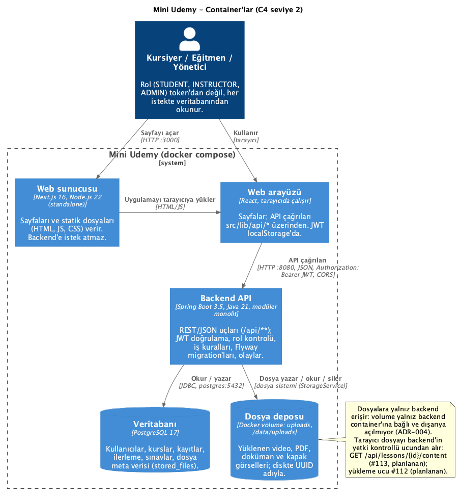
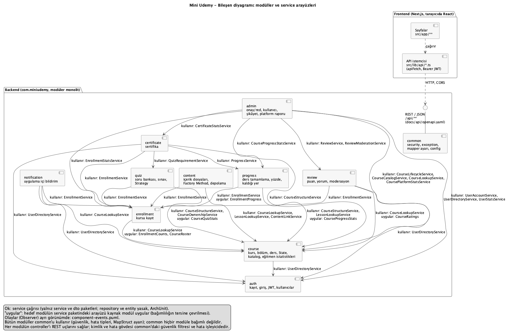
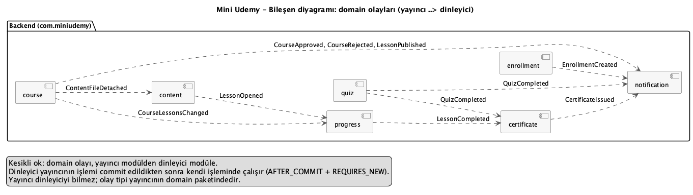
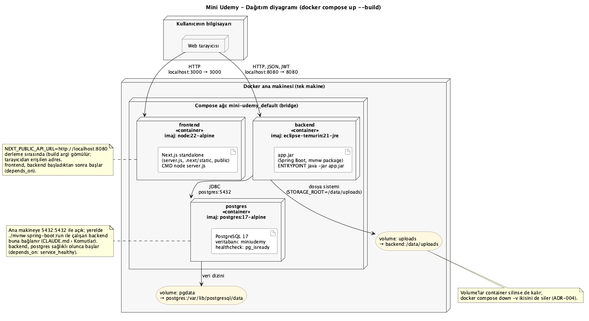
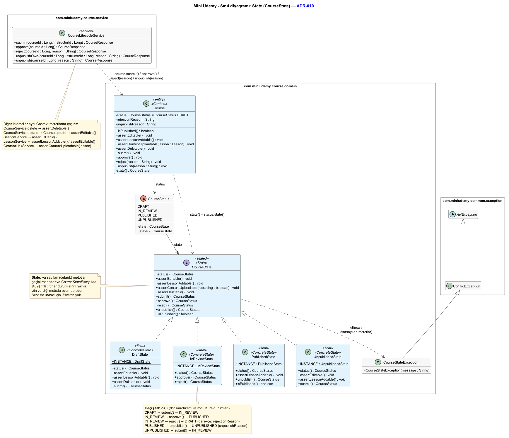
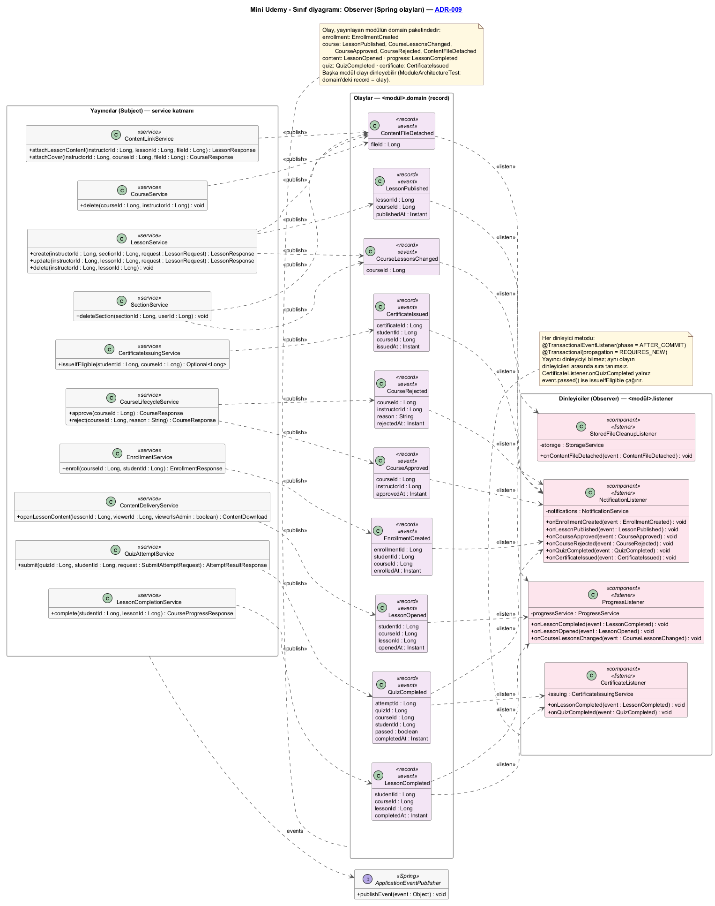
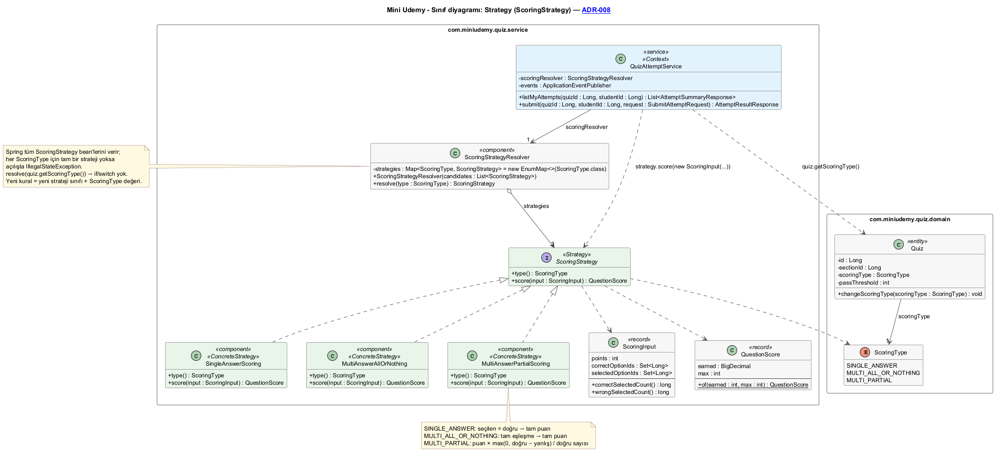
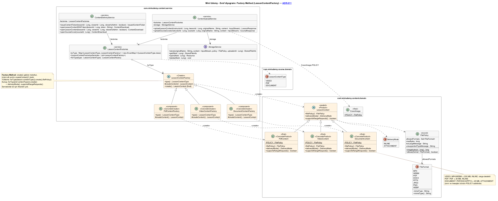
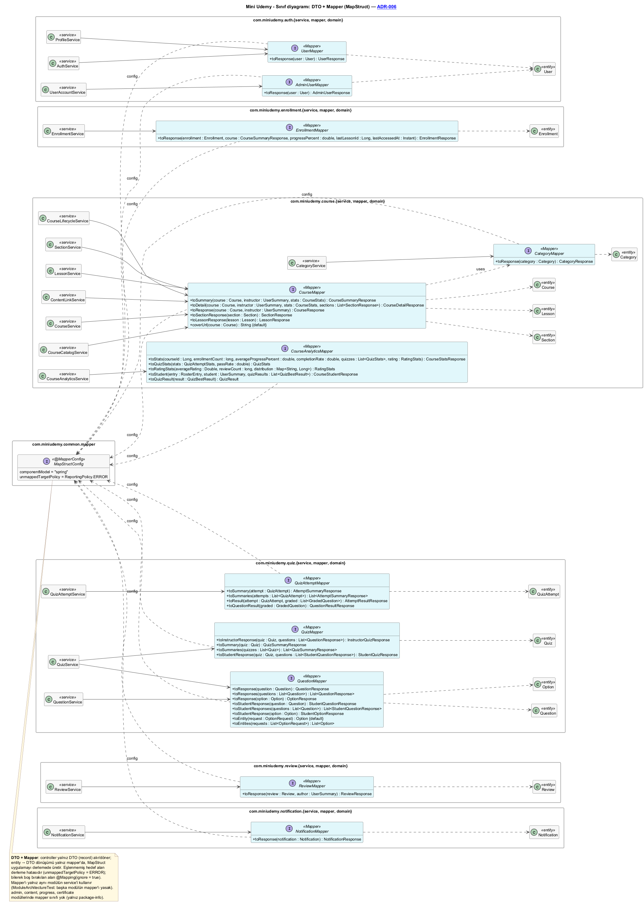

# Proje raporu — Bölüm 4 (taslak)

Hocanın Proje Yazım Şablonu'nun 4. bölümünün içeriği (#103). Word dosyasında birleştirme #69'da yapılır; bu dosya metnin kaynağıdır. Bölüm 1–3: [`bolum-1-3.md`](bolum-1-3.md).

**Veri tarihi:** 22.11.2026, `main` @ `86b9b6e`. Bu bölümdeki her iddianın kaynağı yanındaki kod yolu, ADR ya da testtir. Java yolları `backend/src/main/java/com/miniudemy/` altına, test yolları `backend/src/test/java/com/miniudemy/` altına göredir.

**Şablon numaraları:** 4.2 (sistem mimarisi), 4.3 (bileşen diyagramı), 4.4 (dağıtım) ve 4.6 (SOLID) issue'lardaki şablon atıflarından (#87, #91, #94, #95) alındı. 4.1, 4.5, 4.7, 4.8 ve 4.9'un sırası #103'ün başlığından (mimari, desenler, SOLID, API, güvenlik, mimari kararlar) çıkarıldı; Word şablonuyla birleştirirken (#69) kontrol edilecek.

---

## 4. Sistem tasarımı

### 4.1 Mimari yaklaşım

Backend **katmanlı bir modüler monolittir**: tek Spring Boot uygulaması, tek PostgreSQL veritabanı. Kod önce iş alanına (modül), sonra katmana göre paketlenir: `com.miniudemy.<modül>.<katman>` ([ADR-001](../docs/adr/0001-moduler-monolit.md)).

**Neden bu yaklaşım?** Proje tanım dokümanı bu yapıyı öneriyor. Dört kişilik ekip ve beş haftalık süre için mikroservislerin getirdiği dağıtım, servisler arası ağ iletişimi ve dağıtık veri tutarlılığı maliyeti, karşılığında bir fayda üretmezdi: tek bir kurs platformu, tek veritabanı ve tek demo ortamı var. Modül sınırları ise kodun büyürken dağılmasını önlüyor ve bir modülün ileride ayrı bir servise çıkarılmasını mümkün kılıyor.

| Değerlendirilen seçenek | Neden seçilmedi (ADR-001) |
|---|---|
| Mikroservisler | Ekip ve süre için dağıtım, servisler arası iletişim ve dağıtık tutarlılık maliyeti fazla; demo tek komutla kurulmalı (NFR-16). |
| Klasik katmanlı monolit (önce katman: `controller/`, `service/` …) | İş alanları katmanlara dağılır; bir modülün sınırı kodda görünmez, modüller arası bağımlılık denetlenemez. |
| Modüler monolit, modül bazlı paketleme | **Seçildi.** Tek dağıtım birimi, ama modül sınırları paket yapısında görünür ve testle denetlenir. |

**Modüller.** 10 iş modülü ve ortak altyapı `common`. Her modül proje dokümanındaki A–L modüllerinden birine ya da birkaçına karşılık gelir ([`docs/architecture.md`](../docs/architecture.md) › 2):

| Modül | Sorumluluk | Doküman |
|---|---|---|
| `auth` | Kayıt, giriş, JWT, parola yenileme, profil, roller | A |
| `course` | Kategori, kurs/bölüm/ders hiyerarşisi, kurs durumları, katalog ve arama, eğitmen istatistikleri | B, D, J |
| `content` | İçerik yükleme, içerik türleri, yerel depolama, yetki kontrollü servis | C |
| `enrollment` | Ücretsiz kayıt, kayıtlı kurslar, mükerrer kayıt engeli | E |
| `progress` | Ders tamamlama, ilerleme yüzdesi, kaldığı yerden devam | F |
| `quiz` | Soru bankası, bölüm sınavı, puanlama, deneme geçmişi | G |
| `certificate` | Doğrulama kodlu sertifika | H |
| `review` | Puan ve yorum | I |
| `notification` | Uygulama içi bildirimler (olay dinleyicileri) | L |
| `admin` | Onay/red/yayından kaldırma, kullanıcı ve kategori yönetimi, şikâyet, raporlar | K |
| `common` | Güvenlik altyapısı, hata yönetimi, ortak ayarlar; iş kuralı içermez, hiçbir modüle bağımlı değildir | – |

**Katmanlar.** Her modül aynı altı pakete ayrılır ve bağımlılık tek yönlüdür: **controller → service → repository**; hepsi `domain`'i kullanabilir; `dto` ve `mapper` controller–service sınırındadır. Controller yalnız DTO alır ve döner, iş kuralı içermez, repository'ye erişmez; iş kuralı ve işlem sınırı (`@Transactional`) service'tedir; `domain` hiçbir katmana bağımlı değildir (tek istisna ortak hata tipleri, ADR-010).

**Modüller arası iletişim yalnız iki yoldan** yapılır: diğer modülün `service` paketindeki public arayüz (senkron çağrı) ya da domain olayları (Observer, 4.5.2). Başka modülün `repository`'sine ve entity'sine erişilmez; modül sınırında yalnız id ya da DTO taşınır.

**Kurallar testle korunur.** Bu kurallar yazılı bir dokümanda kalmıyor; ArchUnit testleri CI'da her PR'da çalışır ve ihlal build'i kırar (`common/architecture/`, #86):

| Test | Denetlediği | Test sayısı |
|---|---|---|
| `LayerArchitectureTest` | Katman yönü; controller'ın repository'ye erişmemesi ve entity almaması/döndürmemesi; domain'in yalnız JPA, Java ve `common.exception`'a bağımlı olması | 7 |
| `ModuleArchitectureTest` | Başka modülden yalnız `service`, `dto`, olay ve enum kullanımı; izinli modül bağımlılıkları tablosu (`ALLOWED`); döngü yokluğu; `common`'un bağımsızlığı | 5 |
| `ObserverArchitectureTest` | Hiçbir service'in bir dinleyiciyi doğrudan çağırmaması | 1 |
| `ComponentDiagramTest` | Bileşen diyagramındaki okların koddaki bağımlılıklar ve dinleyicilerle birebir aynı olması (4.3) | 3 |

Son çalıştırmada 16 testin 16'sı geçti (`./mvnw clean verify`, 22.11.2026).

### 4.2 Sistem mimarisi

Sistem bağlamı (C4 seviye 1) 3.4.5'te verildi. Container diyagramı (C4 seviye 2) çalışan parçaları ve aralarındaki iletişimi gösterir:



| Container | Teknoloji | Sorumluluk | Konuştuğu |
|---|---|---|---|
| Web arayüzü | React 19, tarayıcıda | Sayfalar ve etkileşim; API çağrıları yalnız `frontend/src/lib/api/*` üzerinden | Backend API (REST/JSON, JWT) |
| Web sunucusu | Next.js 16 (Node.js 22) | Sayfaları ve statik dosyaları verir; backend'e istek atmaz | – |
| Backend API | Spring Boot 3.5, Java 21 | REST uçları, kimlik doğrulama, yetki, iş kuralları, olaylar, migration'lar | PostgreSQL (JDBC), dosya deposu |
| Veritabanı | PostgreSQL 17 | Kalıcı veri; şema yalnız Flyway migration'larıyla değişir (ADR-003) | – |
| Dosya deposu | Docker volume `uploads` | Video, PDF, doküman ve kapak görselleri; diskte UUID adıyla | Yalnız backend erişir (ADR-004) |

**Neden ayrı frontend?** Oynatıcı, sınav ve bildirim zili gibi etkileşimli ekranlar zaten yoğun istemci kodu gerektiriyordu. Ayrı bir React/Next.js uygulaması ile REST API arasındaki sınır OpenAPI sözleşmesiyle tanımlandı; iki taraf aynı sözleşmeye göre paralel geliştirildi ([ADR-005](../docs/adr/0005-ayri-frontend-rest-openapi.md)). Tarayıcı backend'e doğrudan istek atar (`NEXT_PUBLIC_API_URL`); backend yalnız izinli origin'den gelen isteklere CORS izni verir (`common/config/WebConfig`, `CORS_ALLOWED_ORIGINS`).

### 4.3 Bileşen diyagramı

Bileşen diyagramı modülleri, birbirlerinin hangi service sınıfını kullandıklarını ve hangi arayüzü uyguladıklarını gösterir. İkinci diyagram yalnız olay akışını (yayınlayan → dinleyen) verir.





**Bağımlılık yönü.** İzinli bağımlılıklar `docs/architecture.md` › 4'teki tabloda ve aynen `ModuleArchitectureTest.ALLOWED`'da kodludur. `auth` hiçbir modüle, `course` yalnız `auth`'a bağımlıdır; diğer modüller `course` ve `enrollment`'ı kullanır. `admin` en çok bağımlılığı olan modüldür, çünkü onay, kullanıcı yönetimi ve raporlar diğer modüllerin verisini birleştirir. Döngü yoktur.

**Döngüyü kıran arayüzler (Dependency Inversion).** Eğitmen paneli ve katalog `course` modülünde, ama kayıt, ilerleme, sınav ve puan verisi diğer modüllerde. `course` bu modülleri doğrudan çağırsaydı, onlar da `course`'a bağımlı olduğu için döngü oluşurdu. Bunun yerine `course` ihtiyaç duyduğu sorgu arayüzlerini kendi `service` paketinde tanımlar, diğer modüller uygular:

| Arayüz (`course/service`) | Uygulayan | Kullanıldığı yer |
|---|---|---|
| `EnrollmentCounts` | `enrollment/service/EnrollmentStatsService` | Katalogdaki kayıt sayısı; kursiyeri olan kursun silinmemesi |
| `CourseRoster` | `enrollment/service/EnrollmentRosterService` | Eğitmenin kursiyer listesi; yayından kaldırılan kursa erişim |
| `CourseProgressStats` | `progress/service/CourseProgressStatsService` | Ortalama ilerleme, ilerleme dağılımı |
| `CourseQuizStats` | `quiz/service/QuizStatsService` | Sınav başarı oranları |
| `CourseRatings` | `review/service/ReviewStatsService` | Ortalama puan, puan filtresi, puan dağılımı |

Aynı kalıp `common` için de kullanıldı: güvenlik filtresi kullanıcının güncel durumunu `common/security/AccountLookup` arayüzünden sorar, `auth/service/AccountLookupService` uygular. Böylece `common` hiçbir modüle bağımlı olmaz.

**Diyagram ile kodun tutarlılığı testle denetlenir.** `ComponentDiagramTest` diyagramın kaynak dosyasını (`component.puml`, `component-events.puml`) okur ve bağımlılık oklarının `ModuleArchitectureTest.ALLOWED` ile, olay oklarının koddaki `@TransactionalEventListener` metotlarıyla birebir aynı olduğunu doğrular. Kodda yeni bir bağımlılık ya da dinleyici eklenip diyagram güncellenmezse build kırılır. Bu kontrol bir kez işe yaradı: `certificate → auth` bağımlılığı #130 ile kodda eklenmiş, diyagram güncellenmemişti; #91'in PR'ında (#298) düzeltildi.

### 4.4 Dağıtım



Sistem tek komutla, tek makinede çalışır: `docker compose up --build` (NFR-16). `docker-compose.yml` ve iki Dockerfile diyagramla birebir aynıdır:

| Düğüm | İmaj | Port | Kalıcı veri |
|---|---|---|---|
| `postgres` | `postgres:17-alpine` | 5432 | Volume `pgdata` |
| `backend` | `backend/Dockerfile` (iki aşamalı: JDK'da Maven ile derleme, JRE'de çalıştırma) | 8080 | Volume `uploads` → `/data/uploads` |
| `frontend` | `frontend/Dockerfile` (Next.js `standalone` çıktısı) | 3000 | – |

Backend, veritabanı sağlık kontrolünü geçmeden başlamaz (`depends_on: condition: service_healthy`). Açılışta Flyway bekleyen migration'ları uygular, ardından Hibernate şemayı entity'lere karşı doğrular (`ddl-auto=validate`); uyuşmazlık varsa uygulama başlamaz (ADR-003). Demo ortamında `dev` profili açıktır: boş veritabanına seed verisi yüklenir (`common/seed/DemoSeedRunner`) ve parola yenileme bağlantısı e-posta yerine loga yazılır (#115). Temiz bir makinede ilk build yaklaşık 22 dakika, önbellekle 18 saniye sürdü (#68, #70).

### 4.5 Tasarım desenleri

Beş desen gerçek bir ihtiyaç için kullanıldı; her birinin gerekçesi ve değerlendirilen alternatifleri bir ADR'de, kuralları testtedir. Genel sınıf diyagramı 3.4.3'te; her desenin ayrıntılı diyagramı aşağıda.

#### 4.5.1 State — kurs yaşam döngüsü (ADR-010)

**Problem.** Kurs dört durumdan birindedir: Taslak, İncelemede, Yayımlandı, Yayından kaldırıldı. Hangi işlemin izinli olduğu duruma bağlıdır (FR-09, FR-10, FR-38): taslak düzenlenir ve silinir, incelemedeki kurs yalnız onaylanır ya da reddedilir, yayımlanmış kursa yalnız yeni ders eklenir. Bu kurallar servislerde `if/switch` olarak yazılsaydı her yeni işlem birden fazla servisi değiştirirdi ve kurallar dağılırdı.

**Çözüm.** `course/domain/CourseState` `sealed`, paket içi bir arayüzdür; dört durum sınıfı (`DraftState`, `InReviewState`, `PublishedState`, `UnpublishedState`) yedi işlemin (üç kontrol, dört geçiş) her birine kendi cevabını verir. Servis yalnız `course.submit()`, `course.approve()`, `course.assertEditable()` gibi iş metotlarını çağırır; izinsiz işlem `CourseStateException` (409) fırlatır. Veritabanında durum nesnesi değil `CourseStatus` enum'u saklanır; her enum sabiti kendi durum nesnesini bilir.



**Alternatifler (ADR-010).** Enum + `switch`: sınıf sayısı az, ama her işlem için ayrı bir `switch` ve kuralların dağılması. Enum sabitlerinde metot gövdeleri: kalıcılık değeri ile davranışı aynı türde karıştırır.

**Kanıt.** `CourseStateTest`, 4 durum × 7 işlemin 28 birleşiminin tamamını parametreli testle denetler: izinli geçişte hedef durum, izinsizde 409 ve durumun değişmemesi.

#### 4.5.2 Observer — domain olayları (ADR-009)

**Problem.** Bir işin birden fazla modülde tepkisi var. Ders tamamlanınca ilerleme yüzdesi güncellenir ve sertifika koşulu kontrol edilir; kursa kayıt olunca eğitmene bildirim gider. Yayınlayan modül bu tepkileri doğrudan çağırsaydı `progress`, `certificate` ve `notification`'a bağımlı olur, modüller arası döngü oluşurdu.

**Çözüm.** Olay tipleri yayınlayan modülün `domain` paketinde Java `record`'tur (10 olay: `EnrollmentCreated`, `LessonPublished`, `CourseApproved`, `CourseRejected`, `LessonCompleted`, `QuizCompleted`, `LessonOpened`, `CourseLessonsChanged`, `ContentFileDetached`, `CertificateIssued`). Service olayı `ApplicationEventPublisher` ile yayınlar. Dinleyiciler `listener` paketindedir ve `@TransactionalEventListener(phase = AFTER_COMMIT)` kullanır: olay yalnız işlem commit edilince teslim edilir, rollback olursa hiç teslim edilmez. Veritabanına yazan dinleyici kendi işlemini açar (`REQUIRES_NEW`); dinleyicideki bir hata yayınlayanın işini geri almaz.



Olaydan bildirime kadar örnek akış 3.4.4'teki sertifika sekans diyagramındadır.

**Alternatifler (ADR-009).** Doğrudan servis çağrısı (bağımlılık ve döngü), mesaj kuyruğu (RabbitMQ/Kafka; tek uygulamada gereksiz altyapı), işlem fazı olmayan `@EventListener` (rollback olan işin olayı da teslim edilir), `@Async` dinleyiciler (sıra ve hata yönetimi zorlaşır; ihtiyaç yok).

**Kanıt.** `ObserverArchitectureTest` hiçbir service'in dinleyiciyi çağırmadığını; `EnrollmentCreatedDeliveryTest` ve `LessonCompletedDeliveryTest` olayın yalnız commit'ten sonra teslim edildiğini; `NotificationScenarioIT` altı bildirim olayını uçtan uca gerçek PostgreSQL'de gösterir.

#### 4.5.3 Strategy — sınav puanlama (ADR-008)

**Problem.** Sınavın puanlama kuralı türüne göre değişir: tek doğru cevap, çoklu cevapta hep-ya-hiç, çoklu cevapta kısmi puan. Kurallar servis içinde `if/switch` ile yazılsaydı her yeni kural servisi değiştirirdi (Open/Closed'a aykırı).

**Çözüm.** `quiz/service/ScoringStrategy` arayüzünün üç uygulaması vardır: `SingleAnswerScoring`, `MultiAnswerAllOrNothing`, `MultiAnswerPartialScoring`. `ScoringStrategyResolver` sınavın `scoringType`'ına göre stratejiyi bir eşleme tablosundan seçer; seçimde `if/switch` yoktur. Bir tür için strateji eksikse uygulama açılırken hata verir. Stratejiler entity değil sade değer tipleri (`ScoringInput`, `QuestionScore`) alır; JPA'ya bağımlı değildir ve tek başına test edilir.



**Alternatifler (ADR-008).** Serviste `if/switch` (yeni kural servisi değiştirir); tek sınıfta mod bayrağı (kurallar tek sınıfta karışır).

**Kanıt.** Her stratejinin kendi birim testi ve servisin strateji seçimi testleri (#56, PR #248); sınav çözme akışı 3.4.4'teki sekans diyagramında.

#### 4.5.4 Factory Method — ders içerik türleri (ADR-011)

**Problem.** Video, PDF ve doküman derslerinin kuralları farklıdır: kabul edilen dosya biçimi, boyut sınırı (video 200 MB, PDF ve doküman 20 MB), sunuluş (tarayıcıda açma ya da indirme) ve ileri sarma desteği. Bu farklar yükleme ve sunum kodunda `switch` olarak dağılsaydı yeni bir içerik türü birçok yeri değiştirirdi.

**Çözüm.** Yaratıcı soyut `LessonContentFactory`'nin factory method'u `createContent()`'tir; her türün fabrikası (`VideoContentFactory`, `PdfContentFactory`, `DocumentContentFactory`) kendi ürününü (`VideoContent`, `PdfContent`, `DocumentContent`) üretir. Ürün `filePolicy()` (biçimler, sınır, 413/415 mesajları), `deliveryMode()` ve `supportsRangeRequests()` verir. Tür → fabrika seçimi `content/service/LessonContentFactories`'te bir eşlemeyle yapılır. Yükleme servisi yalnız `filePolicy()`'yi, sunum yalnız sunuluşu kullanır; depolama türleri bilmez.



**Alternatifler (ADR-011).** Tek sınıfta `switch` (her yeni tür birden fazla yeri değiştirir); Abstract Factory (bir türün birlikte değişen birden fazla nesnesi olsaydı uygundu; burada tek ürün var).

**Kanıt.** Dosya türü içerikten (ilk baytlar) belirlenir: `content/service/FileFormatDetector`. Uzantısı `.mp4` olan çalıştırılabilir dosya 415 alır, sınırı aşan dosya 413 (`FileFormatDetectorTest`, `ContentUploadIT`). Bunlar Bölüm 6'nın dosya denetimi testleridir.

#### 4.5.5 DTO + Mapper (ADR-006)

**Problem.** Entity'ler API'ye çıkarsa veritabanı şeması API sözleşmesine sızar: iç alanlar (parola özeti gibi) yanlışlıkla dışarı çıkabilir, şema değişikliği istemciyi bozar.

**Çözüm.** API'nin istek ve yanıt tipleri her modülün `dto` paketinde Java `record`'tur. Dönüşüm yalnız `mapper` paketindeki **MapStruct** arayüzlerinde yapılır; ortak ayar `common/mapper/MapStructConfig`'tedir: `unmappedTargetPolicy = ERROR`. Yanıt DTO'sundaki bir alanın kaynağı bulunamazsa derleme durur; alan bilerek boş bırakılacaksa açıkça yazılır.



**Alternatifler (ADR-006).** Elle yazılmış mapper (tekrar eden kod; yeni alan unutulursa sessizce eksik kalır); ModelMapper (çalışma anında yansıma; hata derlemede değil çalışırken çıkar).

**Kanıt.** `LayerArchitectureTest`, hiçbir controller metodunun entity almadığını ya da döndürmediğini (generic tipler dahil) denetler.

### 4.6 SOLID ve nesne yönelimli tasarım

Her ilkenin kodda nerede uygulandığı, kod parçalarıyla birlikte [`docs/solid.md`](../docs/solid.md)'dedir (#95). Özet:

| İlke | Kodda | Nasıl |
|---|---|---|
| **S** — Tek sorumluluk | `CourseMapper`, `NotificationListener`, `content/service/StorageService` | Mapper yalnız dönüştürür; dinleyici olayı yalnız servise iletir; depolama dosya türünü bilmez, yalnız verilen kuralı (`FilePolicy`) uygular. |
| **O** — Açık/kapalı | `ScoringStrategyResolver`, `LessonContentFactories` | Yeni puanlama kuralı ya da içerik türü yeni bir sınıftır; seçim kodu değişmez. |
| **L** — Liskov | `CourseState` + 4 durum; `LessonContent` + 3 ürün | Her durum ve ürün aynı sözleşmeyle birbirinin yerine geçer; çağıran hangisi olduğunu bilmez. |
| **I** — Arayüz ayrımı | `CourseRoster`, `EnrollmentCounts`, `CourseProgressStats`, `CourseQuizStats`, `CourseRatings` | Tek bir "istatistik servisi" yerine beş dar arayüz; her uygulayıcı yalnız kendi verisini sağlar. |
| **D** — Bağımlılığı tersine çevirme | 4.3'teki arayüzler, `AccountLookup`, `EnrollmentProgress`, `StorageService` | Arayüz onu kullanan modülde, uygulama veriyi sahiplenen modülde; bağımlılık yönü tek ve döngüsüz. |

**Nesne yönelimli kavramlar.**
- **Kapsülleme:** kursun durumu yalnız iş metotlarıyla değişir (`Course.submit()` …); `CourseState` paket içidir, dışarıdan durum nesnesi verilemez.
- **Çok biçimlilik:** aynı çağrı nesneye göre farklı davranır: `state().submit()`, `strategy.score(...)`, `content.filePolicy()`.
- **Kalıtım ve soyutlama:** `LessonContentFactory.create()` şablon metottur; `CourseState` ve `LessonContent` `sealed` hiyerarşilerdir, izinli alt sınıflar derleyicide sabittir.

**Bilinçli ödünleşimler** (solid.md › Bilinçli ödünleşimler):
- **Görünürlük kuralı iki yerde:** State desenine rağmen katalog sorgusu "yalnız Yayımlandı" filtresini SQL'de ayrıca uygular.
- **Strategy tam kapalı değil:** yeni bir puanlama türü yeni strateji sınıfının yanında `ScoringType` enum'una, veritabanı CHECK kısıtına (yeni migration) ve OpenAPI'ye bir değer ekler. Bunlar puanlama mantığı değil, saklanan değerin sözleşmesidir.
- **Tek dinleyici sınıfı:** `NotificationListener` altı olayı tek sınıfta dinler. Altı metodun hepsi aynı işi yapar ve sınıfın değişme nedeni tektir.

### 4.7 API tasarımı

API REST + JSON'dur ve **önce sözleşme** ilkesiyle geliştirildi: bir uç kodlanmadan önce [`docs/api/openapi.yaml`](../docs/api/openapi.yaml)'a yazılır; uç değişirse sözleşme aynı PR'da güncellenir (ADR-005, NFR-15).

| Ölçü | Değer (sözleşmeden) |
|---|---|
| Yol (path) | 58 |
| İşlem (yöntem + yol) | 74 |
| Etiket (kaynak grubu) | 17: Auth, Users, Categories, Catalog, Courses, Sections, Lessons, Content, Enrollments, Progress, Quizzes, Certificates, Reviews, Complaints, Notifications, Instructor, Admin |
| Kimliksiz işlem (`security: []`) | 10 |

Koddaki `@GetMapping`/`@PostMapping`/`@PutMapping`/`@PatchMapping`/`@DeleteMapping` sayısı da 74'tür.

**Kurallar** (`CLAUDE.md` › İsimlendirme):
- **Kaynak adları:** `/api/` altında, çoğul ve kebab-case (`/api/courses/{id}/sections`).
- **Önekler:** kullanıcının kendi kaynakları `/api/me/...`, yönetici uçları `/api/admin/...`, eğitmen uçları `/api/instructor/...`.
- **JSON:** alanlar camelCase. Anlam HTTP yöntemi ve durum koduyla taşınır: oluşturma 201, gövdesiz başarı 204, kabul edilen ama hemen yürütülmeyen istek 202 (parola yenileme isteği).
- **Sayfalama:** liste döndüren uçlar `page`/`size` alır; `size` en fazla 100, daha büyüğü 400 (NFR-01).

**Tek hata gövdesi.** Bütün hatalar aynı biçimde döner:

```json
{ "status": 409, "message": "Bu kursa zaten kayıtlısınız.", "errors": { "alan": "mesaj" } }
```

Service katmanı `common/exception`'daki istisnalardan birini fırlatır: `BadRequestException` 400, `UnauthorizedException` 401, `ForbiddenException` 403, `NotFoundException` 404, `ConflictException` 409, `PayloadTooLargeException` 413, `UnsupportedMediaTypeException` 415. Global handler bunları ve Spring'in kendi hatalarını (bozuk JSON, yanlış yöntem, beklenmeyen hata) bu gövdeye çevirir; mesaj kullanıcıya gösterilebilir Türkçe bir cümledir, stack trace içermez (#11). Alan hataları formdaki sırayla döner; ön yüz mesajı ilgili alanın altında gösterir.

**Ön yüz tarafı.** Sayfalar `fetch`'i doğrudan çağırmaz; bütün istekler `frontend/src/lib/api/client.ts`'teki `apiFetch` ve modül başına `lib/api/<modül>.ts` dosyalarından geçer. Tipler sözleşmedeki şemalardan yazılır.

**Sınır:** sözleşme ile kodun yol yol otomatik karşılaştırılması (#66) yapılmadı. Tutarlılık PR incelemelerinde elle ve yukarıdaki sayı eşitliğiyle denetlendi.

### 4.8 Güvenlik, yetkilendirme ve dosya erişimi

**Kimlik doğrulama** ([ADR-002](../docs/adr/0002-jwt-stateless-kimlik-dogrulama.md)). Sunucuda oturum tutulmaz.
- **Token:** girişte HS256 ile imzalı, 1 saat geçerli bir JWT verilir; `Authorization: Bearer` başlığında taşınır. Doğrulamayı Spring Security'nin resource-server modülü yapar (imza ve süre).
- **Kimlik ve rol veritabanından:** imza geçerliyse `JwtAccountAuthenticationConverter` kullanıcının güncel durumunu `AccountLookup` üzerinden sorar. Silinmiş kullanıcı 401, pasif kullanıcı 403 alır. Rol token'daki claim'den değil veritabanından okunur; rolü düşürülen ya da pasifleştirilen kullanıcının eski token'ı hemen çalışmaz.
- **Parolalar:** BCrypt ile saklanır (8–72 karakter; BCrypt'in 72 bayt sınırı serviste denetlenir).
- **Parola yenileme token'ı:** 32 bayt rastgele değer; veritabanında yalnız SHA-256 özeti tutulur; 30 dakika geçerli ve tek kullanımlıktır (#115).

**Yetkilendirme üç katmanda yapılır** (`docs/architecture.md` › Yetki kontrolleri):

| Soru | Nerede | Örnek |
|---|---|---|
| Kimlik var mı? | Güvenlik filtresi | Token yoksa ya da geçersizse 401; herkese açık uçlar `SecurityConfig.PUBLIC_GET`/`PUBLIC_POST` listesinde ve sözleşmede `security: []` |
| Rol uygun mu? | Adres kuralı ve controller | `/api/admin/**` yalnız ADMIN, `/api/instructor/**` yalnız INSTRUCTOR; diğer uçlarda `@PreAuthorize("hasRole('…')")` |
| Kaynak bu kullanıcının mı? | Service (iş kuralı) | Kurs bu eğitmenin değilse `ForbiddenException`; kullanıcı id'si controller'dan `CurrentUser.id(...)` ile gelir |

**Kanıt.** `AccessMatrixIT`, sözleşmedeki uçları roller × uçlar matrisinde gerçek PostgreSQL'e karşı dener (122 kontrol): girişsiz 401, yanlış rol 403, sözleşmede yazan kural kodla aynı. Bölüm 6'nın dört kritik durumu (kayıtsız erişim, mükerrer kayıt, yetkisiz düzenleme, yanlış ilerleme hesabı) `Bolum6CriticalCasesIT`'tedir; bu testler silinmez ve devre dışı bırakılmaz.

**Dosya yükleme ve erişim** ([ADR-004](../docs/adr/0004-yerel-dosya-depolama.md), [ADR-012](../docs/adr/0012-icerik-token.md)).
- **Tür ve boyut:** tür dosyanın ilk baytlarından belirlenir, uzantıya güvenilmez; boyut akış okunurken sayılır, istemcinin bildirdiği değere güvenilmez.
- **Diske yazma:**
  - dosya önce geçici klasöre yazılır, denetimler geçince kalıcı adına atomik taşınır;
  - diskteki ad sunucunun ürettiği UUID'dir, kullanıcının verdiği ad yol olarak kullanılmaz (`content/service/LocalDiskStorageService`);
  - veritabanı kaydı başarısız olursa dosya da silinir;
  - kullanılan bir dosya silinmek istenirse silme önce veritabanına gönderilir, ret gelirse diske dokunulmaz (#201'de gerçek veritabanında bulunan hata).
- **Sunum:** dosyalar yalnız backend üzerinden verilir. İçerik ucu her istekte kaydı ya da sahipliği sorar: kayıtlı kursiyer, kursun eğitmeni ve yönetici açar, diğerlerine 403.
- **Ders içeriği token'ı:** tarayıcı `<video>` ve bağlantı isteklerine `Authorization` başlığı ekleyemediği için içerik adresi 5 dakika geçerli, kullanıcıya ve derse özel ayrı bir token taşır. Bu token yalnız o dersin içeriğini açar, API'de geçmez (`common/security/ContentTokens`). Ana JWT adreste taşınmaz.

**Tarayıcı tarafı.**
- **XSS:** asıl koruma React'in kaçışlaması ve `dangerouslySetInnerHTML` yasağıdır (`react/no-danger` lint kuralı). Content-Security-Policy dış betiği ve başka sitelere istek atılmasını engelleyen ikinci katmandır.
- **CSP sınırı:** Next.js'in satır içi betikleri nedeniyle nonce'suz biçimde uygulandı ([ADR-007](../docs/adr/0007-csp-nonce-suz.md)).
- **Giriş sonrası yönlendirme:** yalnız site içi yollar kabul edilir; sekme ve satır sonuyla yapılan açık yönlendirme denemesi engellendi (#199).
- **Parolanın bellekte kalması:** başarılı giriş ve kayıttan sonra parola alanı temizlenir (#306).

**Bilinen sınırlar.**
- **XSS riskinde token:** JWT `localStorage`'da durduğu için bir XSS açığı token'ı okuyabilir. Bu risk ADR-002'de kabul edildi, yukarıdaki önlemlerle azaltıldı.
- **Token yenileme yok:** refresh token ve çıkışta sunucu tarafı iptal yok; süre 1 saat, pasifleştirme her istekte denetlenir.
- **İstek sınırı yok:** giriş denemelerinde istek sınırlama (rate limiting) yok.
- **HTTPS yok:** demo HTTP ile çalışır.

### 4.9 Mimari kararlar

Önemli her karar bir mimari karar kaydında (ADR) bağlam, karar, değerlendirilen alternatifler ve sonuçlarla yazıldı ([`docs/adr/`](../docs/adr/README.md)). Kabul edilmiş bir ADR'nin kararı sonradan değiştirilmez; karar değişirse yeni bir ADR yazılır, eskisi "Yerine geçildi" olur (ADR README › Değişmezlik). 12 ADR'nin hepsi "Kabul edildi" durumundadır.

| ADR | Karar | Başlıca alternatif | Değerlendirme (22.11) |
|---|---|---|---|
| 001 | Katmanlı modüler monolit, modül bazlı paketleme | Mikroservisler; katman bazlı paketleme | Tuttu. 10 modül ve izinli bağımlılıklar ArchUnit ile korunuyor; döngü çıkmadı, gerektiğinde arayüzle tersine çevrildi (4.3). |
| 002 | JWT ile stateless kimlik doğrulama; rol her istekte veritabanından | Sunucu oturumu + çerez; harici kimlik sağlayıcı | Tuttu. Ayrı origin'deki frontend için CSRF ve çerez ayarı gerekmedi. Bedeli 4.8'deki sınırlar (localStorage, iptal yok). |
| 003 | Flyway, zaman damgalı migration, `ddl-auto=validate` | Hibernate `update`; Liquibase | Tuttu. Zaman damgalı adlar paralel branch'lerde sıra numarası çakışmasını önlüyor; şema–entity uyuşmazlığı açılışta yakalanıyor. |
| 004 | Dosyalar Docker volume'da, yalnız backend üzerinden yetkiyle | MinIO/S3; statik dosya sunucusu | Tuttu. Tek komutla demo korundu. Ek kararla (#202) tür tespiti için Tika yerine kendi `FileFormatDetector`'ımız kullanıldı. |
| 005 | Ayrı Next.js frontend, REST, önce OpenAPI | Thymeleaf; GraphQL | Tuttu. Frontend ve backend sözleşmeye göre paralel ilerledi. Eksik: yol yol otomatik karşılaştırma (#66). |
| 006 | DTO + MapStruct, eşlenmemiş alan derleme hatası | Elle mapper; ModelMapper | Tuttu. Sözleşmeye eklenip eşlenmeyen alan derlemede yakalanıyor. |
| 007 | Nonce'suz CSP (`'unsafe-inline'`) | SRI; nonce | Ölçülerek seçildi: SRI uygulamayı çalıştırmadı, nonce `cacheComponents` ile uyumsuz. Kalan risk kayıtlı. |
| 008 | Strategy ile puanlama | Serviste `switch`; mod bayrağı | Tuttu. Üç kural ayrı test ediliyor; yeni kural için gereken ek adımlar 4.6'da. |
| 009 | Spring olayları, AFTER_COMMIT, senkron teslim | Doğrudan çağrı; mesaj kuyruğu; `@Async` | Tuttu. 10 olay, 3 dinleyen modül; rollback olan işin olayı teslim edilmiyor. Eşzamanlı iki olayda tek sertifika için ayrıca atomik ekleme (`ON CONFLICT DO NOTHING`) gerekti. |
| 010 | State ile kurs durumu, `sealed` arayüz | Enum + `switch` | Tuttu. #25 ile yedinci işlem ("ders ekle") eklendi; değişiklik yalnız durum sınıflarında kaldı, test tablosu 28 birleşime çıktı. |
| 011 | Factory Method ile içerik türleri | Tek sınıfta `switch`; Abstract Factory | Tuttu. Kapak görseli de aynı `FilePolicy` sözleşmesiyle tanımlandı. |
| 012 | Derse özel, 5 dakikalık içerik token'ı | Blob adresi; ana JWT'yi adreste taşımak | Tuttu. 160 MB videoda ileri sarma çalıştı (206); süre dolunca oynatıcı yeni token alıp kaldığı saniyeden devam ediyor (#45). |

**Kalite kanıtı.**
- **Test sayıları:** son ölçümde 1188 test, 0 hata: 993 birim, 13 mimari, 182 entegrasyon (gerçek PostgreSQL 17, Testcontainers). Ayrıntı [`docs/test-report.md`](../docs/test-report.md)'de.
- **Coverage:** servis katmanında satır coverage'ı %98,4 (19.11 ölçümü).
- **CI:** her PR'da backend derleme ve bütün testler, frontend lint ve build çalışır; kırmızı CI ile merge yapılmaz.
