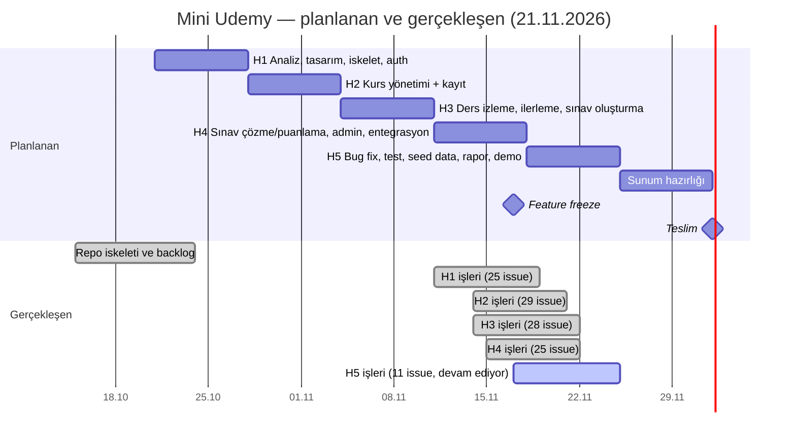

# Proje raporu — Bölüm 5–8 (taslak)

Hocanın Proje Yazım Şablonu'nun 5–8. bölümlerinin içeriği (#104). Word dosyasında birleştirme #69'da yapılır; bu dosya metnin kaynağıdır. Ayrıntılı tablolar repodaki dokümanlarda; burada rapora girecek özetleri var.

**Veri tarihi:** 23.11.2026 (ilk taslak 19.11). ⟨…⟩ ile işaretli yerler bug bash (#68), test raporu (#99) ve demo provası (#106) bitince doldurulacak; son güncelleme 01.12.2026'dan önce.

---

## 5. Açıklayıcı sözlük

| Terim | Açıklama |
|---|---|
| ADR (Architecture Decision Record) | Bir mimari kararın bağlamını, seçeneklerini ve sonucunu kaydeden kısa doküman (`docs/adr/`, 12 adet). |
| AFTER_COMMIT | Bir olayın dinleyiciye yalnız veritabanı işlemi başarıyla bittikten sonra iletilmesi. Geri alınan işlemden olay çıkmaz. |
| API (Uygulama Programlama Arayüzü) | Frontend'in backend'le konuştuğu HTTP uçları. Sözleşmesi `docs/api/openapi.yaml`'da. |
| ArchUnit | Mimari kuralları (katman yönü, modül sınırları) birim testi gibi denetleyen kütüphane. |
| Bug bash | Ekibin belirli bir sürede uygulamayı elle, kontrol listesiyle denemesi (#68). |
| CI (Sürekli Entegrasyon) | Her PR'da derleme ve testlerin otomatik çalışması (GitHub Actions). |
| Coverage (kod kapsamı) | Testlerin çalıştırdığı kod satırı ve dalı oranı; JaCoCo ile ölçülür. |
| Domain olayı | Sistemde olan bir şeyin kaydı (ör. `EnrollmentCreated`: kursa kayıt oldu). Projede 10 olay var. |
| DTO (Veri Aktarım Nesnesi) | API'de dışarı verilen ve dışarıdan alınan veri biçimi. Veritabanı nesneleri (entity) dışarı çıkmaz. |
| Entity | Veritabanındaki bir tabloya karşılık gelen sınıf (ör. `Course`). |
| Factory Method | Nesnenin hangi sınıftan üretileceğine alt sınıfların karar verdiği tasarım deseni. Projede ders içerik türleri (video, PDF, doküman). |
| Feature freeze | Yeni özellik eklemenin durduğu tarih (17.11.2026); sonrasında yalnız hata düzeltme, test ve dokümantasyon. |
| Flyway | Veritabanı şemasını sürümlü SQL dosyalarıyla (migration) kuran araç. |
| FR / NFR | Fonksiyonel gereksinim (sistemin ne yaptığı, 44 adet) / fonksiyonel olmayan gereksinim (nasıl yaptığı: güvenlik, performans; 19 adet). |
| İçerik token'ı | Video ve PDF etiketlerinin kullandığı, 5 dakika geçerli, tek derse bağlı kısa ömürlü erişim anahtarı (ADR-012). |
| Kabul kriteri | Bir işin bitmiş sayılması için sağlanması gereken, test edilebilir koşul. |
| JWT (JSON Web Token) | Girişten sonra verilen, kullanıcının kimliğini ve rolünü taşıyan imzalı anahtar. |
| MapStruct | Entity ↔ DTO dönüşüm kodunu derleme sırasında üreten kütüphane. |
| Milestone / Sprint | Bir haftalık çalışma dönemi ve o dönemde bitirilecek işler. |
| Modüler monolit | Tek uygulama olarak çalışan ama birbirine yalnız tanımlı arayüzlerle erişen modüllere bölünmüş mimari. Projede 10 modül. |
| Observer | Bir olay olduğunda ilgili dinleyicilerin, yayıncı onları tanımadan haberdar edildiği desen. |
| OpenAPI | REST API'nin uçlarını, isteklerini ve yanıtlarını tanımlayan standart biçim. |
| P1 / P2 / P3 | Öncelik: P1 zorunlu, P2 önemli, P3 kapsam dışı (zaman kalırsa). |
| PR (Pull Request) | Bir değişikliğin ana dala (`main`) alınmadan önce incelendiği istek. |
| Range isteği (206) | Tarayıcının dosyanın yalnız bir parçasını istemesi; videoda ileri sarmayı sağlar. |
| REQUIRES_NEW | Dinleyicinin kendi yeni veritabanı işlemini açması; yayıncının işleminden bağımsız commit edilir. |
| Rol | Kullanıcı türü: kursiyer (STUDENT), eğitmen (INSTRUCTOR), yönetici (ADMIN). |
| Seed verisi | Demo ve elle test için uygulama ilk açılışta yüklenen örnek veri (hesaplar, kurslar, ilerleme). |
| State | Bir nesnenin davranışının içinde bulunduğu duruma göre değiştiği desen. Projede kurs durumları. |
| Strategy | Aynı işin farklı yöntemlerinin değiştirilebilir sınıflar olarak yazıldığı desen. Projede sınav puanlama türleri. |
| Testcontainers | Testlerde gerçek PostgreSQL'i Docker konteyneri olarak başlatan kütüphane. |
| Doğrulama kodu | Sertifikanın gerçekliğini kontrol etmek için verilen kod (ör. `K7Q2-M9XA-4T`). |
| WIP limiti | Bir kişinin aynı anda üzerinde çalışabileceği en fazla iş sayısı (2). |

---

## 6. Proje planı

Kaynak: [`docs/plan.md`](../docs/plan.md) (#82). Bu bölüm o dokümanın gerçekleşenle güncellenmiş özetidir.

### 6.1 Takvim ve fazlar

| Faz | Planlanan | Gerçekleşen (21.11.2026) |
|---|---|---|
| Analiz ve tasarım (Hafta 1) | 21–27.10 | Gereksinimler, use-case'ler, ER, OpenAPI ve mimari kurallar repo iskeletiyle birlikte 15–24.10'da hazırlandı; PR'larla `main`'e girişi 11–14.11 |
| Geliştirme (Hafta 2–4) | 28.10–17.11 | Kod 11–23.11 arasında geldi (174 PR; en yoğun gün 17.11, 32 PR). Feature freeze 17.11'de uygulandı; P2 işler "İnce" kapsamla sürdü, eksik ekranlar 20–21.11'de tamamlandı |
| Test ve kararlılık (Hafta 5) | 18–24.11 | Senaryo testleri, Bölüm 6 testleri, erişim matrisi, seed verisi ve izlenebilirlik matrisi 17–19.11'de; beş senaryonun temiz kurulumda ekranda yürünmesi 21.11'de (#70); bug bash ve test raporu ⟨24.11⟩ |
| Sunum hazırlığı | 25.11–01.12 | ⟨Word raporu, slaytlar, demo provası⟩ |

### 6.2 Gantt şeması

Planlanan milestone'lar ve gerçekleşen çalışma (PR ile kapanan issue'ların ilk ve son merge tarihi). Kaynak dosya: [`docs/diagrams/gantt.mmd`](../docs/diagrams/gantt.mmd); Word'e görüntü olarak eklenir.



**Yorum.** Plan bir haftalık sprint'lerle sıralı ilerlemeyi öngörüyordu; gerçekte ilk PR 11.11'de geldi ve Hafta 1–4'ün işleri 11–21.11 arasında paralel yapıldı. Takvim kayması (risk R1) gerçekleşti. Feature freeze tarihi korundu, ama kapsam 17.11'de yeniden belirlendi (6.5).

### 6.3 Planlanan ve gerçekleşen iş

| Milestone | Issue | Kapanan (23.11) | Kapanan (16.11) |
|---|---|---|---|
| Hafta 1 | 26 | 26 | 19 |
| Hafta 2 | 32 | 32 | 5 |
| Hafta 3 | 33 | 33 | 4 |
| Hafta 4 | 30 | 30 | 1 |
| Hafta 5 | 18 | 14 | 0 |
| Sunum | 7 | 1 | 0 |
| Milestone'suz (demo yürüyüşünde açılanlar) | 7 | 6 | – |
| **Toplam** | **153** | **142 (%93)** | **29** |

"Not planned" kapatılan 8 issue (kapsamdan çıkarılanlar) sayılmaz. Açık işlerin listesi `docs/plan.md` › 8'de.

### 6.4 Görev dağılımı

Roller `CONTRIBUTING.md` › Roller tablosundan; her issue'nun tek rol etiketi var.

| Üye | Rol | Kapanan issue (atanan) | Merge edilen PR | `main`'deki commit |
|---|---|---|---|---|
| Bertan | Yazılım Mimarı | 43 / 43 | 63 | 70 |
| Eray | Veri ve Entegrasyon | 40 / 41 | 40 | 40 |
| Veronika | Kalite ve Süreç | 29 / 32 | 41 | 41 |
| Sedat | Alan Tasarımcısı | 23 / 26 | 30 | 30 |
| Atanmamış | – | 7 / 11 | – | – |

**Git geçmişiyle tutarlılık.** `main` "Squash and merge" ile birleştirildiği için her PR tek commit'tir; PR ve commit sayıları bu yüzden birebir aynı. Tek fark Bertan'ın 7 commit'i: repo iskeleti ve backlog, PR kuralı konmadan önce (15–24.10) doğrudan `main`'e yazıldı. Komut: `git log --format='%an' main | sort | uniq -c`. ⟨Sayılar 01.12'de son kez alınacak.⟩

Rol dışı iş devri: `rol:alan`'daki #8 ve #9'u Sedat müsait olmadığı için Bertan yaptı; alan rolünün kalan işleri 17.11 kararıyla diğer üyelere dağıtıldı (risk R3, R10). 21.11'de demo yürüyüşünde açılan sınav ekranı işleri (#304, #58, #296) Eray'dan Bertan'a devredildi.

### 6.5 Risk analizi (özet)

Tam tablo `docs/plan.md` › 6'da. Gerçekleşen ve sonucu belli olan riskler:

| # | Risk | Sonuç |
|---|---|---|
| R1 | Takvim kayması | **Gerçekleşti.** İlk PR 11.11'de. 17.11'de feature freeze kararı: §3'te adı geçen hiçbir iş kesilmedi, P2'ler "İnce" kapsama alındı, 3 iş kesildi (#73, #88, #185). |
| R2 | Kritik yol bağımlılığı (auth zinciri) | Giderildi: auth zinciri 13–17.11'de kapandı. |
| R3, R10 | Üyenin müsait olmaması, alan rolünde iş yükü | Gerçekleşti; işler devredildi. Sedat 15.11'de döndü ve toplam 23 issue kapattı. |
| R5 | Testlerin yetişmemesi | Önlendi: `main`'de 1194 test, servis katmanında satır coverage'ı %98,2 (hedef %70). |
| R6 | Review'sız merge, doküman–kod tutarsızlığı | İki kez gerçekleşti: ilk 4 PR onaysız birleşti; 21.11'de iki dalgada 19 PR hızlı kontrol beklenmeden merge edildi ve merge sonrası kontrol edildi (3'ünde doküman ve kanıt eksiği bulundu, 16'sı temizdi). İzlenebilirlik matrisi (#98) ve diyagram–kod kontrolü (#97, 9 diyagramın 9'u; bileşen diyagramı CI'da `ComponentDiagramTest` ile) yapıldı. |
| R7 | Giriş ve parola yenileme denemelerinde sınır yok | Kabul edildi (yerel demo, kapsam dışı); bölüm 8.3'te gelecek çalışma. Parola yenilemede varlık sızmıyor (her e-postaya aynı 202), token yalnız özetiyle saklanıyor ve tek kullanımlık (#115) |
| R8 | Demo günü ortamın çalışmaması | 21.11'de temiz kurulumda (`docker compose down -v` + `up --build`) beş senaryo ekranda yüründü (#70); eksik çıkan ekranlar aynı gün tamamlandı. İlk build ~22 dk sürdüğü için sunum günü image'lar önceden build edilecek. ⟨Demo provası (#106) sonucu⟩ |

### 6.6 Bütçe

Ürünün lisans maliyeti **0 TL**: kullanılan bütün yazılımlar açık kaynak ya da eğitim kullanımında ücretsiz (liste 7.2'de). Uygulama yerelde Docker ile çalışır; sunucu ya da bulut maliyeti yoktur. Geliştirmede kullanılan Claude Code ücretli bir abonelik gerektirir; ürünün çalışması için gerekli değildir. Ayrıntı `docs/plan.md` › 7.

---

## 7. Projeye özgü içerik

### 7.1 Metodoloji

Proje, bir haftalık sprint'lerle yürütülen hafif bir Scrum uyarlamasıyla yapıldı. Kurallar `CONTRIBUTING.md`'de:

- **Planlama:** Her pazartesi o haftanın milestone'undaki issue'lar GitHub Project board'unda "Bu Hafta" kolonuna alınır. Kolonlar: Backlog → Bu Hafta → In Progress → Review → Done.
- **İş seçme:** Rol = kişi. Üye kendi rol etiketli işini alır, kendini atar ve kartı "In Progress"e taşır. Önce P1'ler; kişi başı en fazla 2 iş.
- **Branch ve PR:** `main`'e doğrudan push yok. Her iş `feature/#<no>-kisa-ad` dalında, `Closes #<no>` içeren bir PR ile gelir; PR açıklamasında "Ne / Neden" ve kabul kriteri → kanıt tablosu bulunur. Squash and merge.
- **Definition of Done:** CI yeşil, Kalite ve Süreç sorumlusunun hızlı kontrolü (CI, kanıt tablosu, açıklamanın kodla uyumu, OpenAPI/diyagram güncelliği), kabul kriterlerinin hepsi işaretli, kod değiştiyse diyagram ve OpenAPI aynı PR'da.
- **Takip:** Haftalık ilerleme raporları (`docs/progress/`), risk tablosu, feature freeze.
- **Yapay zekâ desteği:** Her üye Claude Code ile çalıştı (`docs/claude-code-workflow.md`). Kural: PR açıklamasındaki her teknik iddia kodla karşılaştırılır; üye kendi PR'ındaki kararları sunumda anlatabilmelidir (katkı notları `docs/katki/`).
- **Kırmızı kontrol:** Test issue'larında testin gerçekten hata yakaladığı, kod bilerek bozulup CI'da testin kırmızıya düştüğü görülerek kanıtlandı (sonra geri alındı). Bu yöntem 4 test açığı buldu (bkz. 7.5).

### 7.2 Kullanılan teknolojiler ve kütüphaneler

Sürümler `backend/pom.xml` ve `frontend/package.json`'dan (19.11.2026). Kütüphanelerin, araçların ve dış kaynakların lisanslarıyla tam listesi: [`docs/dependencies.md`](../docs/dependencies.md) (#100; sürümler araçla ölçüldü). Rapora bu tablo, ayrıntılı liste Ek olarak girer.

| Katman | Teknoloji | Sürüm | Kullanım | Lisans |
|---|---|---|---|---|
| Backend | Java | 21 | Dil | GPL + Classpath istisnası |
| | Spring Boot (Web, Validation, Data JPA, Security, OAuth2 Resource Server, Actuator) | 3.5.16 | Uygulama çatısı, REST, JWT doğrulama | Apache 2.0 |
| | Flyway (+ PostgreSQL eklentisi) | Spring Boot BOM | Migration'lar | Apache 2.0 |
| | MapStruct | 1.6.3 | DTO dönüşümü | Apache 2.0 |
| Veritabanı | PostgreSQL | 17 | İlişkisel veritabanı | PostgreSQL License |
| Frontend | Next.js | 16.4.6 | React çatısı, sayfa yönlendirme | MIT |
| | React, React DOM | 19.3.0 | Arayüz | MIT |
| | TypeScript, ESLint | 5, 9 | Tip denetimi, kod denetimi | Apache 2.0 / MIT |
| Test | JUnit 5, Mockito, AssertJ (`spring-boot-starter-test`), Spring Security Test | Spring Boot BOM | Birim ve controller testleri | EPL 2.0 / MIT / Apache 2.0 |
| | Testcontainers (PostgreSQL) | Spring Boot BOM | Gerçek veritabanıyla entegrasyon testleri | MIT |
| | ArchUnit | 1.4.1 | Mimari kural testleri | Apache 2.0 |
| | JaCoCo | 0.8.13 | Coverage ölçümü | EPL 2.0 |
| Çalıştırma | Docker, Docker Compose | – | Tek komutla kurulum | Apache 2.0 |
| Süreç | GitHub (Issues, Projects, Actions) | – | Repo, iş takibi, CI | Ücretsiz (açık repo) |
| Dokümantasyon | PlantUML, Mermaid | – | UML diyagramları, Gantt | Açık kaynak |

Frontend'e UI kütüphanesi, durum yönetimi kütüphanesi ya da otomatik UI testi eklenmedi (proje kuralı); bileşenler CSS modülleriyle yazıldı.

### 7.3 Erişilebilirlik

Uygulanan önlemler (kodda kontrol edildi, `frontend/src`):

- Sayfa dili `lang="tr"`; ekran okuyucular Türkçe okur.
- Form alanlarının hepsi etiketli (`<label>`, `aria-label`). Hatalı alan `aria-invalid` ile işaretlenir ve hata metni `aria-describedby` ile alana bağlanır.
- Yükleniyor, hata ve boş durumlar ortak bileşenlerle (#320): `Loading` (`role="status"`, `aria-live="polite"`), `ErrorMessage` (`role="alert"`, "Tekrar dene"), `EmptyState`. Önceden "yükleniyor" metinleri ekran okuyucuya duyurulmuyordu.
- Bölgeler ve gezinme etiketli: ders listesi `nav aria-label="Bölümler ve dersler"`, önceki/sonraki ders gezinmesi, katalog araması `role="search"`.
- Ders listesi aç/kapa düğmesi `aria-expanded` ve `aria-controls` taşır; puan yıldızları klavyeyle seçilebilir ve odak görünür (`:focus-visible`).
- Dekoratif öğeler `aria-hidden`, anlamlı görseller (`role="img"`) metinle açıklanır.
- Mobil uyumluluk (NFR-07, #321): 360 px'te sayfalarda yatay kaydırma yok; dar ya da dokunmatik ekranda düğme, form alanı ve tek başına duran bağlantılar ≥ 44 px (WCAG 2.5.5; cümle içi bağlantılar istisna). Önce/sonra betikle ölçüldü: iki sayfadaki taşma (205 px ve 5 px) giderildi. ⟨Bug bash'te (#68) tekrar⟩.
- Karanlık temada vurgu zeminli düğmelerin yazı rengi kontrast için ayrı değişkende (`--accent-fg`, #321).
- Bildirim zilinin ekran okuyucu etiketi okunmamış sayısını söyler ("Bildirimler, 7 okunmamış"); panel Esc ile kapanır ve odak zile döner (#323).

**Kısıt:** Resmî bir WCAG denetimi ve ekran okuyucuyla uçtan uca deneme yapılmadı; renk kontrastı araçla ölçülmedi (yalnız karanlık temadaki bilinen düğme sorunu düzeltildi). Bunlar bölüm 8.3'te gelecek çalışma olarak yazıldı.

### 7.4 Kullanım kılavuzu

**Kurulum.** Docker yeterlidir:

```bash
docker compose up --build
```

Frontend http://localhost:3000, backend http://localhost:8080. Veritabanı boşsa örnek veri (seed, #67) açılışta yüklenir: 10 kurs (7'si yayında), 5 kategori, her kursta video, PDF ve doküman dersleri ile en az bir bölüm sınavı (#337). Bütün demo hesaplarının parolası `Demo1234!`; aşağıdaki tablo seçilmiş hesaplar, tam liste README › Demo hesapları.

| Hesap | Rol | Durumu |
|---|---|---|
| `admin@miniudemy.dev` | Yönetici | Onay kuyruğunda "SQL ve Veritabanları"; şikâyetlerde Selin'in açık şikâyeti |
| `mehmet.kaya@miniudemy.dev` | Eğitmen | "Sıfırdan Python" ve "Pandas ile Veri Analizine Giriş" (yayında), "SQL ve Veritabanları" (incelemede), "Python 2 (eski)" (yayından kaldırılmış) |
| `zeynep.ak@miniudemy.dev` | Eğitmen | "Java ile Nesne Yönelimli Programlama", "Arayüz Tasarımının Temelleri", "Git ile Sürüm Kontrolü" (yayında), "Web Geliştirmeye Giriş" (reddedildi, gerekçeli) |
| `ece.yildiz@miniudemy.dev` | Eğitmen | "İş İngilizcesi: E-posta ve Toplantılar", "Scrum ile Çevik Proje Yönetimi" (yayında) |
| `ayse.yilmaz@miniudemy.dev` | Kursiyer | Python %100, sertifikalı (`K7Q2-M9XA-4T`) |
| `can.demir@miniudemy.dev` | Kursiyer | Python %67; kaldığı yer "Fonksiyon Tanımlama" |
| `elif.sahin@miniudemy.dev` | Kursiyer | Python %50; giriş sınavından kaldı |
| `deniz.arslan@miniudemy.dev` | Kursiyer | Python'a kayıtlı, hiç başlamadı |

**Kursiyer olarak**

1. Ana sayfada (`/`) kursları arayın; kategori, seviye ve en az puana göre süzün (deneyin: "4 ve üzeri" → 5 kurs). Yalnız yayımlanmış kurslar görünür.
2. Bir kursa tıklayın: açıklama, kazanımlar, bölüm/ders listesi, toplam süre ve değerlendirmeler görünür.
3. Giriş yapmadıysanız "Kayıt ol" sizi giriş sayfasına götürür; yeni hesap için `/register`. Giriş yaptıysanız "Kursa kayıt ol"; düğme "Derse başla"ya döner.
4. "Kurslarım"da (`/my-courses`) her kursta "Son ders: … · %… tamamlandı" yazar; "Kaldığın yerden devam et" son açtığınız derse götürür (deneyin: `can.demir@…` → "Fonksiyon Tanımlama"). Aynı düğme kurs sayfasında da var.
5. Ders sayfasında (`/learn/...`) PDF okunur, video oynatılır ve ileri sarılır; "Önceki / Sonraki" ile dersler arasında gezilir. Dersi bitirince "Tamamlandı olarak işaretle": sol listede ders tiklenir, bölüm ve kurs ilerleme çubukları güncellenir. Kayıtsız bir hesap aynı adreste "Bu derse erişmek için kursa kaydolun." uyarısını görür.
6. Sınavlar ders listesinde bölümün altında ("📝 … · Zorunlu"). Cevapları gönderin: puan, yüzde, geçti/kaldı ve soru bazında sonuç. Kalınca "Tekrar dene", geçince "Kursa dön"; önceki denemeler "Deneme geçmişim"de (deneyin: `elif.sahin@…`).
7. Zorunlu dersler ve sınavlar bitince sertifika kendiliğinden oluşur: "Kurslarım" → "Sertifikalarım" (`/certificates`) → sertifika → "Yazdır". Sertifikada doğrulama kodu ve "resmî akreditasyon değildir" ibaresi var (deneyin: `ayse.yilmaz@…`).
8. Sertifikayı gören herkes giriş yapmadan doğrulayabilir: `/verify/K7Q2-M9XA-4T` → "✓ Geçerli sertifika" (ad, kurs, tarih).
9. Kurs sayfasında 1–5 puan ve yorum verin (kurs başına bir kez).
10. Üst menüdeki zilde okunmamış bildirim sayısı görünür (kayıt, sınav sonucu, sertifika); zile tıklayınca liste açılır, bildirime tıklamak onu okundu yapar ve ilgili sayfaya götürür; "Hepsini okundu işaretle" de var.

**Eğitmen olarak** (`mehmet.kaya@…`)

1. Eğitmen panelinde (`/instructor`) kurslarınız durumlarıyla görünür; reddedilen ya da yayından kaldırılan kursta gerekçe yazar.
2. "Yeni kurs" (`/instructor/courses/new`): başlık, açıklama, kategori, seviye, öğrenme hedefleri (eklenir, silinir, sırası değiştirilir) ve kapak (jpg/png/webp, en fazla 2 MB; seçince önizlenir) → "Kursu oluştur". Kurs Taslak olarak oluşur. Taslak ya da yayından kaldırılmış kursun bilgileri "Düzenle" ile değiştirilir; incelemedeki ve yayındaki kursta form salt okunurdur.
3. "Bölüm ve dersler" (`/instructor/courses/{id}/sections`): bölüm ve ders ekle, düzenle, sil, ↑/↓ ile sırala; derse içerik yükle (video mp4/webm ≤ 200 MB, PDF ve doküman ≤ 20 MB; ilerleme çubuğuyla) ve "Önizle". Yanlış tür 415, büyük dosya 413 mesajı dersin altında.
4. Taslak kursu "Onaya gönder"; yayındaki kursu gerekçeyle "Yayından kaldır".
5. Soru bankası (`/instructor/courses/{id}/questions`) ve bölüm sınavları (`/instructor/courses/{id}/quizzes`).
6. Analitik (`/instructor/courses/{id}/analytics`): kayıt sayısı, ortalama ilerleme, tamamlanma oranı, sınav başarısı, puan dağılımı ve kursiyer listesi.

**Her hesap için**

- Başlıktaki ada tıklayınca "Profilim" (`/profile`): ad soyad ve kısa biyografi değiştirilir; e-posta ve hesap türü yalnız gösterilir.
- Girişte "Parolamı unuttum" (`/forgot-password`): e-posta girilir, kayıtlı olsun olmasın aynı mesaj gösterilir. E-posta gönderilmez; yerel kurulumda bağlantı backend loguna yazılır (`docker compose logs backend | grep "Parola yenileme bağlantısı"`). Bağlantı (`/reset-password?token=…`) 30 dakika geçerli ve tek kullanımlıktır.

**Yönetici olarak** (`admin@…`)

1. Yönetici paneli (`/admin`) → "Kurs onayı" (`/admin/courses`): liste varsayılan olarak İncelemede bekleyen kursları gösterir (deneyin: "SQL ve Veritabanları"); durum filtresiyle diğerleri.
2. "İncele" (`/admin/courses/{id}`): açıklama, hedefler, bölüm/ders listesi; içeriği olan derste "İçeriği aç" dersi yeni sekmede açar, içeriği olmayan ders "İçerik yok" diye işaretlidir.
3. İncelemedeki kursu "Onayla" ya da gerekçeyle (5–1000 karakter) "Reddet"; yayındaki kursu gerekçeyle "Yayından kaldır". Liste ve durum hemen güncellenir, eğitmene bildirim yazılır.
4. Yorum moderasyonu (`/admin/reviews`): durum ve kursa göre süzülen yorum listesi; uygunsuz yorum gerekçeyle "Gizle", sonra "Geri aç". Gizli yorum kurs sayfasında görünmez ve ortalamaya katılmaz (deneyin: Ayşe'nin Python yorumu gizlenince ortalama 4,3 → 4,0).
5. Şikâyetler (`/admin/complaints`): kurs ve yorum şikâyetleri en yeni önce; her satır "İncelendi" ya da "Reddet" ile sonuçlandırılır. Kurs şikâyeti kurs inceleme ekranına bağlantı verir; gerekirse yorum moderasyonu ya da yayından kaldırma oradan yapılır (deneyin: seed'de Selin'in "Java ile Nesne Yönelimli Programlama" için açık şikâyeti var).
6. Diğer sayfalar: kullanıcılar (rol ve pasifleştirme, `/admin/users`), kategoriler (`/admin/categories`), platform raporu (`/admin/reports`).

**Ekranı henüz olmayan işlem** (25.11.2026; API ile yapılır, adımlar [`docs/demo.md`](../docs/demo.md)'de): kullanıcının şikâyet oluşturması (`POST /api/complaints`; düğmesi yok). Seed'de bir açık şikâyet hazır olduğu için yönetici ekranı yine de gösterilebilir. ⟨01.12'de ekran görüntüleri #72'den.⟩

### 7.5 Test planı ve test raporu özeti

Plan: [`docs/test-plan.md`](../docs/test-plan.md) (#92). Rapor: `docs/test-report.md` (#99). İzlenebilirlik: [`docs/traceability.md`](../docs/traceability.md) (#98).

**Test seviyeleri.**

| Seviye | Araç | Sayı (23.11) |
|---|---|---|
| Birim | JUnit 5, Mockito, AssertJ | 997 |
| Mimari | ArchUnit | 13 |
| Entegrasyon | Spring Boot Test + Testcontainers (gerçek PostgreSQL 17, gerçek HTTP) | 184 |
| **Toplam** | | **1194**, hepsi CI'da yeşil |
| Manuel | Tarayıcı, kontrol listesi (bug bash #68) | ⟨sonuç⟩ |

**Kapsam.**

- Servis katmanında satır coverage'ı **%98,2**, dal coverage'ı **%93,3** (hedef %70); genel %96,3 (JaCoCo, 23.11).
- Otomatik testi olan gereksinim: FR 43/44, NFR 16/19. Testi olmayan tek FR: FR-29 akreditasyon ibaresi (ön yüzde sabit metin; ön yüz test aracı olmadığı için bug bash'te elle kontrol).
- Proje tanımı Bölüm 6'nın dört kritik durumu (kayıtsız erişim, mükerrer kayıt, yetkisiz düzenleme, yanlış ilerleme hesabı) uçtan uca testli (`Bolum6CriticalCasesIT`).
- Erişim matrisi testi (`AccessMatrixIT`, 122 kontrol): OpenAPI'deki her ucun rol bilgisinin koddaki yetki kuralıyla aynı olduğu denetlenir; gövdesiz uçlarda girişsiz istek 401, yanlış rol 403 alır.
- Beş demo senaryosunun her biri bir entegrasyon testiyle doğrulandı.

**Kırmızı kontrol bulguları.** Kod bilerek bozulduğunda yeşil kalan 4 test açığı bulundu ve kapatıldı: platform raporunda tamamlanma sayısı (#145), sınav puanlamada strateji seçimi (#56), ilerlemede %0 ve %100 sınırları (#44), bildirim dinleyicisinin commit sonrası çalışması (#137). Senaryo 4 testi (#138) sertifika görüntüleme, girişsiz doğrulama ve bildirimlerle uçtan uca genişletildi; iki bozma (bildirim olayı yok, doğrulama `valid=false`) testi kırmızıya düşürdü.

**Bug bash.** ⟨#68 sonuçları: bulunan hata sayısı, P1'lerin durumu.⟩

### 7.6 Bakım planı

| Konu | Plan |
|---|---|
| Bağımlılık güncellemeleri | Spring Boot yama sürümleri (3.5.x) ve Next.js güncellemeleri ayda bir; güncelleme kendi PR'ında, CI yeşilse merge. Yeni kütüphane ekip onayıyla. |
| Veritabanı şeması | Her değişiklik yeni, zaman damgalı bir Flyway migration'ı; merge edilmiş migration'lar değiştirilmez. ER diyagramı aynı PR'da güncellenir. |
| Yedekleme | Veritabanı `pg_dump` ile, yüklenen dosyalar depolama klasörünün kopyalanmasıyla. Gerçek kullanımda günlük yedek ve geri yükleme denemesi. |
| İzleme | Spring Boot Actuator sağlık ucu (`/actuator/health`); hatalar sunucu loguna yazılır, kullanıcıya iç ayrıntı gösterilmez. |
| Hata yönetimi | Hata GitHub'da `bug` etiketli issue olarak açılır, önceliği verilir, `fix/#<no>-...` dalında testle birlikte düzeltilir. |
| Kalite güvencesi | Her değişiklik CI'dan (1194 test, ArchUnit kuralları, frontend lint + build) ve hızlı kontrolden geçer. |
| Dokümantasyon | OpenAPI, diyagramlar ve ADR'ler kodla aynı PR'da güncellenir. |
| Güvenlik | Üretimde JWT anahtarı yalnız ortam değişkeninden (`JWT_SECRET`) okunur; tanımlı değilse ya da 32 bayttan kısaysa uygulama açılmaz. Repodaki anahtarlar yalnız geliştirme ve test profillerinde. Bağımlılık güvenlik uyarıları (GitHub) takip edilir. |

---

## 8. Sonuç ve tartışma

### 8.1 Hedeflere ulaşma

| Hedef | Durum (21.11.2026) |
|---|---|
| Üç rollü (kursiyer, eğitmen, yönetici) çevrim içi eğitim platformu | Backend'in 10 modülü çalışıyor; 44 FR'nin 43'ünün otomatik testi var. Frontend'de 30 sayfa; P2 işler (parola yenileme, profil, yorum moderasyonu, şikâyet, platform raporu) "İnce" kapsamla yapıldı. ⟨01.12 durumu⟩ |
| Beş demo senaryosu (kurs yayımlama, kayıt ve öğrenme, kaldığı yerden devam, sınav ve sertifika, eğitmen analitiği) | Beşi de uçtan uca testli ve 21.11'de temiz kurulumda ekranda yüründü (#70). Bildirimler artık zille ekranda (#136). Ekranı olmayan yalnız kullanıcının şikâyet oluşturması; API ile gösteriliyor (7.4). |
| Tasarım desenleri: State, Strategy, Factory Method, Observer, DTO + Mapper | Beşi de kodda; sınıf diyagramlarında (#51) ve SOLID dokümanında (#95) gösterildi. |
| Modüler monolit, modül sınırları | 10 modül; sınırlar ArchUnit testleriyle CI'da denetleniyor, ihlal yok. |
| Test hedefleri (test planı › 7) | Servis coverage'ı %98,2 (hedef %70); Bölüm 6 testleri ve erişim matrisi yeşil. ⟨Bug bash ve demo provası sonucu⟩ |
| Tek komutla kurulum (NFR-16) | `docker compose up --build`; seed verisi otomatik. Temiz kurulumda denendi (21.11, #70); ilk build ~22 dk, önbellekle 18 sn. ⟨Demo provası, #106⟩ |

### 8.2 Kısıtlar

- **Geç başlangıç:** Kod PR'ları 11.11'de başladı; dört haftalık geliştirme işi yaklaşık bir haftaya sığdırıldı. Bu yüzden 17.11'de kapsam yeniden belirlendi ve P2 işler "İnce" yapıldı.
- **Ekip kapasitesi:** Bir üye iki hafta müsait değildi; işleri devredildi.
- **Ekranı eksik akış:** Kullanıcının şikâyet oluşturması (7.4) yalnız API ile yapılabiliyor.
- **Frontend'de otomatik test yok:** Arayüz yalnız lint, derleme ve elle test ile denetlendi.
- **Güvenlik sınırları:** Giriş ve parola yenileme denemelerine sınır konmadı (R7); parola yenileme bağlantısı e-postayla gönderilmiyor (yalnız `dev`'de log'a yazılıyor); dosyalar yerel diskte tutuluyor.
- **Performans:** Kurs süresinin hesabında bilinen bir N+1 sorgu sınırı var (#185, kapsamdan çıkarıldı); yük testi yapılmadı.
- **Erişilebilirlik:** Resmî WCAG denetimi yapılmadı (7.3).

### 8.3 Gelecek çalışmalar

- **Ödeme entegrasyonu** (#74, P3): ücretli kurslar ve ödeme sağlayıcısının test modu.
- Giriş ve parola yenileme isteklerine deneme sınırı (R7); parola yenileme bağlantısının ve bildirimlerin e-postayla gönderilmesi (`PasswordResetNotifier` arayüzüne SMTP uygulaması).
- Dosyaların bulut depolamaya (S3 uyumlu) taşınması; video için akış biçimi (HLS) ve farklı çözünürlükler.
- Frontend için uçtan uca otomatik testler (ör. Playwright) ve erişilebilirlik denetimi.
- Kullanıcı ekranında "Şikâyet et" düğmesi (şikâyet şimdilik API ile oluşturuluyor).

### 8.4 Tartışma

⟨Taslak (Veronika, 23.11); ekip sunumdan önce kendi gözlemlerini ekleyecek.⟩

**Geç başlangıç ve sıkı kurallar.** Kod PR'ları 11.11'de başladı; dört haftalık iş yaklaşık on güne sığdı. Bu baskıda her PR'da kanıt tablosu, "Ne / Neden" ve hızlı kontrol istemek ilk bakışta yavaşlatıcı görünüyordu. Ama kurallar hataları merge'den önce yakaladı: ilk PR'larda API sözleşmesi ile ER arasındaki alan uzunluğu farkı, sonra yayımlanmamış kursun yorumunun şikâyet edilebilmesi (#292 → #294) ve rapor bölümleri arasındaki sayı farkları. Bunlar demo günü ya da raporda ortaya çıksaydı düzeltmek daha pahalı olurdu.

**Hızlı kontrolün zamanı.** 21.11'de 19 PR hızlı kontrol beklenmeden merge edildi. Sonradan hepsine bakıldı: 16'sı temizdi, 3'ünde doküman ve kanıt eksiği vardı; ikisi tarayıcıda hiç denenmemişti. Ekip hız için kontrolü atlamayı seçti ve çoğu durumda haklı çıktı; ama eksikler yine de ayrı bir iş olarak geri döndü. Kontrolün merge'den önce yapılması, eksikleri PR'ı açanın bağlamı tazeyken düzeltmeyi sağlıyor.

**Coverage tek başına yetmez.** Servis katmanında satır coverage'ı %98,2; buna rağmen kırmızı kontrol 4 test açığı buldu (#56, #44, #145, #137). En çarpıcısı #137: bildirim dinleyicisi geri alınan işlemde de bildirim yazacak şekilde bozulduğunda 1054 testin hepsi yeşil kaldı. Coverage bir satırın çalıştığını gösterir, testin o satırın yanlış davranışını yakalayacağını göstermez. Bu yüzden test issue'larında kodu bilerek bozup testin kırmızıya düştüğünü görmek kalıcı bir alışkanlık oldu; diğer üyeler de kendi PR'larında uyguladı (#303, #315, #322, #326).

**Testle korunan dokümanlar.** Erişim matrisi testi rolleri OpenAPI'den, bileşen diyagramı testi okları diyagram dosyasından okuyor. Böylece "doküman kodla aynı mı?" sorusu bir kerelik kontrol olmaktan çıkıp her CI'da tekrar ediliyor. Elle kontrol edilen diyagramlarda (sınıf, C4) ise kodla aradaki fark ancak #97'de bulundu. Ders: kodla eşitlenmesi gereken her doküman için mümkünse bir test.

**Yapay zekâ desteği.** Bütün üyeler Claude Code kullandı; kod, test ve doküman taslakları hızlı üretildi. Bunun riski, üyenin kendi PR'ını açıklayamamasıydı (risk R9). Önlem iki kuraldı: PR açıklamasındaki her teknik iddia kodla karşılaştırılır ve her üye katkı notunda kararlarını kendi cümleleriyle yazar. Hızlı kontrolde açıklama ile kod arasında fark bulunan PR'lar (ör. eksik doküman, yanlış sayı) bu kuralın gerekli olduğunu gösterdi.

**Ortam eşitsizliği.** Kalite ve Süreç sorumlusunun makinesinde Docker, Java ve Node yoktu; bütün doğrulama CI üzerinden ve geçici PR'larla yapıldı. Bu, CI'ı tek doğruluk kaynağı yaptı (iyi), ama tarayıcı denemelerini ve diyagram görüntülerini diğer üyelere bağımlı bıraktı. Bir sonraki projede herkesin aynı ortamı kurabilmesi baştan sağlanmalı.
