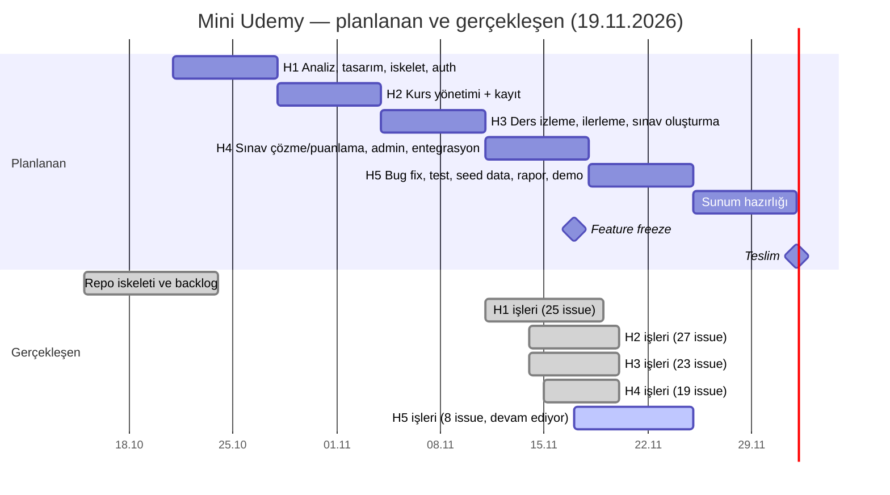

# Proje raporu — Bölüm 5–8 (taslak)

Hocanın Proje Yazım Şablonu'nun 5–8. bölümlerinin içeriği (#104). Word dosyasında birleştirme #69'da yapılır; bu dosya metnin kaynağıdır. Ayrıntılı tablolar repodaki dokümanlarda; burada rapora girecek özetleri var.

**Veri tarihi:** 19.11.2026. ⟨…⟩ ile işaretli yerler bug bash (#68), test raporu (#99) ve demo provası (#106) bitince doldurulacak; son güncelleme 01.12.2026'dan önce.

---

## 5. Açıklayıcı sözlük

| Terim | Açıklama |
|---|---|
| ADR (Architecture Decision Record) | Bir mimari kararın bağlamını, seçeneklerini ve sonucunu kaydeden kısa doküman (`docs/adr/`, 12 adet). |
| AFTER_COMMIT | Bir olayın dinleyiciye yalnız veritabanı işlemi başarıyla bittikten sonra iletilmesi. Geri alınan işlemden olay çıkmaz. |
| API (Uygulama Programlama Arayüzü) | Frontend'in backend'le konuştuğu HTTP uçları. Sözleşmesi `docs/api/openapi.yaml`'da. |
| ArchUnit | Mimari kuralları (katman yönü, modül sınırları) birim testi gibi denetleyen kütüphane. |
| Bug bash | Ekibin belirli bir sürede uygulamayı elle, kontrol listesiyle denemesi (#68). |
| CI (Sürekli Entegrasyon) | Her PR'da derleme ve testlerin otomatik çalışması (GitHub Actions). |
| Coverage (kod kapsamı) | Testlerin çalıştırdığı kod satırı ve dalı oranı; JaCoCo ile ölçülür. |
| Domain olayı | Sistemde olan bir şeyin kaydı (ör. `EnrollmentCreated`: kursa kayıt oldu). Projede 10 olay var. |
| DTO (Veri Aktarım Nesnesi) | API'de dışarı verilen ve dışarıdan alınan veri biçimi. Veritabanı nesneleri (entity) dışarı çıkmaz. |
| Entity | Veritabanındaki bir tabloya karşılık gelen sınıf (ör. `Course`). |
| Factory Method | Nesnenin hangi sınıftan üretileceğine alt sınıfların karar verdiği tasarım deseni. Projede ders içerik türleri (video, PDF, doküman). |
| Feature freeze | Yeni özellik eklemenin durduğu tarih (17.11.2026); sonrasında yalnız hata düzeltme, test ve dokümantasyon. |
| Flyway | Veritabanı şemasını sürümlü SQL dosyalarıyla (migration) kuran araç. |
| FR / NFR | Fonksiyonel gereksinim (sistemin ne yaptığı, 44 adet) / fonksiyonel olmayan gereksinim (nasıl yaptığı: güvenlik, performans; 19 adet). |
| İçerik token'ı | Video ve PDF etiketlerinin kullandığı, 5 dakika geçerli, tek derse bağlı kısa ömürlü erişim anahtarı (ADR-012). |
| Kabul kriteri | Bir işin bitmiş sayılması için sağlanması gereken, test edilebilir koşul. |
| JWT (JSON Web Token) | Girişten sonra verilen, kullanıcının kimliğini ve rolünü taşıyan imzalı anahtar. |
| MapStruct | Entity ↔ DTO dönüşüm kodunu derleme sırasında üreten kütüphane. |
| Milestone / Sprint | Bir haftalık çalışma dönemi ve o dönemde bitirilecek işler. |
| Modüler monolit | Tek uygulama olarak çalışan ama birbirine yalnız tanımlı arayüzlerle erişen modüllere bölünmüş mimari. Projede 10 modül. |
| Observer | Bir olay olduğunda ilgili dinleyicilerin, yayıncı onları tanımadan haberdar edildiği desen. |
| OpenAPI | REST API'nin uçlarını, isteklerini ve yanıtlarını tanımlayan standart biçim. |
| P1 / P2 / P3 | Öncelik: P1 zorunlu, P2 önemli, P3 kapsam dışı (zaman kalırsa). |
| PR (Pull Request) | Bir değişikliğin ana dala (`main`) alınmadan önce incelendiği istek. |
| Range isteği (206) | Tarayıcının dosyanın yalnız bir parçasını istemesi; videoda ileri sarmayı sağlar. |
| REQUIRES_NEW | Dinleyicinin kendi yeni veritabanı işlemini açması; yayıncının işleminden bağımsız commit edilir. |
| Rol | Kullanıcı türü: kursiyer (STUDENT), eğitmen (INSTRUCTOR), yönetici (ADMIN). |
| Seed verisi | Demo ve elle test için uygulama ilk açılışta yüklenen örnek veri (hesaplar, kurslar, ilerleme). |
| State | Bir nesnenin davranışının içinde bulunduğu duruma göre değiştiği desen. Projede kurs durumları. |
| Strategy | Aynı işin farklı yöntemlerinin değiştirilebilir sınıflar olarak yazıldığı desen. Projede sınav puanlama türleri. |
| Testcontainers | Testlerde gerçek PostgreSQL'i Docker konteyneri olarak başlatan kütüphane. |
| Doğrulama kodu | Sertifikanın gerçekliğini kontrol etmek için verilen kod (ör. `K7Q2-M9XA-4T`). |
| WIP limiti | Bir kişinin aynı anda üzerinde çalışabileceği en fazla iş sayısı (2). |

---

## 6. Proje planı

Kaynak: [`docs/plan.md`](../docs/plan.md) (#82). Bu bölüm o dokümanın gerçekleşenle güncellenmiş özetidir.

### 6.1 Takvim ve fazlar

| Faz | Planlanan | Gerçekleşen (19.11.2026) |
|---|---|---|
| Analiz ve tasarım (Hafta 1) | 21–27.10 | Gereksinimler, use-case'ler, ER, OpenAPI ve mimari kurallar repo iskeletiyle birlikte 15–24.10'da hazırlandı; PR'larla `main`'e girişi 11–14.11 |
| Geliştirme (Hafta 2–4) | 28.10–17.11 | Kodun tamamı 11–19.11 arasında geldi (125 PR). Feature freeze 17.11'de uygulandı; P2 işler "İnce" kapsamla sürdü |
| Test ve kararlılık (Hafta 5) | 18–24.11 | Senaryo testleri, Bölüm 6 testleri, erişim matrisi, seed verisi ve izlenebilirlik matrisi 17–19.11'de; bug bash ve test raporu ⟨24.11⟩ |
| Sunum hazırlığı | 25.11–01.12 | ⟨Word raporu, slaytlar, demo provası⟩ |

### 6.2 Gantt şeması

Planlanan milestone'lar ve gerçekleşen çalışma (PR ile kapanan issue'ların ilk ve son merge tarihi). Kaynak dosya: [`docs/diagrams/gantt.mmd`](../docs/diagrams/gantt.mmd); Word'e görüntü olarak eklenir.



**Yorum.** Plan bir haftalık sprint'lerle sıralı ilerlemeyi öngörüyordu; gerçekte ilk PR 11.11'de geldi ve Hafta 1–4'ün işleri 11–19.11 arasında paralel yapıldı. Takvim kayması (risk R1) gerçekleşti. Feature freeze tarihi korundu, ama kapsam 17.11'de yeniden belirlendi (6.5).

### 6.3 Planlanan ve gerçekleşen iş

| Milestone | Issue | Kapanan (19.11) | Kapanan (16.11) |
|---|---|---|---|
| Hafta 1 | 26 | 26 | 19 |
| Hafta 2 | 32 | 30 | 5 |
| Hafta 3 | 33 | 25 | 4 |
| Hafta 4 | 32 | 22 | 1 |
| Hafta 5 | 18 | 8 | 0 |
| Sunum | 7 | 0 | 0 |
| **Toplam** | **148** | **111 (%75)** | **29** |

"Not planned" kapatılan 6 issue (kapsamdan çıkarılanlar) sayılmaz. Açık işlerin listesi `docs/plan.md` › 8'de.

### 6.4 Görev dağılımı

Roller `CONTRIBUTING.md` › Roller tablosundan; her issue'nun tek rol etiketi var.

| Üye | Rol | Kapanan issue (atanan) | Merge edilen PR | `main`'deki commit |
|---|---|---|---|---|
| Bertan | Yazılım Mimarı | 31 / 35 | 44 | 51 |
| Eray | Veri ve Entegrasyon | 40 / 45 | 39 | 39 |
| Veronika | Kalite ve Süreç | 25 / 29 | 29 | 29 |
| Sedat | Alan Tasarımcısı | 13 / 14 | 13 | 13 |
| Atanmamış | – | 2 / 26 | – | – |

**Git geçmişiyle tutarlılık.** `main` "Squash and merge" ile birleştirildiği için her PR tek commit'tir; PR ve commit sayıları bu yüzden birebir aynı. Tek fark Bertan'ın 7 commit'i: repo iskeleti ve backlog, PR kuralı konmadan önce (15–24.10) doğrudan `main`'e yazıldı. Komut: `git log --format='%an' main | sort | uniq -c`. ⟨Sayılar 01.12'de son kez alınacak.⟩

Rol dışı iş devri: `rol:alan`'daki #8 ve #9'u Sedat müsait olmadığı için Bertan yaptı; alan rolünün kalan işleri 17.11 kararıyla diğer üyelere dağıtıldı (risk R3, R10).

### 6.5 Risk analizi (özet)

Tam tablo `docs/plan.md` › 6'da. Gerçekleşen ve sonucu belli olan riskler:

| # | Risk | Sonuç |
|---|---|---|
| R1 | Takvim kayması | **Gerçekleşti.** İlk PR 11.11'de. 17.11'de feature freeze kararı: §3'te adı geçen hiçbir iş kesilmedi, P2'ler "İnce" kapsama alındı, 3 iş kesildi (#73, #88, #185). |
| R2 | Kritik yol bağımlılığı (auth zinciri) | Giderildi: auth zinciri 13–17.11'de kapandı. |
| R3, R10 | Üyenin müsait olmaması, alan rolünde iş yükü | Gerçekleşti; işler devredildi. Sedat 15.11'de döndü ve toplam 13 issue kapattı. |
| R5 | Testlerin yetişmemesi | Önlendi: `main`'de 1056 test, servis katmanında satır coverage'ı %98,4 (hedef %70). |
| R6 | Review'sız merge, doküman–kod tutarsızlığı | İlk 4 PR onaysız birleşti; sonra her PR hızlı kontrolden geçti. İzlenebilirlik matrisi (#98) ve diyagram–kod kontrolü (#97) yapıldı. |
| R7 | Giriş denemelerinde sınır yok | Kabul edildi (yerel demo, kapsam dışı); bölüm 8.3'te gelecek çalışma. |
| R8 | Demo günü ortamın çalışmaması | ⟨Demo provası (#106) sonucu⟩ |

### 6.6 Bütçe

Ürünün lisans maliyeti **0 TL**: kullanılan bütün yazılımlar açık kaynak ya da eğitim kullanımında ücretsiz (liste 7.2'de). Uygulama yerelde Docker ile çalışır; sunucu ya da bulut maliyeti yoktur. Geliştirmede kullanılan Claude Code ücretli bir abonelik gerektirir; ürünün çalışması için gerekli değildir. Ayrıntı `docs/plan.md` › 7.

---

## 7. Projeye özgü içerik

### 7.1 Metodoloji

Proje, bir haftalık sprint'lerle yürütülen hafif bir Scrum uyarlamasıyla yapıldı. Kurallar `CONTRIBUTING.md`'de:

- **Planlama:** Her pazartesi o haftanın milestone'undaki issue'lar GitHub Project board'unda "Bu Hafta" kolonuna alınır. Kolonlar: Backlog → Bu Hafta → In Progress → Review → Done.
- **İş seçme:** Rol = kişi. Üye kendi rol etiketli işini alır, kendini atar ve kartı "In Progress"e taşır. Önce P1'ler; kişi başı en fazla 2 iş.
- **Branch ve PR:** `main`'e doğrudan push yok. Her iş `feature/#<no>-kisa-ad` dalında, `Closes #<no>` içeren bir PR ile gelir; PR açıklamasında "Ne / Neden" ve kabul kriteri → kanıt tablosu bulunur. Squash and merge.
- **Definition of Done:** CI yeşil, Kalite ve Süreç sorumlusunun hızlı kontrolü (CI, kanıt tablosu, açıklamanın kodla uyumu, OpenAPI/diyagram güncelliği), kabul kriterlerinin hepsi işaretli, kod değiştiyse diyagram ve OpenAPI aynı PR'da.
- **Takip:** Haftalık ilerleme raporları (`docs/progress/`), risk tablosu, feature freeze.
- **Yapay zekâ desteği:** Her üye Claude Code ile çalıştı (`docs/claude-code-workflow.md`). Kural: PR açıklamasındaki her teknik iddia kodla karşılaştırılır; üye kendi PR'ındaki kararları sunumda anlatabilmelidir (katkı notları `docs/katki/`).
- **Kırmızı kontrol:** Test issue'larında testin gerçekten hata yakaladığı, kod bilerek bozulup CI'da testin kırmızıya düştüğü görülerek kanıtlandı (sonra geri alındı). Bu yöntem 4 test açığı buldu (bkz. 7.5).

### 7.2 Kullanılan teknolojiler ve kütüphaneler

Sürümler `backend/pom.xml` ve `frontend/package.json`'dan (19.11.2026). Kütüphanelerin ve dış kaynakların tam listesi #100'de.

| Katman | Teknoloji | Sürüm | Kullanım | Lisans |
|---|---|---|---|---|
| Backend | Java | 21 | Dil | GPL + Classpath istisnası |
| | Spring Boot (Web, Validation, Data JPA, Security, OAuth2 Resource Server, Actuator) | 3.5.16 | Uygulama çatısı, REST, JWT doğrulama | Apache 2.0 |
| | Flyway (+ PostgreSQL eklentisi) | Spring Boot BOM | Migration'lar | Apache 2.0 |
| | MapStruct | 1.6.3 | DTO dönüşümü | Apache 2.0 |
| Veritabanı | PostgreSQL | 17 | İlişkisel veritabanı | PostgreSQL License |
| Frontend | Next.js | 16.4.6 | React çatısı, sayfa yönlendirme | MIT |
| | React, React DOM | 19.3.0 | Arayüz | MIT |
| | TypeScript, ESLint | 5, 9 | Tip denetimi, kod denetimi | Apache 2.0 / MIT |
| Test | JUnit 5, Mockito, AssertJ (`spring-boot-starter-test`), Spring Security Test | Spring Boot BOM | Birim ve controller testleri | EPL 2.0 / MIT / Apache 2.0 |
| | Testcontainers (PostgreSQL) | Spring Boot BOM | Gerçek veritabanıyla entegrasyon testleri | MIT |
| | ArchUnit | 1.4.1 | Mimari kural testleri | Apache 2.0 |
| | JaCoCo | 0.8.13 | Coverage ölçümü | EPL 2.0 |
| Çalıştırma | Docker, Docker Compose | – | Tek komutla kurulum | Apache 2.0 |
| Süreç | GitHub (Issues, Projects, Actions) | – | Repo, iş takibi, CI | Ücretsiz (açık repo) |
| Dokümantasyon | PlantUML, Mermaid | – | UML diyagramları, Gantt | Açık kaynak |

Frontend'e UI kütüphanesi, durum yönetimi kütüphanesi ya da otomatik UI testi eklenmedi (proje kuralı); bileşenler CSS modülleriyle yazıldı.

### 7.3 Erişilebilirlik

Uygulanan önlemler (kodda kontrol edildi, `frontend/src`):

- Sayfa dili `lang="tr"`; ekran okuyucular Türkçe okur.
- Form alanlarının hepsi etiketli (`<label>`, `aria-label`). Hatalı alan `aria-invalid` ile işaretlenir ve hata metni `aria-describedby` ile alana bağlanır.
- Hata mesajları `role="alert"` (51 yerde), yükleniyor ve başarı mesajları `role="status"` ile duyurulur.
- Bölgeler ve gezinme etiketli: ders listesi `nav aria-label="Bölümler ve dersler"`, önceki/sonraki ders gezinmesi, katalog araması `role="search"`.
- Ders listesi aç/kapa düğmesi `aria-expanded` ve `aria-controls` taşır; puan yıldızları klavyeyle seçilebilir ve odak görünür (`:focus-visible`).
- Dekoratif öğeler `aria-hidden`, anlamlı görseller (`role="img"`) metinle açıklanır.
- Mobil uyumluluk (NFR-07): 360 px genişlikte yatay kaydırma olmaması hedeflendi; ⟨bug bash'te (#68) kontrol sonucu⟩.

**Kısıt:** Resmî bir WCAG denetimi ve ekran okuyucuyla uçtan uca deneme yapılmadı; renk kontrastı ölçülmedi. Bunlar bölüm 8.3'te gelecek çalışma olarak yazıldı.

### 7.4 Kullanım kılavuzu

**Kurulum.** Docker yeterlidir:

```bash
docker compose up --build
```

Frontend http://localhost:3000, backend http://localhost:8080. Veritabanı boşsa örnek veri (seed, #67) açılışta yüklenir. Bütün demo hesaplarının parolası `Demo1234!`.

| Hesap | Rol | Durumu |
|---|---|---|
| `admin@miniudemy.dev` | Yönetici | – |
| `mehmet.kaya@miniudemy.dev` | Eğitmen | "Sıfırdan Python" (yayında), "SQL ve Veritabanları" (incelemede), "Python 2 (eski)" (yayından kaldırılmış) |
| `zeynep.ak@miniudemy.dev` | Eğitmen | "Java ile Nesne Yönelimli Programlama" (yayında), "Web Geliştirmeye Giriş" (reddedildi, gerekçeli) |
| `ayse.yilmaz@miniudemy.dev` | Kursiyer | Python %100, sertifikalı (`K7Q2-M9XA-4T`) |
| `can.demir@miniudemy.dev` | Kursiyer | Python %66,67; kaldığı yer "Fonksiyon Tanımlama" |
| `elif.sahin@miniudemy.dev` | Kursiyer | Python %50; giriş sınavından kaldı |
| `deniz.arslan@miniudemy.dev` | Kursiyer | Python'a kayıtlı, hiç başlamadı |

**Kursiyer olarak**

1. Ana sayfada (`/`) kursları arayın; kategori, seviye ve puana göre süzün. Yalnız yayımlanmış kurslar görünür.
2. Bir kursa tıklayın: açıklama, kazanımlar, bölüm/ders listesi, toplam süre ve değerlendirmeler görünür.
3. Giriş yapmadıysanız "Kayıt ol" sizi giriş sayfasına götürür; yeni hesap için `/register`. Giriş yaptıysanız "Kursa kayıt ol".
4. "Kurslarım"da (`/my-courses`) her kursun ilerlemesi görünür; "Kaldığın yerden devam et" son açtığınız derse götürür (deneyin: `can.demir@…`).
5. Ders sayfasında (`/learn/...`) PDF okunur, video oynatılır ve ileri sarılır; "Önceki / Sonraki" ile dersler arasında gezilir. Kayıtsız bir hesap aynı adreste "Bu derse erişmek için kursa kaydolun." uyarısını görür.
6. Sınava girin (`/quizzes/{id}`), cevapları gönderin; önceki denemeler `/quizzes/{id}/attempts`'te.
7. Kurs sayfasında 1–5 puan ve yorum verin (kurs başına bir kez).

**Eğitmen olarak** (`mehmet.kaya@…`)

1. Eğitmen panelinde (`/instructor`) kurslarınız durumlarıyla görünür; reddedilen kursta yöneticinin gerekçesi yazar.
2. Taslak kursu "Onaya gönder"; yayındaki kursu gerekçeyle "Yayından kaldır".
3. Soru bankası (`/instructor/courses/{id}/questions`) ve bölüm sınavları (`/instructor/courses/{id}/quizzes`).
4. Analitik (`/instructor/courses/{id}/analytics`): kayıt sayısı, ortalama ilerleme, tamamlanma oranı, sınav başarısı, puan dağılımı ve kursiyer listesi.

**Yönetici olarak** (`admin@…`)

1. Yönetici paneli (`/admin`) → "Kurs onayı" (`/admin/courses`): liste varsayılan olarak İncelemede bekleyen kursları gösterir (deneyin: "SQL ve Veritabanları"); durum filtresiyle diğerleri.
2. "İncele" (`/admin/courses/{id}`): açıklama, hedefler, bölüm/ders listesi; içeriği olan derste "İçeriği aç" dersi yeni sekmede açar, içeriği olmayan ders "İçerik yok" diye işaretlidir.
3. İncelemedeki kursu "Onayla" ya da gerekçeyle (5–1000 karakter) "Reddet"; yayındaki kursu gerekçeyle "Yayından kaldır". Liste ve durum hemen güncellenir, eğitmene bildirim yazılır.
4. Diğer sayfalar: kullanıcılar (rol ve pasifleştirme, `/admin/users`), kategoriler (`/admin/categories`), platform raporu (`/admin/reports`).

**Ekranı henüz olmayan işlemler** (19.11.2026; API ile yapılır, adımlar [`docs/demo.md`](../docs/demo.md)'de): kurs oluşturma formu (#33), bölüm/ders düzenleme ve içerik yükleme (#34), dersi "tamamlandı" işaretleme düğmesi (#46), sertifika sayfası ve doğrulama (#130, #131), bildirim listesi (#136). ⟨01.12'de ekranı gelenler adımlara eklenecek, ekran görüntüleri #72'den.⟩

### 7.5 Test planı ve test raporu özeti

Plan: [`docs/test-plan.md`](../docs/test-plan.md) (#92). Rapor: `docs/test-report.md` (#99). İzlenebilirlik: [`docs/traceability.md`](../docs/traceability.md) (#98).

**Test seviyeleri.**

| Seviye | Araç | Sayı (19.11) |
|---|---|---|
| Birim | JUnit 5, Mockito, AssertJ | 895 |
| Mimari | ArchUnit | 13 |
| Entegrasyon | Spring Boot Test + Testcontainers (gerçek PostgreSQL 17, gerçek HTTP) | 148 |
| **Toplam** | | **1056**, hepsi CI'da yeşil |
| Manuel | Tarayıcı, kontrol listesi (bug bash #68) | ⟨sonuç⟩ |

**Kapsam.**

- Servis katmanında satır coverage'ı **%98,4**, dal coverage'ı **%93,9** (hedef %70); genel %96,1 (JaCoCo).
- Otomatik testi olan gereksinim: FR 38/44, NFR 16/19. Testi olmayan 6 FR'nin hepsi henüz kodu yazılmamış işlere bağlı (#115, #125, #130, #131, #142, #144).
- Proje tanımı Bölüm 6'nın dört kritik durumu (kayıtsız erişim, mükerrer kayıt, yetkisiz düzenleme, yanlış ilerleme hesabı) uçtan uca testli (`Bolum6CriticalCasesIT`).
- Erişim matrisi testi (`AccessMatrixIT`, 102 kontrol): OpenAPI'deki her ucun rol bilgisinin koddaki yetki kuralıyla aynı olduğu denetlenir; gövdesiz uçlarda girişsiz istek 401, yanlış rol 403 alır.
- Beş demo senaryosunun her biri bir entegrasyon testiyle doğrulandı.

**Kırmızı kontrol bulguları.** Kod bilerek bozulduğunda yeşil kalan 4 test açığı bulundu ve kapatıldı: platform raporunda tamamlanma sayısı (#145), sınav puanlamada strateji seçimi (#56), ilerlemede %0 ve %100 sınırları (#44), bildirim dinleyicisinin commit sonrası çalışması (#137).

**Bug bash.** ⟨#68 sonuçları: bulunan hata sayısı, P1'lerin durumu.⟩

### 7.6 Bakım planı

| Konu | Plan |
|---|---|
| Bağımlılık güncellemeleri | Spring Boot yama sürümleri (3.5.x) ve Next.js güncellemeleri ayda bir; güncelleme kendi PR'ında, CI yeşilse merge. Yeni kütüphane ekip onayıyla. |
| Veritabanı şeması | Her değişiklik yeni, zaman damgalı bir Flyway migration'ı; merge edilmiş migration'lar değiştirilmez. ER diyagramı aynı PR'da güncellenir. |
| Yedekleme | Veritabanı `pg_dump` ile, yüklenen dosyalar depolama klasörünün kopyalanmasıyla. Gerçek kullanımda günlük yedek ve geri yükleme denemesi. |
| İzleme | Spring Boot Actuator sağlık ucu (`/actuator/health`); hatalar sunucu loguna yazılır, kullanıcıya iç ayrıntı gösterilmez. |
| Hata yönetimi | Hata GitHub'da `bug` etiketli issue olarak açılır, önceliği verilir, `fix/#<no>-...` dalında testle birlikte düzeltilir. |
| Kalite güvencesi | Her değişiklik CI'dan (1056 test, ArchUnit kuralları, frontend lint + build) ve hızlı kontrolden geçer. |
| Dokümantasyon | OpenAPI, diyagramlar ve ADR'ler kodla aynı PR'da güncellenir. |
| Güvenlik | Üretimde JWT anahtarı yalnız ortam değişkeninden (`JWT_SECRET`) okunur; tanımlı değilse ya da 32 bayttan kısaysa uygulama açılmaz. Repodaki anahtarlar yalnız geliştirme ve test profillerinde. Bağımlılık güvenlik uyarıları (GitHub) takip edilir. |

---

## 8. Sonuç ve tartışma

### 8.1 Hedeflere ulaşma

| Hedef | Durum (19.11.2026) |
|---|---|
| Üç rollü (kursiyer, eğitmen, yönetici) çevrim içi eğitim platformu | Backend'in 10 modülü çalışıyor; 44 FR'nin 38'inin otomatik testi var. Frontend'de 19 ekran. ⟨01.12 durumu⟩ |
| Beş demo senaryosu (kurs yayımlama, kayıt ve öğrenme, kaldığı yerden devam, sınav ve sertifika, eğitmen analitiği) | Beşi de uçtan uca testli. Bazı adımların ekranı yok, API ile gösteriliyor (7.4). |
| Tasarım desenleri: State, Strategy, Factory Method, Observer, DTO + Mapper | Beşi de kodda; sınıf diyagramlarında (#51) ve SOLID dokümanında (#95) gösterildi. |
| Modüler monolit, modül sınırları | 10 modül; sınırlar ArchUnit testleriyle CI'da denetleniyor, ihlal yok. |
| Test hedefleri (test planı › 7) | Servis coverage'ı %98,4 (hedef %70); Bölüm 6 testleri ve erişim matrisi yeşil. ⟨Bug bash ve demo provası sonucu⟩ |
| Tek komutla kurulum (NFR-16) | `docker compose up --build`; seed verisi otomatik. ⟨Temiz makinede deneme, #70/#106⟩ |

### 8.2 Kısıtlar

- **Geç başlangıç:** Kod PR'ları 11.11'de başladı; dört haftalık geliştirme işi yaklaşık bir haftaya sığdırıldı. Bu yüzden 17.11'de kapsam yeniden belirlendi ve P2 işler "İnce" yapıldı.
- **Ekip kapasitesi:** Bir üye iki hafta müsait değildi; işleri devredildi.
- **Ekranı eksik akışlar:** Bazı işlemler (7.4) yalnız API ile yapılabiliyor.
- **Frontend'de otomatik test yok:** Arayüz yalnız lint, derleme ve elle test ile denetlendi.
- **Güvenlik sınırları:** Giriş denemelerine sınır konmadı (R7); dosyalar yerel diskte tutuluyor.
- **Performans:** Kurs süresinin hesabında bilinen bir N+1 sorgu sınırı var (#185, kapsamdan çıkarıldı); yük testi yapılmadı.
- **Erişilebilirlik:** Resmî WCAG denetimi yapılmadı (7.3).

### 8.3 Gelecek çalışmalar

- **Ödeme entegrasyonu** (#74, P3): ücretli kurslar ve ödeme sağlayıcısının test modu.
- Giriş ve parola yenileme isteklerine deneme sınırı (R7) ve e-posta ile bildirim.
- Dosyaların bulut depolamaya (S3 uyumlu) taşınması; video için akış biçimi (HLS) ve farklı çözünürlükler.
- Frontend için uçtan uca otomatik testler (ör. Playwright) ve erişilebilirlik denetimi.
- ⟨01.12'de hâlâ açık kalan P2 işler: #115–#117 parola yenileme ve profil, #142 yorum moderasyonu, #144 şikâyet, #146 moderasyon ekranları⟩

### 8.4 Tartışma

⟨Sunumdan önce ekipçe yazılacak. Önerilen başlıklar:⟩

- Sıkı PR kuralları (kanıt tablosu, hızlı kontrol, doküman–kod uyumu) geç başlayan bir projede hızı düşürdü mü, yoksa hataları erken yakalayarak kazandırdı mı? Örnek: ilk PR'larda sözleşme ile ER arasındaki alan uzunluğu farkı review'da yakalandı.
- Kırmızı kontrol, "yeşil" testlerin bir kısmının hatayı yakalamadığını gösterdi (4 açık). Coverage yüksek olsa bile testin doğru şeyi denetlediği ayrıca kanıtlanmalı.
- Yapay zekâ desteği (Claude Code) iş üretimini hızlandırdı; buna karşı "her teknik iddia kodla karşılaştırılır" kuralı ve katkı notları, üyelerin kendi kodunu anlayıp anlatabilmesi için gerekli oldu.
